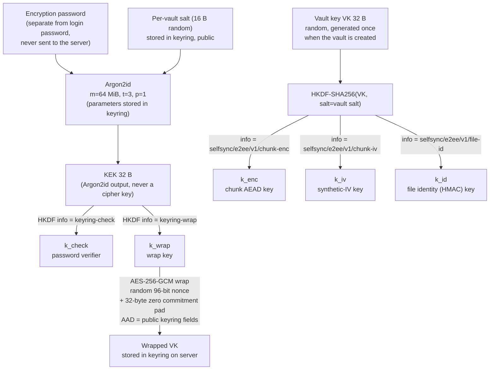
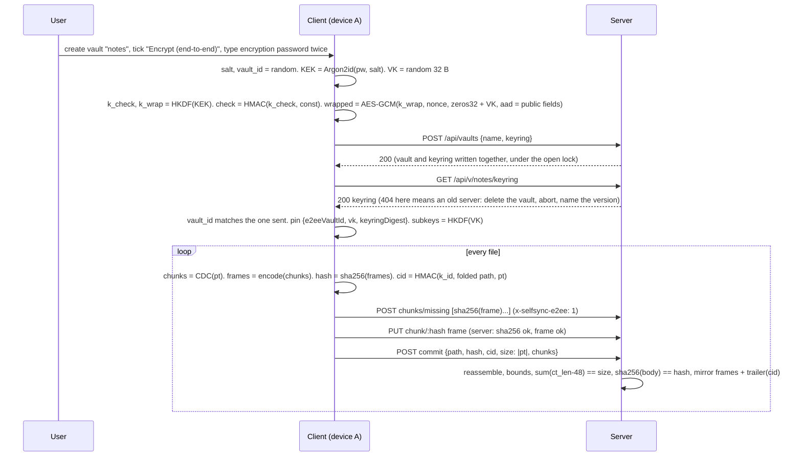
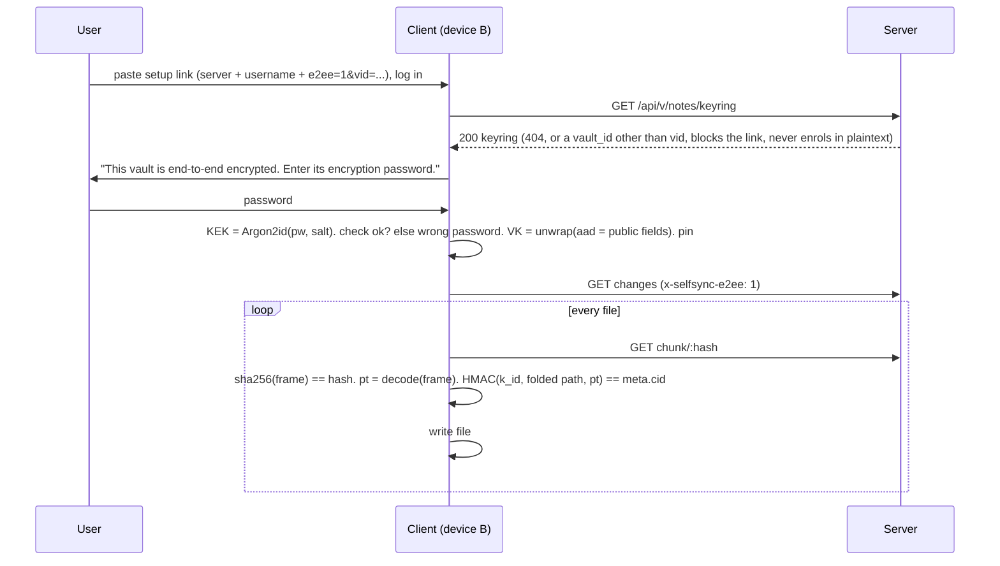
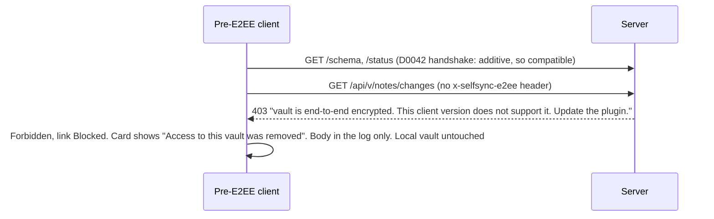

# SelfSync — optional client-side end-to-end encryption (design, revision 4)

**Date:** 2026-11-10 · **Status:** DESIGN, panel round 3 (D0187) · **Charter:** st009 (owner,
2026-11-10), stories us012–us014 · **Supersedes:** the declined 2026-07-05 spec (D0009).
**Decisions this spec grounds:** D0096 (direction and scope), the D0099–D0104 chain (construction
and protocol) and the D0105–D0111 chain (custody, sharing, migration). All stay `proposed` until
the owner accepts them.

This document is the artifact the panel reviews. Every claim about the code cites `file:line` at
HEAD `83f8eb4` (source files unchanged since `4f5d298`). The model (Need, UseCases,
SystemRequirements, Decisions, tasks) is the truth. This document is the readable design with its
diagrams and its finding→resolution map (§10).

**What changed in revision 4** (round-2 panel, 1 ACCEPT, 6 OBJECT):
- `cid` hashes the folded path through the identity seam (§4.3).
- The keyring wrap binds every public field, and the link carries the vault id (§4.4, §4.8).
- Every rebuild-from-disk uses the frame splitter, and an unparseable mirror file is `lost` (§4.5).
- The keyring routes and type are non-gating in the wire signature (§4.4).
- The old-client message is the real one, "Access to this vault was removed" (§4.6, §4.12).
- Migration reuses the vault name, and a pinned device has one re-enrol gesture (§4.8, §6).
- The password-change requirement is cut. The password floor gains a requirement (§6, model).
- The `#DependsOn` edges form the real graph, not a chain (model).

---

## 1. Goal

An **optional, per-vault** mode in which note content is encrypted on the user's devices before
upload and decrypted only on the user's devices. A compromised, curious, or seized server (or
anyone with the data volume) cannot read note content. Off by default. Chosen when a vault is
created.

## 2. Threat model, stated plainly

| Protected (in an encrypted vault) | Not protected (documented, deliberate) |
|---|---|
| Content of every synced file, including `.obsidian/` config | File **paths**, **sizes**, **mtimes**, version numbers, device names, author |
| Integrity of a file: a chunk substituted, dropped or reordered inside a file, or a file's content served under another path, is detected on the client | **Chunk equality within one vault** (same plaintext chunk gives the same frame, so dedup works) |
| The encryption password and the vault key never leave the device | **Chunk-length sequence**: CDC boundaries are a public function of the plaintext, and every frame exposes its length. For a file over 2 KiB this is a fingerprint. A server can test "is document X in this vault" by chunking X and matching lengths |
| An old client cannot write plaintext into an encrypted vault, and cannot write ciphertext into the user's local vault | **Freshness and version mix**: the server can serve an older version of a file (rollback). No competitor protects this either |
| An enrolled device never silently falls back to plaintext when the server answers that the vault is not encrypted | **Offline password guessing**: anyone with the keyring can run Argon2id against the wrapped key. At 64 MiB a 64-core box tries about 300 guesses per second. A random 12-character password is out of reach. A patterned human password is not. The floor is a length, not an entropy bound |
| The keyring's public fields cannot be altered by the server without the next unwrap failing | **The local device**: the vault key, the login token and the three-way-merge base text live in `data.json` as today (`client/src/settings.ts:49,64`, `client/src/base.ts:22-24`) |
| | **Timing and frequency of edits**. **Pre-encryption copies**: an earlier plaintext vault is deleted, not scrubbed. Earlier operator backups still hold it. A device still pointed at the old name must meet the new encrypted vault, not a re-create prompt (§6) |

Trusted: the user's devices and the Obsidian runtime. Untrusted: the server, its disk, its operator,
and the network. TLS stays necessary for login credentials and tokens, which E2EE does not cover.

## 3. What exists today (the facts the design must respect)

- Content-defined chunking on the client: `client/src/chunker.ts:3,34-48` (MIN 2 KiB, AVG about
  16 KiB, MAX 64 KiB). Chunk address = SHA-256 of the chunk bytes (`chunker.ts:17-20`). An empty file
  yields one empty chunk (`chunker.ts:45`).
- Push: `commitBytes` chunks, queries `missing`, PUTs missing chunks, then commits with
  `hash = sha256(plaintext file)` (`client/src/sync.ts:209-225`).
- Pull: `getVerifiedChunk` checks `sha256(bytes) == hash` before caching (`sync.ts:112-118`).
  `fetchFileBytes` reassembles (`sync.ts:125-127`). `streamFileToDisk` appends per chunk with an
  incremental SHA-256 and verifies before rename (`sync.ts:134-160`, `client/src/streamhash.ts:20-56`).
- Reconcile decides by comparing hash strings: local, base, remote (`client/src/reconcile.ts:19-21`).
  Local identity sites that feed or compare `FileMeta.hash`: `reconcile.ts:640, 761, 1078, 1232, 1321,
  1422`, `reconcile.ts:787-800` (whole-file verify), `client/src/main.ts:1221-1226` (switch preview).
  `main.ts:840-843` hashes the plugin's own `main.js` as a build fingerprint, not content.
  `normalizedHash` (`client/src/frontmatter.ts:291-295`, used at `reconcile.ts:616-650, 1247, 1442`)
  compares plaintext on both sides and keeps plain SHA-256.
- Path identity is decided in one seam, `identityKey(path, fs)` (`client/src/pathidentity.ts:36-39`):
  NFC fold on macOS and iOS, case fold on Windows, macOS and iOS. The server folds with Rust
  `to_lowercase` only (`server/src/index_store.rs:218, 373-376`). A divergent local spelling is
  aliased to the server key for sync identity (`reconcile.ts:848-855`).
- Server chunk store verifies `sha256(PUT bytes) == :hash` (`server/src/chunkstore.rs:77-82`).
- Server commit reassembles every chunk, aborts when the running total exceeds `req.size`
  (`server/src/vault.rs:606-617`) and needs `len == req.size && sha256(body) == req.hash`
  (`vault.rs:618-620`). The mirror self-heal compares `mirror.len() == body.len()` (`vault.rs:631-634`).
- Server writes a plaintext **mirror** of every committed file to `root/vault/<path>`
  (`vault.rs:104-123, 687-690`). The mirror comment states its purpose: if the index is lost, reindex
  rebuilds from the mirror (`vault.rs:108-111`). A corrupt index is quarantined and rebuilt at open
  with no operator action (`vault.rs:205-270`). The rebuild-from-disk branch (`vault.rs:467-482`)
  also runs on a healthy reindex when a chunk is missing or a disk file has no row
  (`vault.rs:455-466`). It reads the file, SHA-256s it, re-chunks it with the server's CDC port, and
  version-preserves on `old.hash == hash`. A lost file aborts reindex unless `force` (`vault.rs:410-414`).
- Index rows hold path, hash, size, mtime, version, chunk list, provenance in SQLite
  (`server/src/index_store.rs:47-62`). Any `files` column change today bumps the schema version and
  the migration runs at every open (`index_store.rs:76-80, 100-111`). The `fold` column was added as
  an idempotent heal without a bump (`index_store.rs:112-119`).
- Vaults are keyed by `(owner, name)`. `POST /api/vaults` returns a bare status with no id
  (`server/src/vaults.rs:15-41`). A delete tombstone is cleared by a deliberate recreate
  (`vaults.rs:35-38`). The client's re-create prompt posts `{name}` only (`main.ts:2517-2526`,
  `client/src/transport.ts:233-237`).
- Shares: a Read grant can call `changes`, `chunk`, `meta` (`server/src/api.rs:101-119, 124-130,
  184-197`, `server/src/shares.rs:67-88`). A share link carries server + token only
  (`client/src/sharelink.ts:11-29`).
- Mounts wrap the same `SyncApi` and rewrite paths to the source vault (`client/src/mountio.ts:69-70,
  76-105`). The primary and every mount share one `ChunkCache` (`client/src/main.ts:422, 3185-3188`).
  The base-ownership key is `host|owner/vault` (`main.ts:3584-3586`), and a key mismatch clears the
  base (`main.ts:2685-2697`).
- Old-client error handling: an unknown 4xx is `ServerDegraded` and retries slowly. A 403 is
  `Forbidden`, which blocks the link and waits for the user (`client/src/connstate.ts:90-107, 112-124`).
  The card then shows the fixed text "Access to this vault was removed" (`connstate.ts:208`). The
  response body reaches only the plugin log (`transport.ts:103-106, 126-133`).
- The setup wizard has **no** encryption field (`client/src/setupwizard.ts:93`). The only
  `encrypt` hits in `client/src` concern plaintext http.
- Client crypto today: `crypto.subtle.digest` only (`chunker.ts:20`). No AEAD, no KDF, no WASM.
  Server: `argon2 0.5`, `sha2`, `blake3` (unused) in `server/Cargo.toml:24-26`. No AEAD crate.
- The wire contract is signed and diffed directionally (D0042, `server/src/wire_signature.rs`,
  `client/src/wiresignature.ts:15-22, 117-134`). A new response field and a new optional request
  field are compatible both ways. A new **endpoint** or **type** in the client's embedded signature is
  `breaking, older: server` unless it is non-gating (`wiresignature.ts:83-91`).

## 4. Architecture

### 4.1 Key hierarchy



Why a random VK under a password-derived KEK, and not a password-derived content key? A password
change re-wraps 32 bytes instead of re-encrypting the vault. Sharing hands over a key, not a
password hash. This is the Bitwarden, Proton, and Standard Notes shape (see §5). The Argon2id
output is never used as a cipher key. HKDF derives `k_wrap` and `k_check` from it, so the two uses
are domain-separated.

### 4.2 Chunk encryption (deterministic, so content-addressed dedup survives)

```
plaintext chunk  pt  (0–64 KiB, from the existing CDC chunker)
iv   = HMAC-SHA256(k_iv, pt)[0..12]                 synthetic IV: same pt gives same iv, same ct
body = 0x00 x 32 || pt                              key-commitment pad (Albertini et al. 2020)
ct   = AES-256-GCM(k_enc, iv, body, aad)            aad = "selfsync/e2ee/v1" || keyring.vault_id
frame = magic "SSE1" (4 B) || iv (12 B) || ct_len (4 B, LE) || ct (incl. 16 B tag)
chunk address = SHA-256(frame)                      the server's existing content address, unchanged
```

- Per-chunk overhead: 4 + 12 + 4 + 16 + 32 = 68 B, about 0.41 % at the 16 KiB average. A zero-byte
  file is one 68-byte frame with `size 0`. A commit always lists at least one frame.
- `vault_id` is a random 16-byte value minted by the client at creation and stored in the keyring.
  It is distinct from the salt because a later re-wrap may rotate the salt. The AAD is a
  domain-separation label and is cryptographically redundant with the unique VK. It is kept stable
  so one (key, IV) pair never meets two AADs.
- The same plaintext under the same VK gives the same frame, so `missing` and dedup work exactly as
  now. The server learns which chunks are equal **within a vault**, and nothing else. It cannot
  confirm a guessed plaintext from the ciphertext, because the IV key is secret. It can match a
  guessed document by its chunk-length sequence (§2).
- Two different plaintexts collide on a 96-bit IV with probability about n²/2⁹⁷. At 2²⁰ chunks that
  is 2⁻⁵⁷. A collision would reuse a GCM nonce under one key. The bound is why this is acceptable.
- The 32-byte zero pad makes decryption **key-committing**. `decodeChunk` verifies the tag, then
  checks all 32 pad bytes, then recomputes `iv` from the plaintext and compares. Only then is
  plaintext released or cached. This closes the partitioning-oracle attack on a password-derived key
  hierarchy (Len, Grubbs, Ristenpart 2021).
- The frame is **self-delimiting without the key**. Magic and lengths let the server split a
  mirrored file back into its frames (§4.5) and validate that an encrypted vault receives only frames
  (§4.6). On PUT the body length alone gives the plaintext length. `ct_len` exists for the mirror split.

### 4.3 File identity, split in two

Revision 2 put a keyed HMAC into `FileMeta.hash`. Five panelists showed the server then cannot
verify a commit or rebuild a row from the mirror. Revision 3 keeps two identities. Revision 4 fixes
the path spelling the keyed identity binds.

| Field | Value in an encrypted vault | Who computes | Who verifies |
|---|---|---|---|
| `FileMeta.hash` (exists) | `sha256(frame_1 ‖ … ‖ frame_n)`, the frame stream | client and server | server at commit (`vault.rs:618`, unchanged), reindex, `classify_missing` |
| `FileMeta.cid` (new, optional, additive) | `HMAC-SHA256(k_id, u32le(len(f)) ‖ f ‖ pt)` (hex), with `f` the folded path | client only | client on every pull, before the file is written |
| `FileMeta.size` (exists) | plaintext size | client | server from frame headers (§4.6), client as today |

- `f = identityKey(path, {caseInsensitive: true, normInsensitive: true})` as UTF-8: NFC, then
  lowercase (`pathidentity.ts:36-39`). The server's fold uniqueness already makes one folded name
  one file. So a case-only or NFC/NFD respelling keeps its `cid`, and a file served under a different
  folded path still fails. `path` is the server-stored path of the row, or the aliased base key for
  a divergent local spelling, never a raw listing string.
- Reconcile is unchanged in logic. For an encrypted vault the client's identity string is `cid`.
  `decide()` compares local `cid`, base `cid`, remote `cid`. The codec exposes
  `fileIdentity(path, pt)`. For a plaintext vault it returns `sha256(pt)` and `cid` is absent. The
  switch preview (`main.ts:1221-1226`) compares `cid`, not `hash`, in an encrypted vault.
- The pull-side check **replaces** the `hash` comparison with the `cid` comparison in an encrypted
  vault. The cache holds plaintext, so `sha256(frames)` cannot be recomputed on a cache hit.
- A rename across folded names is a delete plus a create with a new `cid`. Its chunks dedup, so the
  cost is one commit.
- What the client detects on pull: a chunk substituted, dropped or reordered inside a file, and a
  file's content served under another folded path. What it cannot detect: an older version of the
  same path served as current (§2, freshness).
- The server stores `cid` opaquely in the index row and returns it in `changes` and `meta`. The
  column is added as an idempotent heal, like `fold`, with no schema bump, so a rolled-back image
  still opens the vault. For an encrypted vault a commit without `cid` is refused (§4.6).

### 4.4 Keyring: the per-vault record the server stores but cannot open

```json
{
  "version": 1,
  "vault_id": "<base64 16 B random>",
  "kdf":  { "alg": "argon2id", "m_kib": 65536, "t": 3, "p": 1, "salt": "<base64 16 B>" },
  "check": "<hex HMAC-SHA256(k_check, \"selfsync-keyring-v1\")>",
  "wrap": { "alg": "A256GCM", "nonce": "<base64 12 B>", "ct": "<base64 32 pad + 32 VK + 16 tag>" },
  "created_at": "2026-11-10T00:00:00Z", "created_by": "<server-authenticated username>"
}
```

- Stored as a sidecar `root/.keyring.json` next to `.version-hwm` (`vault.rs:279-292` is the
  pattern), **not** in the integer-only `meta` table.
- `created_by` is server-written from the authenticated user, as `author` is today. The audit entry
  for vault creation carries `encrypted=true`.
- **The public fields are authenticated.** The wrap's AAD is the canonical bytes of `version`,
  `vault_id`, `kdf` and `salt`. A keyring with any public field altered fails to open. The link flag
  carries `vid=<vault_id>`, and a joiner refuses a keyring whose id differs (§4.8).
- Three outcomes a joining device tells apart, in this order and before any content is read:
  the record does not parse → **corrupt keyring**. `check` does not match → **wrong password**.
  `check` matches but the wrap's tag fails → **corrupt keyring**. An enrolled device compares the
  fetched record's digest with its pinned one. A mismatch → **keyring changed**, link blocked.
- **Atomic creation.** `POST /api/vaults {name, keyring?}` creates the vault and its keyring in one
  call, under the per-key open lock, with `create_new` on the sidecar. A second device racing the
  same name gets 409. `keyring` is an optional request field, so the change is additive.
- **Old server.** An old server ignores the field and creates a plaintext vault. So the client reads
  `GET keyring` after creation and pins only when the returned `vault_id` is the one it sent. On 404
  it deletes the vault, discards the generated VK, and names the minimum server version. No commit
  happens before that check passes. `DELETE /api/vault` never passes through the guard.
- **Wire signature.** The two `GET keyring` routes and the keyring type are declared non-gating
  (`wiresignature.ts:83-91`), so a new plugin keeps syncing a plaintext vault on an old server. A
  test pins that the new embedded signature against the pre-E2EE server signature is compatible.
- **No `PUT keyring` and no `DELETE keyring` in v1.** The keyring lives and dies with the vault.
  Re-wrap (password change) and rotation are tracked follow-ups (§6). A lost `.keyring.json` has
  one recovery: an enrolled device re-creates the vault through the encrypted-create dialog (§4.8).

Endpoints (additive):

| Route | Access | Semantics |
|---|---|---|
| `GET /api/v/:vault/keyring`, `GET /api/u/:owner/:vault/keyring` | Read grant | 200 keyring, 404 = vault is not encrypted. Non-gating |
| `POST /api/vaults {name, keyring?}` | owner | create vault and keyring atomically (409 if the name or keyring exists) |

### 4.5 Server mirror and reindex for an encrypted vault

The mirror stays, because reindex-from-disk is the durability property the mirror exists for
(`vault.rs:108-111`). For an encrypted vault the mirror file holds the **frame stream followed by a
trailer**: `frame_1 ‖ … ‖ frame_n ‖ "SSEM" ‖ cid (32 B)`. Frames are length-prefixed, so the
parser never scans for the trailer. A human on the server sees names, not content.

For a vault whose `.keyring.json` exists, **every rebuild-from-disk** uses the frame splitter: the
corrupt-index rebuild, the missing-chunk fallthrough, and an unindexed disk file
(`vault.rs:455-482`). It stores the frames as chunks, sets `hash = sha256(frames)` (trailer
excluded), `size = Σ(ct_len − 48)`, and `cid` from the trailer. The rebuilt row equals the committed
row, so every client verifies it. A mirror file that does not parse is classified `lost`, which
aborts reindex unless `force`, as today. The self-heal compares the mirror length with
`body.len() + 36`. The host-filesystem edit feature of the mirror (`vault.rs:632-636`) is
unavailable for an encrypted vault, and `docs/deployment.md` says so.

### 4.6 Server-side verification and the downgrade guard

For a vault with a keyring (`encrypted = true`):

1. `PUT chunk`: `sha256(bytes) == :hash` as today **and** the bytes parse as one frame (magic,
   `ct_len` consistent with body length, `ct_len >= 48`, body ≤ `MAX_CHUNK_BYTES`). A plaintext chunk
   is refused with 422 and a message naming the cause.
2. `commit`: an empty chunk list is refused. The running-total guard keeps its raw bound,
   `body.len() ≤ req.size + 68 × req.chunks.len()`, and adds the plaintext sum. Final checks:
   `Σ(ct_len − 48) == req.size`, `sha256(body) == req.hash` (unchanged), and `req.cid` present. The
   mirror receives the frame stream plus trailer.
3. **Downgrade guard as a router layer** on the two vault route families (`lib.rs:110-127`), since
   `scoped()` sees no headers (`api.rs:26-31`). A request on an encrypted vault without the header
   `x-selfsync-e2ee: 1` is answered **HTTP 403** with the body
   `vault is end-to-end encrypted. This client version does not support it. Update the plugin.`
   Exempt by construction: `status`, `GET keyring`, `/api/ws` (it carries no header and serves
   version numbers only), `DELETE /api/vault`, the admin and share-link routes. A test iterates the
   signed route list (`wire_signature.rs:62-78`) and asserts the guard on every other route,
   `reindex` included.
4. **What the old client shows.** It maps 403 to `Forbidden`, blocks the link, and shows the fixed
   card text "Access to this vault was removed" (`connstate.ts:95-96, 118-124, 208`). The 403 body
   appears only in the plugin log. It does not write ciphertext into the user's vault or plaintext
   into the server's. `docs/deployment.md` and the README say that this card on an encrypted vault
   means "update the plugin".

For a vault without a keyring nothing changes.

### 4.7 Client: one seam, the content codec

```ts
interface ContentCodec {
  readonly tag: "plain" | string;                                  // cache namespace (E2EE: hex of vault_id)
  readonly encrypted: boolean;
  encodeChunk(pt: Uint8Array): Promise<Uint8Array>;               // plaintext to frame (identity when plain)
  decodeChunk(frame: Uint8Array): Promise<Uint8Array>;            // frame to plaintext (tag, pad, iv checks)
  fileIdentity(path: string, pt: Uint8Array): Promise<string>;    // sha256(pt) | HMAC(k_id, folded path, pt)
  identityStream(path: string): IdentityStream;                   // incremental form for streamFileToDisk
  fileHash(frames: Uint8Array[]): Promise<string>;                // FileMeta.hash: sha256 of the stream
}
```

- `PlainCodec` reproduces today's behaviour byte for byte. `E2eeCodec` holds the three subkeys.
- **Cache.** `ChunkCache` keys become `tag ‖ ":" ‖ hash`. The commitment pad makes frame→plaintext
  unique per key, so the tag is a namespace, not the integrity mechanism. `commitBytes` caches
  plaintext under the **frame** hash after encoding, never under `sha256(pt)`.
- Touch points: `commitBytes` (encode after chunking, `hash` over frames, `cid` over folded path and
  plaintext). `getVerifiedChunk` (verify `sha256(frame)`, then decode, then cache). `streamFileToDisk`
  and the buffered `fetchVerified` (decode per chunk, `cid` over plaintext, `written` counts
  plaintext). The identity sites listed in §3. A lint test fails on any `sha256hex` import outside
  `chunker.ts`, `frontmatter.ts`, `streamhash.ts`, the codec, and the `main.js` build fingerprint
  (D0047: a correction becomes a guard).
- `HttpTransport` sends `x-selfsync-e2ee: 1` on every vault-scoped request when the codec is
  encrypted.
- The keyring fetch runs outside the engine's effect path, so a 404 never becomes a slow retry
  through the transport classifier (`connstate.ts:94`).
- `Sha256` in `streamhash.ts` gains `digest(): Uint8Array` so an incremental HMAC can wrap it.

### 4.8 Custody on the device, pinned

- At enrolment the device stores, per vault, `{ e2eeVaultId, vk, keyringDigest }` in `data.json`. It
  never stores the encryption password. The field name avoids the existing `settings.vaultId`, which
  is the server vault name (`settings.ts:52`). `vk` presence is the encrypted flag.
- **The pin wins over the server.** On every connect the client reads `GET keyring`. For a pinned
  vault, a 404, a different digest, or a parse failure blocks the link with a named reason. The codec
  is never changed by a server answer. This closes the operator-deleted-keyring, the
  restored-old-backup, the same-name-recreate, and the lying-server cases.
- **One gesture replaces a pin.** The Blocked card for "keyring missing" or "keyring changed" offers
  "Re-enrol". The user types the encryption password. The client then joins the keyring the server
  holds. On 404 it re-creates the vault through the encrypted-create dialog instead. Re-enrol clears
  that vault's base entries. The re-create prompt for a `VaultGone` vault with a pin goes through the
  same dialog, never through a plaintext create.
- The base-ownership key gains the codec tag (`host|owner/vault|e2eeVaultId`), so the existing
  base-mismatch guard (`main.ts:2685-2697`) clears a base whose identities were `sha256(pt)`.
- The device setup link and the share link gain `e2ee=1&vid=<vault_id>` and never carry VK or the
  password. A joining device that sees the flag and receives 404 on `GET keyring`, or a different
  `vault_id`, fails closed with a named reason, instead of enrolling in plaintext.
- A second device, or a collaborator, types the encryption password once. The client fetches the
  keyring, derives KEK, checks `check`, unwraps VK, pins `{e2eeVaultId, vk, keyringDigest}`.
- Secrets never reach a log line, the audit log, an error body, a conflict-copy name, or a
  composition recipe: password, KEK, VK, subkeys. A runtime capture test runs create, join and a
  conflict-copy flow with marker values and asserts the markers appear nowhere.

### 4.9 Password floor and KDF cost

- The creation dialog refuses an encryption password under 12 characters and refuses a password
  equal to the login password. The dialog asks twice and states that a lost password loses the data.
  The floor is a length, not an entropy bound, and §2 says so.
- Argon2id runs once per device enrolment and once per wrong-password retry. The dialog shows
  progress during derivation. Measured on the owner's desktop in pure JS at 64 MiB and three passes:
  2.7 seconds. The E4 gate measures KDF wall time and peak memory on one real iOS and one real
  Android device. The shipped default is chosen from that measurement before the tag. The parameters
  live in the keyring, so raising them later is a re-wrap.

### 4.10 Sequence: first device creates an encrypted vault



### 4.11 Sequence: second device joins



### 4.12 Sequence: old client meets an encrypted vault



## 5. Comparison with published practice, and the revisions it caused

| # | Topic | Revision 1 (first draft, and the 2026-07-05 spec) | Published practice | Adopted (revision 4) |
|---|---|---|---|---|
| 1 | Content key | Derived directly from the password | Bitwarden, Proton, Standard Notes 004, Cryptomator: a **random** content or master key wrapped by a password-derived KEK | Random VK wrapped under `k_wrap` from the KEK (§4.1) |
| 2 | Subkeys | One key for everything | Cryptomator: separate encryption and MAC keys. Standard Notes: per-purpose keys. NIST SP 800-108 and HKDF | HKDF-SHA256 from VK: enc, IV, file identity. `k_wrap` and `k_check` from the KEK |
| 3 | Cipher | XChaCha20-Poly1305 via a JS or WASM lib | Obsidian Sync: AES-256-GCM with scrypt. Cryptomator: AES-GCM. LiveSync: WebCrypto AES-GCM | **AES-256-GCM via WebCrypto** (native on Electron and both mobile WebViews, no bundle). Synthetic IVs keep the 96-bit nonce safe (§4.2 bound) |
| 4 | Dedup vs confidentiality | Convergent: nonce from the plaintext hash | Plain convergent encryption is brute-forceable for low-entropy content. DupLESS adds a secret-keyed PRF | Synthetic IV from **HMAC(k_iv, pt)** with a secret key. Equality leaks within a vault. The chunk-length fingerprint is stated, not hidden (§2) |
| 5 | Key commitment | Not considered | Len, Grubbs, Ristenpart 2021. Albertini et al. 2020: a zero-block pad gives commitment cheaply | 32-byte zero pad, checked after the tag and before release, in every frame and in the wrap |
| 6 | Integrity of the chunk list | Per-chunk content-address check only | Cryptomator binds chunks to a file header. Standard Notes authenticates the whole item | Folded-path-bound keyed identity `cid` (§4.3) plus the server-verifiable stream hash. Per-chunk AAD binding to the file was rejected: it breaks cross-file dedup |
| 7 | KDF | Argon2id, parameters and library unstated | OWASP: Argon2id at least 19 MiB, t=2, p=1. Bitwarden's Argon2id option defaults to 32 MiB, 6 iterations, 4 lanes (its KDF help page). WebCrypto has no Argon2 | Argon2id **64 MiB, t=3, p=1** from `@noble/hashes`, final value from the phone measurement (§4.9). Its `argon2` module is **outside** the Cure53 audit scope (README). Accepted because it runs once per enrolment and feeds only the KEK |
| 8 | Wrong-password detection | Decrypt a chunk and see | Cryptomator: RFC 3394 key-wrap integrity under the scrypt KEK tells a wrong password before any content. Its `versionMac` guards downgrade | `check` from the KEK (§4.4): wrong password, corrupt keyring and changed keyring are told apart before any content is read |
| 9 | Downgrade protection | None | Signal and Matrix: capability negotiation fails closed. D0042 in this repo | 403 router layer unless `x-selfsync-e2ee: 1`. Frame validation on PUT. Pinned custody on the device (§4.8). Non-gating keyring routes so the new plugin still works on an old server |
| 10 | Paths and structure | Visible (content-only) | **Obsidian Sync encrypts paths** (its security page lists only device, time and the path↔content mapping as visible). LiveSync: optional path obfuscation. Cryptomator: full name encryption | **Content-only in v1**, on this repo's own grounds: the readable mirror tree, conflict naming by path, mount and share path semantics. Path encryption is a tracked follow-up |
| 11 | Migration of an existing vault | In-place re-upload | Obsidian Sync: chosen at remote-vault creation. LiveSync: rebuild the remote | **Chosen at vault creation**. Encrypting an existing vault = delete the old vault, then create the encrypted one **under the same name**, then switch. The old copy is deleted, not scrubbed, and earlier backups keep it (§6) |
| 12 | Revocation of a collaborator | Not considered | Bitwarden org key: ACL-only until rotation. Proton: re-encrypt the vault key for the rest | v1: ACL revocation only. Rotation is a tracked follow-up. The UI copy says so |
| 13 | Local custody | Password cached | Obsidian Sync and LiveSync keep the key or passphrase in app storage | VK pinned with the keyring digest, password never (§4.8) |
| 14 | Recovery | Lose the password, lose the data | Obsidian Sync: same. Bitwarden: optional recovery code | v1: same as Obsidian Sync, double entry, explicit warning, 12-character floor. A recovery key is a tracked follow-up |

## 6. Scope of v1 and what is explicitly not in it

**In v1:**
- Encrypted vault creation (wizard and "create vault" dialog), atomic with its keyring, with an
  "end-to-end encrypted" indicator on the status card.
- Second-device join. Shared-vault join by a **different account** through a share link. Re-enrol.
- All push and pull paths (buffered and streamed). Config sync rides the same pipeline.
- `GET keyring`, atomic create, server frame validation, the 403 layer, the mirror trailer and the
  reindex rebuild for an encrypted vault.
- The `docs/deployment.md` trust-model update and the CMMC posture note. The deployment items:
  custody, server-first upgrade order, keyring in backups, pre-encryption backups still hold
  plaintext, host-FS edits unavailable, the old-plugin card text, the lost-keyring recovery route.

**Migration of an existing vault:** delete the old vault, create the encrypted vault **under the
same name**, switch to it. A device still pointed at the old name then meets the 403 on an old
plugin, or the join prompt on a new plugin. It never meets a plaintext re-create prompt.

**Not in v1 (each a tracked task):**
1. `e2eeEncryptedMountSource`: mounting an encrypted source vault. v1 refuses with a clear message.
2. `e2eePasswordChange`: a re-wrap route with compare-and-swap on `check`, and a settings action.
   The key hierarchy already makes it a 32-byte change. Every enrolled device keeps its VK. Its
   observable requirement is written when it is chartered.
3. `e2eeVaultKeyRotation`: cryptographic revocation.
4. `e2eePathEncryptionDesign`: path and structure encryption, design first.
5. `e2eeRecoveryKey`: a recovery key.

**Declined, not tracked:** in-place encryption of an existing vault. The create-switch-delete route
covers it.

## 7. Implementation plan (sprints, Fibonacci points)

| Sprint | Task | Deliverable | Pts |
|---|---|---|---|
| E1 | `e2eeCryptoCore` | `client/src/e2ee/`. KDF. `k_wrap`, `k_check`. Keyring create and open (public fields in the AAD, three outcomes). HKDF subkeys. Frame encode and decode (tag, pad, iv checks). `cid` over the folded path, incremental too. Stream hash. Test vector shared with the server | 5 |
| E2 | `e2eeServerKeyringAndGuard` | Keyring sidecar under the open lock. Atomic create. `GET keyring` on both routes. Frame parser. PUT and commit rules with both bounds. `cid` column as an idempotent heal. 403 router layer with the exemption set. Mirror trailer. Every rebuild-from-disk through the splitter. Wire signature, non-gating. Route-list test. `missing` dedup assertion | 5 |
| E3a | `e2eeClientWiring` | `ContentCodec` seam. Codec-keyed cache. Transport header. Pinned custody with digest. Base key with codec tag. Keyring fetch outside the classifier. Lint guard on `sha256hex`. Runtime secrets capture test. Case-only and NFC/NFD rename scenarios | 5 |
| E3b | `e2eeClientFlows` | Wizard and create dialog (double entry, 12-char floor, progress, abort on old server). Join prompt (three outcomes). Re-enrol gesture. Encrypted-mount refusal. `e2ee=1&vid=` link flag. Status-card indicator. Non-gating signature test. Docs and perf-protocol row | 3 |
| E4 | `e2eeRealServerE2e` | Two accounts via share link. Push, pull, merge, conflict copy, config. Plaintext-marker grep. Old-client 403 arm asserting the card text. Cross-path substitution arm. Dedup. Reindex-from-mirror. KDF measured on one real iOS and one real Android device. Release server-first | 3 |

## 8. Open points for the owner (not blocking the panel)

1. Argon2id memory: 64 MiB is the proposed default, decided by the phone measurement in E4 (§4.9).
2. Whether content-only (paths visible) is the boundary you meant. Obsidian Sync hides paths. The
   Need records this boundary as the AI's proposal, not as elicited.

## 9. Cross-checks the author refutes with evidence

- REDUCER R1-8 and R2-6 asked to cut the path-encryption and recovery-key tasks. Kept. SE round 2
  reads CLAUDE.md §4 the same way the author does. D0096 names both items. The cost is legibility
  in `orient`, and §10 records it.
- REDUCER R1-9 asked to drop the AAD. Kept as a stable domain-separation label. §4.2 now calls it
  cryptographically redundant with the unique VK. The E1 "foreign AAD" test item is dropped.
- REDUCER R1-2 asked to cut the frame-split reindex. Superseded by §4.3 and §4.5. REDUCER withdrew
  it in round 2.
- OPTIMIST-1 R2-8 asked to make the password-change SR `must`. Moot. REDUCER R2-1 and SE R2-4 showed
  the SR traces to no Need clause, so revision 4 cuts it. D0099's decision text keeps the invariant.

## 10. Finding to resolution map

### Round 2 (1 ACCEPT, 6 OBJECT)

| Panelist | # | Sev | Finding (short) | Resolution |
|---|---|---|---|---|
| OPTIMIST-1 | 1 | MINOR | KEK used raw as a cipher key | Adopted: `k_wrap` from HKDF (§4.1) |
| OPTIMIST-1 | 2 | MINOR | plaintext accounting loses the DoS bound | Adopted: both bounds (§4.6) |
| OPTIMIST-1 | 3 | MINOR | pull check must replace `hash` compare | Adopted (§4.3) |
| OPTIMIST-1 | 4 | MINOR | lint fires on the `main.js` fingerprint | Adopted: allow-listed (§4.7) |
| OPTIMIST-1 | 5 | MINOR | `scoped()` cannot host the guard | Adopted: router layer (§4.6) |
| OPTIMIST-1 | 6 | MINOR | keyring 404 would become a slow retry | Adopted (§4.7) |
| OPTIMIST-1 | 7 | MINOR | D0096 consequences stale | Adopted: rewritten |
| OPTIMIST-1 | 8 | MINOR | password-change SR priority | Moot, see §9 |
| OPTIMIST-1 | 9 | MINOR | no E4 cross-path arm | Adopted (§7) |
| OPTIMIST-1 | 10 | MINOR | pin a digest of the record | Adopted (§4.8) |
| REDUCER | 1 | MAJOR | cut the password-change SR | Adopted: SR and edge removed, E1 re-wrap item dropped |
| REDUCER | 2 | MAJOR | linear `#DependsOn` chains are not the real graph | Adopted: the real graph |
| REDUCER | 3–5, 8, 11–17 | MINOR | wording and KEEPs | Adopted where wording, agreed where KEEP |
| REDUCER | 6 | MINOR | cut two follow-up tasks | Refuted, see §9 |
| REDUCER | 7 | MINOR | D0096 stale | Adopted |
| REDUCER | 9 | MINOR | why both salt and `vault_id` | Adopted: one sentence (§4.2, D0102) |
| REDUCER | 10 | MINOR | drop the `encrypted` boolean | Adopted: `vk` presence is the flag |
| REDUCER | 14 | MINOR | merge two SRs | Adopted: one SR with four named outcomes |
| REDUCER | 15 | MINOR | a source grep cannot see a runtime leak | Adopted: runtime capture test |
| REDUCER | 18 | MINOR | "D0099" is ambiguous with the engine reference | Adopted: comments qualified |
| PESSIMIST-1 | 1 | MAJOR | public keyring fields unauthenticated | Adopted: AAD = public fields, `vid` in links |
| PESSIMIST-1 | 2 | MAJOR | healthy-index fallthrough ingests through the plaintext path | Adopted: every rebuild through the splitter |
| PESSIMIST-1 | 3 | MAJOR | `cid` binds a non-canonical spelling | Adopted: folded path through `identityKey` |
| PESSIMIST-1 | 4 | MINOR | self-heal length | Adopted: +36 |
| PESSIMIST-1 | 5 | MINOR | lint misses `.hash` reads | Adopted in part: the switch preview routed through the codec. A type seam is noted for E3a |
| PESSIMIST-1 | 6 | MINOR | floor is a length, not entropy | Adopted: stated in §2 and §4.9 |
| PESSIMIST-2 | 1 | BLOCKER | new plugin refuses every old server | Adopted: non-gating routes and type, signature test |
| PESSIMIST-2 | 2 | MAJOR | old client shows "Access to this vault was removed" | Adopted everywhere |
| PESSIMIST-2 | 3 | MAJOR | re-create prompt resurrects plaintext | Adopted: same-name migration, re-enrol dialog |
| PESSIMIST-2 | 4 | MAJOR | base key must carry the codec tag | Adopted (§4.8). E4 base-clear item dropped |
| PESSIMIST-2 | 5 | MAJOR | `cid` column schema bump is a one-way door | Adopted: idempotent heal (§4.3) |
| PESSIMIST-2 | 6 | MAJOR | 64 MiB unmeasured on phones | Adopted: E4 measures on real devices before the tag |
| PESSIMIST-2 | 7 | MINOR | exemption set incomplete | Adopted (§4.6) |
| PESSIMIST-2 | 8 | MINOR | "skipped" contradicts `lost` | Adopted: `lost` |
| PESSIMIST-2 | 9 | MINOR | self-heal length | Adopted |
| PESSIMIST-2 | 10 | MINOR | lost keyring recovery, audit flag | Adopted (§4.4, §4.8) |
| SE | 1 | MAJOR | D0096 consequences stale | Adopted |
| SE | 2 | MAJOR | join use case says 428 and two outcomes | Adopted: implementation-free, three outcomes |
| SE | 3 | MAJOR | password floor has no SR | Adopted: `srE2eePasswordFloorAndWarning` |
| SE | 4 | MINOR | password-change SR is mechanism | Adopted: cut (REDUCER 1) |
| SE | 5 | MINOR | status card indicator has no DoD | Adopted: E3b |
| SE | 6 | MINOR | Need omits device and timing | Adopted |
| SE | 7 | MINOR | composition recipe missing from the capture list | Adopted |
| SE | 8 | MINOR | server dedup edge unbacked | Adopted: E2 `missing` item |
| SE | 9 | MINOR | follow-ups surface as ready | Accepted as a legibility cost, no edge convention exists |
| SE | 10 | MINOR | noble install uncommitted | Left uncommitted until E1 opens |
| PEDANT-1 | 1 | MAJOR | old client does not show the body | Adopted everywhere |
| PEDANT-1 | 2 | MAJOR | D0096 stale | Adopted |
| PEDANT-1 | 3 | MINOR | `frontmatter.ts` imports `sha256hex` | Adopted: §3, lint allow-list |
| PEDANT-1 | 4 | MINOR | Bitwarden figures | Adopted: KDF help page figures |
| PEDANT-1 | 5 | MINOR | Cryptomator verifier mislabeled | Adopted: row 8 |
| PEDANT-1 | 6 | MINOR | stale D0097/D0098 references | Adopted |
| PEDANT-1 | 7 | MINOR | encrypt-hits wording | Adopted |
| PEDANT-3 | 1 | MAJOR | `cid` over the raw spelling breaks folding peers | Adopted: folded path, `u32le` prefix |
| PEDANT-3 | 2 | MAJOR | pinned device dead-ends on re-create | Adopted: re-enrol gesture |
| PEDANT-3 | 3 | MINOR | create is not atomic against a racing device | Adopted: open lock, `create_new`, pin after id check |
| PEDANT-3 | 4 | MINOR | `/api/ws` outside the guard | Adopted: named exempt |
| PEDANT-3 | 5 | MINOR | self-heal length | Adopted |
| PEDANT-3 | 6 | MINOR | raw bound, empty chunk list | Adopted |
| PEDANT-3 | 7 | MINOR | split in the shared rebuild branch | Adopted |
| PEDANT-3 | 8 | MINOR | floor against a patterned password | Adopted: stated in §2 |
| PEDANT-3 | 9 | MINOR | `vaultId` name collision | Adopted: `e2eeVaultId` |
| PEDANT-3 | 10 | MINOR | switch preview compares `hash` | Adopted: `cid` |

### Round 1 (7 OBJECT)

| Panelist | # | Sev | Finding (short) | Resolution |
|---|---|---|---|---|
| OPTIMIST-1 | 1 | MAJOR | reindex cannot rebuild keyed identity | Adopted: §4.3 split, §4.5 trailer |
| OPTIMIST-1 | 2 | MAJOR | 404 = plaintext is a downgrade hole, links carry no flag | Adopted: §4.8 pin, `e2ee=1` link flag |
| OPTIMIST-1 | 3 | MINOR | `check` from VK cannot separate wrong from corrupt | Adopted: `check` from KEK, §4.4 |
| OPTIMIST-1 | 4 | MINOR | `vault_id` undefined | Adopted: random id in keyring, §4.2 |
| OPTIMIST-1 | 5–11 | MINOR | seven walls | Kept, all |
| OPTIMIST-1 | 12 | MINOR | VK-not-password is a mild wall | Agreed, stated as custody not crypto (§4.8) |
| PESSIMIST-2 | 1 | BLOCKER | reindex and classify_missing cannot work with keyed hash | Adopted: `hash` = stream sha256, `cid` additive |
| PESSIMIST-2 | 2 | BLOCKER | keyring 404 with cached VK undefined, old server, backups | Adopted: §4.8 pin, atomic create, deployment doc items |
| PESSIMIST-2 | 3 | MAJOR | 428 guard is a route list | Adopted: router layer, route-list test |
| PESSIMIST-2 | 4 | MAJOR | Argon2id on a phone unmeasured | Adopted in round 2: E4 phone measurement |
| PESSIMIST-2 | 5 | MAJOR | "no plaintext residue" false | Adopted: §2, §6, decisions reworded |
| PESSIMIST-2 | 6 | MINOR | status card path for the error body unproven | Adopted in round 2: the real card text |
| PESSIMIST-2 | 7 | MINOR | identity sites undercounted | Adopted: §3 list |
| PESSIMIST-2 | 8 | MINOR | no secrets-in-logs rule | Adopted: §4.8, runtime capture test |
| PESSIMIST-1 | 1 | BLOCKER | reindex cannot rebuild identity | Adopted: §4.3, §4.5 |
| PESSIMIST-1 | 2 | MAJOR | chunk-length fingerprint | Adopted: §2, Need statement |
| PESSIMIST-1 | 3 | MAJOR | path and version mix-and-match | Adopted: folded-path-bound `cid`, version stated unprotected |
| PESSIMIST-1 | 4 | MAJOR | residue false | Adopted |
| PESSIMIST-1 | 5 | MAJOR | keyring to Read grants = offline guessing | Adopted: §2 row, 12-char floor, §4.9 |
| PESSIMIST-1 | 6 | MINOR | 428 is retried | Adopted: 403 |
| PESSIMIST-1 | 7 | MINOR | `vault_id` missing | Adopted |
| PESSIMIST-1 | 8 | MINOR | CSP rationale wrong, KDF unmeasured | Adopted |
| PESSIMIST-1 | 9 | MINOR | D0096 basis is "owner reversed" | Adopted in part: §8 item 2 asks the owner |
| SE | 1 | MAJOR | no typed `#Verify` edges | Adopted: `acceptance.sysml` edges per task |
| SE | 2 | MAJOR | password-change SR unsatisfiable | Adopted in round 2: cut |
| SE | 3 | MAJOR | old-server create fails silently | Adopted: atomic create plus `GET keyring` check, E3b DoD |
| SE | 4 | MAJOR | compound D0097 and D0098 | Adopted: one Decision per clause, real `#DependsOn` graph |
| SE | 5–8 | MINOR | SR observables, sharing arm, Need rows, create extensions | Adopted |
| PEDANT-1 | 1 | MAJOR | noble argon2 outside audit | Adopted: row 7, D0104 |
| PEDANT-1 | 2 | MAJOR | Obsidian Sync encrypts paths | Adopted: row 10, D0096 text |
| PEDANT-1 | 3–10 | MINOR | citations, counts, wording | Adopted |
| REDUCER | 1 | MAJOR | cut `check` as designed | Adopted in substance: `check` from the KEK |
| REDUCER | 2 | MAJOR | cut frame-split reindex | Superseded by the identity split, withdrawn in round 2 |
| REDUCER | 3 | MINOR | cut `ct_len` | Refuted: the mirror split needs it. Withdrawn in round 2 |
| REDUCER | 5 | MAJOR | cut the password-change SR | Adopted in round 2 |
| REDUCER | 8 | MINOR | cut two follow-up tasks | Refuted, see §9 |
| REDUCER | 9 | MINOR | cut the AAD | Refuted, see §9. Withdrawn in round 2 |
| PEDANT-3 | 1 | BLOCKER | server-driven downgrade of an enrolled device | Adopted: §4.8 pin |
| PEDANT-3 | 2 | BLOCKER | reindex cannot rebuild | Adopted: trailer, §4.5 |
| PEDANT-3 | 3 | MAJOR | create-then-keyring gap | Adopted: atomic `POST /api/vaults {name, keyring}` |
| PEDANT-3 | 4 | MAJOR | password change impossible, rewrap evicts nobody | Adopted: follow-up with CAS, custody caveat stated |
| PEDANT-3 | 5 | MAJOR | shared cache across codecs | Adopted: codec-keyed cache |
| PEDANT-3 | 6 | MAJOR | cross-path substitution | Adopted: path-bound `cid`, folded in round 2 |
| PEDANT-3 | 7 | MAJOR | `vault_id` undefined, AAD hazard | Adopted: random id |
| PEDANT-3 | 8–12 | MINOR | 428, arithmetic, sites, pad check, digest | Adopted |

## Sources

- Obsidian Sync security: https://help.obsidian.md/sync/security and
  https://obsidian.md/blog/verify-obsidian-sync-encryption/
- Cryptomator architecture: https://docs.cryptomator.org/security/architecture/
- Standard Notes 004: https://standardnotes.com/help/security/encryption
- Bitwarden KDF help: https://bitwarden.com/help/kdf-algorithms/
- Proton Pass sharing model: https://proton.me/blog/proton-pass-security-model
- Partitioning oracle attacks (Len, Grubbs, Ristenpart, USENIX Security 2021): https://www.usenix.org/conference/usenixsecurity21/presentation/len
- Key commitment fix by padding (Albertini et al.): https://eprint.iacr.org/2020/1456
- DupLESS (server-aided keyed deduplication): https://eprint.iacr.org/2013/429
- NIST SP 800-38D §8.3 random-IV budget: https://csrc.nist.gov/publications/detail/sp/800-38d/final
- OWASP Password Storage Cheat Sheet: https://cheatsheetseries.owasp.org/cheatsheets/Password_Storage_Cheat_Sheet.html
- `@noble/hashes` README, audit scope: https://github.com/paulmillr/noble-hashes
- LiveSync E2EE overview: https://deepwiki.com/vrtmrz/obsidian-livesync/6.3-end-to-end-encryption
