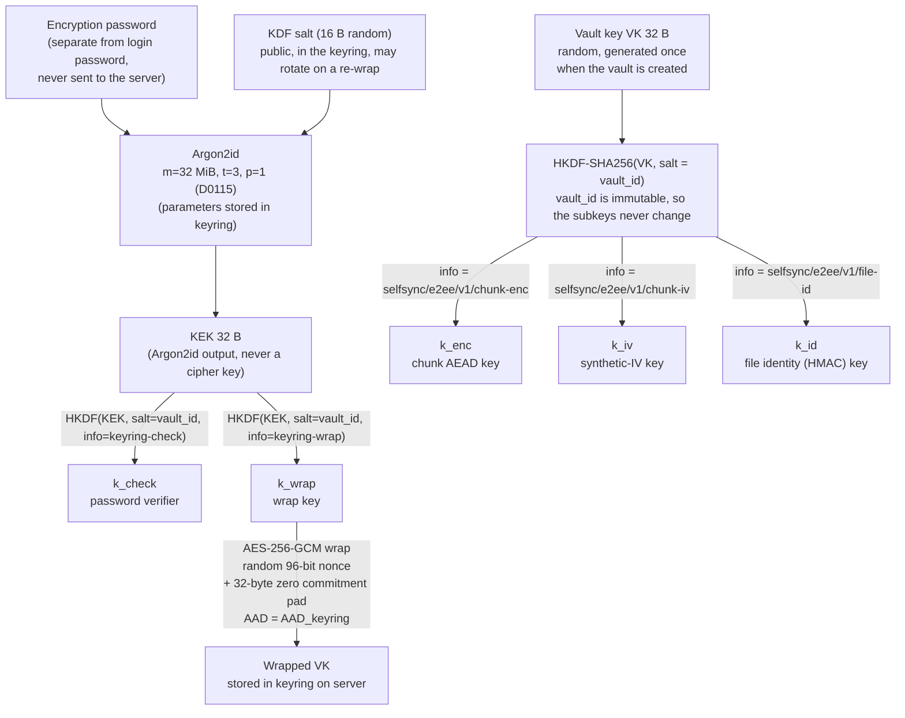
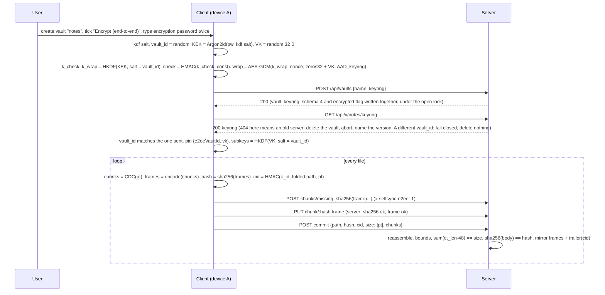
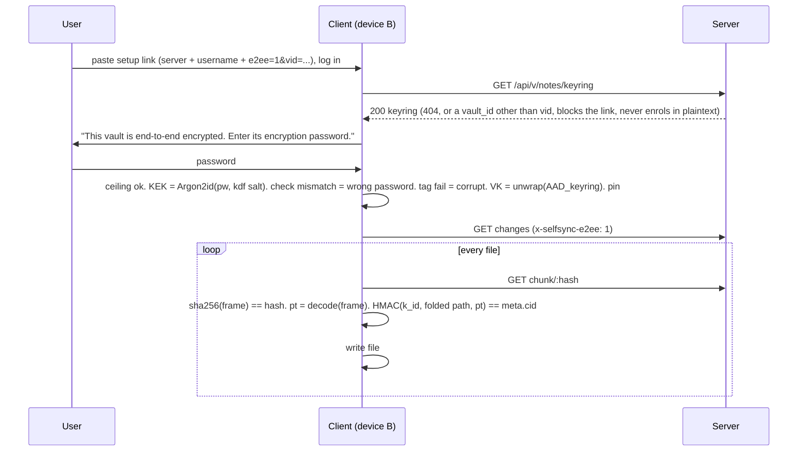
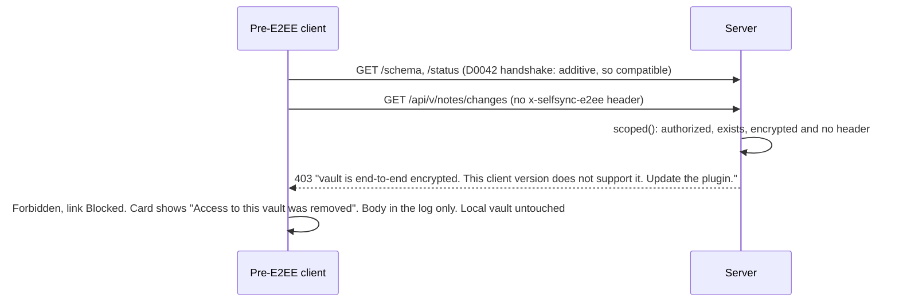

# SelfSync — optional client-side end-to-end encryption (design, revision 11)

**Date:** 2026-11-10 · **Status:** DESIGN, panel closed after round 9 (D0187) · **Charter:** st009 (owner,
2026-11-10), stories us012–us014 · **Supersedes:** the declined 2026-07-05 spec (D0009).
**Decisions this spec grounds:** D0096 (direction and scope), the D0099–D0104 set (construction and
protocol) and the D0105–D0112 set (custody, sharing, migration, KDF cost). All stay `proposed` until the
owner accepts them.

This document is the artifact the panel reviews. Every claim about the code cites `file:line` at
the code HEAD `2ce230d`, unchanged through later docs-only commits (`client/src` and `server/src`
unchanged since `4f5d298`. `server/Cargo.toml` moved
`rusqlite` to 0.41 at `4d37dea` for issue010). The model (Need, UseCases,
SystemRequirements, Decisions, tasks) is the truth. This document is the readable design with its
diagrams and its finding→resolution map (§10).

**What changed in revision 11** (round-9 panel, 1 ACCEPT, 3 OBJECT, every item a one-clause fix):
- The flag derives from the sidecar on any zero-row open or rebuild, in `open` and in `reindex`
  alike, so the operator's own remedy after a lost sidecar yields a flagged handle (§4.4).
- Create inserts the tombstone before `create_dir` and clears it after the sidecar is durable, so a
  never-purged name cannot resurrect as plaintext through a parked open (§4.4).
- The abort reason is a named field on the vault, cleared by the next successful rebuild (§4.5).
- `vault_open_error` gains a mapping for the two refusals. The keyring call sits inside the 401
  re-login try block. The build-time model read names its parser (§4.4, §4.8, §4.9).
- issue011 moves to the follow-up task `e2eeMirrorScanCap`. The SR title covers both arms. The
  create sequence shows the mismatched-id arm (§4.10, §7).

**Panel closure.** Round 9 ended 1 ACCEPT (SE) and 3 OBJECT, each objector naming its remaining
item a one-clause fix and not an irreducible disagreement. Revision 11 adopts every item. The
author closes the panel here and asks the three objectors to verify their clause. Rounds 4 to 9
shrank from seven MAJOR groups to three one-clause items. Every finding since round 6 was a
refinement of an accepted mechanism. The owner judges the design at the sitting review.

---

## 1. Goal

An **optional, per-vault** mode in which note content is encrypted on the user's devices before
upload and decrypted only on the user's devices. A compromised, curious, or seized server (or
anyone with the data volume) cannot read note content. Off by default. Chosen when a vault is
created.

## 2. Threat model, stated plainly

| Protected (in an encrypted vault) | Not protected (documented, deliberate) |
|---|---|
| Content of every synced file, including `.obsidian/` config | File **paths**, **sizes**, **mtimes**, version numbers, device names, author |
| Integrity of a file: a chunk substituted, dropped or reordered inside a file, or a file's content served under another path, is detected on the client | **Chunk equality within one vault** (same plaintext chunk gives the same frame, so dedup works) |
| The encryption password and the vault key never leave the device | **Chunk-length sequence**: CDC boundaries are a public function of the plaintext, and every frame exposes its length. For a file over 2 KiB this is a fingerprint. A server can test "is document X in this vault" by chunking X and matching lengths |
| An old client cannot write plaintext into an encrypted vault, and cannot write ciphertext into the user's local vault, while the server runs the E2EE version or newer | **Freshness and version mix**: the server can serve an older version of a file (rollback). No competitor protects this either |
| An enrolled device never silently falls back to plaintext when the server answers that the vault is not encrypted | **Offline password guessing**: anyone with the keyring can run Argon2id against the wrapped key. A native implementation at 32 MiB (D0115) takes about 0.1 s per guess per core, so a 64-core box tries about 600 guesses per second. A random 12-character password is out of reach. A patterned human password is not. The floor is a length, not an entropy bound |
| The keyring's `version` and `vault_id` cannot be altered by the server without the next unwrap failing. For a joining device, altered KDF fields read as a wrong password (§4.4) | **The local device**: the vault key, the login token and the three-way-merge base text live in `data.json` as today (`client/src/settings.ts:49,64`, `client/src/base.ts:22-24`) |
| A rolled-back server refuses to open any vault the E2EE server opened, so a pre-E2EE server never serves frames to an old client | **Timing and frequency of edits**. **Pre-encryption copies**: an earlier plaintext vault is deleted, not scrubbed. Earlier operator backups still hold it |
| An unpinned new device never enrols in plaintext when the server holds a keyring. `GET keyring` runs before any other vault-scoped call (§4.8) | **Unicode table drift**: a device whose JS engine lowercases a code point differently from Rust gives a second `cid` for one row. A generated fixture pins agreement on every supported engine (§4.3) |

Trusted: the user's devices and the Obsidian runtime. Untrusted: the server, its disk, its operator,
and the network. TLS stays necessary for login credentials and tokens, which E2EE does not cover.

## 3. What exists today (the facts the design must respect)

- Content-defined chunking on the client: `client/src/chunker.ts:3,34-48` (MIN 2 KiB, AVG about
  16 KiB, MAX 64 KiB). Chunk address = SHA-256 of the chunk bytes (`chunker.ts:17-20`). An empty file
  yields one empty chunk (`chunker.ts:45`).
- Push: `commitBytes` chunks, queries `missing`, PUTs missing chunks, then commits with
  `hash = sha256(plaintext file)` (`client/src/sync.ts:209-225`).
- Pull: `getVerifiedChunk` checks `sha256(bytes) == hash` before caching (`sync.ts:112-118`).
  `fetchFileBytes` reassembles (`sync.ts:125-127`). `streamFileToDisk` appends per chunk with an
  incremental SHA-256 and verifies before rename (`sync.ts:134-160`, `client/src/streamhash.ts:20-56`).
- Reconcile decides by comparing hash strings: local, base, remote (`client/src/reconcile.ts:19-21`).
  Local identity sites that feed or compare `FileMeta.hash`: `reconcile.ts:640, 761, 1078, 1232, 1321,
  1422`, `reconcile.ts:787-800` (whole-file verify), `client/src/main.ts:1221-1226` (the plugin
  push/pull preview). `main.ts:840-843` hashes the plugin's own `main.js` as a build fingerprint, not
  content. `normalizedHash` (`client/src/frontmatter.ts:291-295`, used at `reconcile.ts:616-650, 1247,
  1442`) compares plaintext on both sides and keeps plain SHA-256.
- Path identity is decided in one seam, `identityKey(path, fs)` (`client/src/pathidentity.ts:36-39`):
  NFC fold on macOS and iOS, case fold on Windows, macOS and iOS. NTFS keeps NFC and NFD as two
  files (`pathidentity.ts:22-26`). The server folds with Rust `to_lowercase` only
  (`server/src/index_store.rs:218, 373-376`). A divergent local spelling is aliased to the server
  key for sync identity (`reconcile.ts:848-855`).
- Server chunk store verifies `sha256(PUT bytes) == :hash` (`server/src/chunkstore.rs:77-82`).
- Server commit reassembles every chunk, aborts when the running total exceeds `req.size`
  (`server/src/vault.rs:606-617`) and needs `len == req.size && sha256(body) == req.hash`
  (`vault.rs:618-620`). The mirror self-heal compares `meta.len() == body.len()` (`vault.rs:631-640`).
- The mirror has three write sites: commit (`vault.rs:687-690`), the idempotent self-heal
  (`vault.rs:640-645`), and reindex re-materialisation from the chunk store (`vault.rs:427-433`).
- Server writes a plaintext **mirror** of every committed file to `root/vault/<path>`
  (`vault.rs:104-123`). The mirror comment states its purpose: if the index is lost, reindex rebuilds
  from the mirror (`vault.rs:108-111`). A corrupt index is quarantined and rebuilt at open with no
  operator action (`vault.rs:205-270`). The rebuild-from-disk branch (`vault.rs:467-482`) also runs
  on a healthy reindex when a chunk is missing or a disk file has no row (`vault.rs:455-466`). It
  reads the file, SHA-256s it, re-chunks it with the server's CDC port, and version-preserves on
  `old.hash == hash`.
- `lost` means an indexed path absent from disk and store. It aborts reindex
  unless `force` (`vault.rs:403-414`).
- Index rows hold path, hash, size, mtime, version, chunk list, provenance in SQLite
  (`server/src/index_store.rs:47-62`). An index whose `schema_version` is above the binary's
  `CURRENT_SCHEMA` refuses to open with a NEWER-server error (`index_store.rs:80, 100-111`), and
  `scoped()` surfaces that as a 503 (`api.rs:48-57`, `error.rs:60-65`). `migrate()` stamps every
  opened index whose version differs to `CURRENT_SCHEMA` (`index_store.rs:145-147`), so the v2 and v3 bumps
  already refused rollback for every vault. The `fold` column was added as a probe-idempotent heal
  (`index_store.rs:112-119`), and the provenance columns are per-column probes.
- `scoped()` is the one place owner, vault and user meet (`api.rs:26-57`): it checks `authorized()`
  and audits a denial, then `vault_exists()`, then opens the vault. It sees no headers. `/status` runs
  through it too (`api.rs:312`), and connect calls `api.status()` first today (`main.ts:2606`).
- Vaults are keyed by `(owner, name)`. `POST /api/vaults` returns a bare status with no id
  (`server/src/vaults.rs:15-41`). A delete tombstone is cleared by a deliberate recreate
  (`vaults.rs:35-38`). The client's re-create prompt posts `{name}` only (`main.ts:2517-2526`,
  `client/src/transport.ts:233-237`). The plugin never calls `DELETE /api/vault` today. The admin
  page does (`server/src/lib.rs:72-76`).
- `delete_own_vault` (`api.rs:351-366`) calls `purge_vault` (`server/src/state.rs:337`), which purges
  every share grant, then every share link, then the directory (`state.rs:356-374`), so a same-name
  recreate never re-exposes content. It never opens the vault.
- `create_vault` calls `st.vault()`, which
  opens a fresh index and inserts the handle into the namespace cache (`vaults.rs:38`, `state.rs:266-282`).
  Every later request takes the warm path (`state.rs:227-229`) and never touches the open lock.
- `CreateVaultRequest` has no `deny_unknown_fields` (`server/src/protocol.rs:145-148`),
  so an old server accepts `{name, keyring}` and ignores the field. The wizard creates straight after
  login with no `/schema` check (`client/src/setupwizard.ts:209, 327`). `status()` is the first authed
  call today. It carries the one-shot 401 re-login and maps a 503 to a synthetic degraded state with the
  server body verbatim (`main.ts:2605-2624`).
- Shares: a Read grant can call `changes`, `chunk`, `meta` (`server/src/api.rs:101-119, 124-130,
  184-197`, `server/src/shares.rs:67-88`). A share link carries server + token only
  (`client/src/sharelink.ts:11-29`), and the parser ignores unknown parameters (`sharelink.ts:25-28`).
  The setup link is encoded in `client/src/connstr.ts:50-55`.
- Mounts wrap the same `SyncApi` and rewrite paths to the source vault (`client/src/mountio.ts:69-70,
  76-105`). The primary and every mount share one `ChunkCache` (`client/src/main.ts:422, 3185-3188`).
  The base-ownership key is `host|owner/vault` (`main.ts:3584-3586`). A key mismatch routes the base
  through a safe merge with a notice, not a bare clear (`main.ts:2685-2697`).
- Old-client error handling: an unknown 4xx is `ServerDegraded` and retries slowly. A 404 on any
  endpoint except status is `Transient` and backs off (`connstate.ts:94`). A 403 is `Forbidden`,
  which blocks the link and waits for the user (`client/src/connstate.ts:90-107, 112-124`). The card
  then shows the fixed text "Access to this vault was removed" (`connstate.ts:208`). The response
  body reaches only the plugin log (`transport.ts:103-106, 126-133`).
- The setup wizard has **no** encryption field (`client/src/setupwizard.ts:93`). The only
  `encrypt` hits in `client/src` concern plaintext http.
- Client crypto today: `crypto.subtle.digest` only (`chunker.ts:20`). No AEAD, no KDF, no WASM.
  Server: `argon2 0.5`, `sha2`, `blake3` (unused) in `server/Cargo.toml:24-26`. No AEAD crate.
- The wire contract is signed and diffed directionally (D0042, `server/src/wire_signature.rs:42-80`
  for the signed route list, `client/src/wiresignature.ts:15-22, 117-134`). A new response field and
  a new optional request field are compatible both ways. A new **endpoint** or **type** in the
  client's embedded signature is `breaking, older: server` unless it is non-gating. Today only
  `/api/share*` and `/api/admin*` are (`wiresignature.ts:83-91`).

## 4. Architecture

### 4.1 Key hierarchy



Why a random VK under a password-derived KEK, and not a password-derived content key? A password
change re-wraps 32 bytes instead of re-encrypting the vault. Sharing hands over a key, not a
password hash. This is the Bitwarden, Proton, and Standard Notes shape (see §5). The Argon2id
output is never used as a cipher key. HKDF derives `k_wrap` and `k_check` from it.

The content subkeys take `vault_id` as HKDF salt, never the KDF salt. So a future re-wrap that
rotates the KDF salt leaves every frame and every `cid` valid.

### 4.2 Chunk encryption (deterministic, so content-addressed dedup survives)

```
plaintext chunk  pt  (0–64 KiB, from the existing CDC chunker)
iv   = HMAC-SHA256(k_iv, pt)[0..12]                 synthetic IV: same pt gives same iv, same ct
body = 0x00 x 32 || pt                              key-commitment pad (Albertini et al. 2020)
aad  = "selfsync/e2ee/v1" || vault_id               ASCII bytes, then the raw 16-byte id
ct   = AES-256-GCM(k_enc, iv, body, aad)
frame = magic "SSE1" (4 B) || iv (12 B) || ct_len (4 B, LE) || ct (incl. 16 B tag)
chunk address = SHA-256(frame)                      the server's existing content address, unchanged
tag  = hex(HMAC-SHA256(k_id, "selfsync/e2ee/v1/tag"))[0..16]   codec tag, cache namespace, base key
```

- Per-chunk overhead: 4 + 12 + 4 + 16 + 32 = 68 B, about 0.41 % at the 16 KiB average. A zero-byte
  file is one 68-byte frame with `size 0`. A commit always lists at least one frame.
- `vault_id` is a random 16-byte value minted by the client at creation and stored in the keyring.
  It is immutable. The KDF salt is distinct from it because a later re-wrap may rotate the KDF salt.
  The frame AAD is a domain-separation label and is cryptographically redundant with the unique VK.
  It is kept stable so one (key, IV) pair never meets two AADs.
- The same plaintext under the same VK gives the same frame, so `missing` and dedup work exactly as
  now. The server learns which chunks are equal **within a vault**, and nothing else. It cannot
  confirm a guessed plaintext from the ciphertext, because the IV key is secret. It can match a
  guessed document by its chunk-length sequence (§2).
- Two different plaintexts collide on a 96-bit IV with probability about n²/2⁹⁷. At 2²⁰ chunks that
  is 2⁻⁵⁷. A collision would reuse a GCM nonce under one key and cost the confidentiality of those two
  chunks only. A forged frame still fails the recomputed-IV check, so integrity survives nonce reuse.
- The 32-byte zero pad makes decryption **key-committing**. `decodeChunk` verifies the tag, then
  checks all 32 pad bytes, then recomputes `iv` from the plaintext and compares. Only then is
  plaintext released or cached. This closes the partitioning-oracle attack on a password-derived key
  hierarchy (Len, Grubbs, Ristenpart 2021).
- The frame is **self-delimiting without the key**. Magic and lengths let the server split a
  mirrored file back into its frames (§4.5) and validate that an encrypted vault receives only frames
  (§4.6). On PUT the body length alone gives the plaintext length. `ct_len` exists for the mirror split.

### 4.3 File identity, split in two

Revision 2 put a keyed HMAC into `FileMeta.hash`. Five panelists showed the server then cannot
verify a commit or rebuild a row from the mirror. Revision 3 keeps two identities. Revision 5 binds
the keyed identity to exactly the server's path identity.

| Field | Value in an encrypted vault | Who computes | Who verifies |
|---|---|---|---|
| `FileMeta.hash` (exists) | `sha256(frame_1 ‖ … ‖ frame_n)`, the frame stream | client and server | server at commit (`vault.rs:618`, unchanged), reindex, `classify_missing` |
| `FileMeta.cid` (new, optional, additive) | `HMAC-SHA256(k_id, u32le(len(f)) ‖ f ‖ pt)` (hex), with `f` the case-folded path | client only | client on every pull, before the file is written |
| `FileMeta.size` (exists) | plaintext size | client | server from frame headers (§4.6), client as today |

- `f = identityKey(path, {caseInsensitive: true, normInsensitive: false})` as UTF-8: lowercase, no
  normalisation (`pathidentity.ts:36-39`). That is the server's `fold` algorithm, Rust `to_lowercase`,
  so one `f` names one server row. Only clients compute `cid`, so what must agree is every JS engine
  a vault's devices run: V8, JavaScriptCore and the Android WebView. A Rust test enumerates every
  code point whose lowercase is not identity, plus string cases (final sigma, `U+0130`, Georgian).
  A client test iterates every code point and asserts `toLowerCase` equals the fixture or identity.
  The owner's phone protocol runs the same test, the only reach to JavaScriptCore (E1, E4).
- NFC and NFD spellings are two rows on the server with two `cid` values. On a device that
  folds normalisation, the local respelling is aliased to the server key (`reconcile.ts:848-855`).
  So `f` and `cid` do not change.
- `path` is the server-stored path of the row, or the aliased base key, never a raw listing string.
  Only clients compute `f`. The server never computes `cid`. It parses `cid` from the mirror trailer.
- Reconcile is unchanged in logic. For an encrypted vault the client's identity string is `cid`.
  `decide()` compares local `cid`, base `cid`, remote `cid`. The codec exposes
  `fileIdentity(path, pt)`. For a plaintext vault it returns `sha256(pt)` and `cid` is absent. The
  plugin push/pull preview (`main.ts:1221-1226`) compares `cid`, not `hash`, in an encrypted vault.
- The pull-side check **replaces** the `hash` comparison with the `cid` comparison in an encrypted
  vault. The cache holds plaintext, so `sha256(frames)` cannot be recomputed on a cache hit. A row of
  an encrypted vault that carries no `cid` fails closed under the same check.
- A rename across folded names is a delete plus a create with a new `cid`. Its chunks dedup, so the
  cost is one commit.
- What the client detects on pull: a chunk substituted, dropped or reordered inside a file, and a
  file's content served under another folded path. What it cannot detect: an older version of the
  same path served as current (§2, freshness).
- The server stores `cid` opaquely in the index row and returns it in `changes` and `meta`. For an
  encrypted vault a commit without `cid` is refused (§4.6). A garbage `cid` from a buggy client
  fails every other device's pull of that file until the author recommits. A corrupt chunk does the
  same today.

### 4.4 Keyring: the per-vault record the server stores but cannot open

```json
{
  "version": 1,
  "vault_id": "<base64 16 B random>",
  "kdf":  { "alg": "argon2id", "m_kib": 65536, "t": 3, "p": 1, "salt": "<base64 16 B>" },
  "check": "<hex HMAC-SHA256(k_check, 'selfsync-keyring-v1')>",
  "wrap": { "alg": "A256GCM", "nonce": "<base64 12 B>", "ct": "<base64 32 pad + 32 VK + 16 tag>" }
}
```

```
AAD_keyring = "selfsync-keyring-v1" || u32le(version) || u32le(16) || vault_id
            || u32le(len(alg)) || alg || u32le(m_kib) || u32le(t) || u32le(p)
            || u32le(16) || salt || u32le(32) || check                      raw bytes, fixed order
k_check = HKDF-SHA256(KEK, salt = vault_id, info = "selfsync/e2ee/v1/keyring-check")
k_wrap  = HKDF-SHA256(KEK, salt = vault_id, info = "selfsync/e2ee/v1/keyring-wrap")
wrap.ct = AES-256-GCM(k_wrap, nonce, 0x00 x 32 || VK, AAD_keyring)
```

- Stored as a sidecar `root/.keyring.json` next to `.version-hwm` (`vault.rs:279-292` is the
  pattern), **not** in the integer-only `meta` table. The server re-serialises nothing. It stores
  and returns the bytes the client sent.
- The keyring carries no provenance. The audit entry for vault creation carries the creator and
  `encrypted=true`, so the stored bytes are exactly the client's.
- **KDF ceiling.** The ceiling is an absolute constant, `m_kib` 131072, `t` 6, `p` 2, twice the
  maximum default. A keyring above it is reported as **unsupported KDF parameters** before any
  derivation. It blocks like a corrupt keyring, so a lying server cannot exhaust a phone.
- **Outcomes a joining device tells apart**, before any content is read. `openKeyring` builds
  `AAD_keyring` from the stored fields as received and decides by this table.

| parse and ceiling | `check` | unwrap tag | outcome |
|---|---|---|---|
| parse fails | — | — | corrupt keyring |
| above the ceiling | — | — | unsupported KDF parameters |
| ok | mismatch | not run | wrong password |
| ok | match | fail | corrupt keyring |
| ok | match | ok | open |

- So an altered `version`, `nonce` or `wrap.ct` reads as corrupt keyring. An altered `salt`, KDF field,
  `check` or `vault_id` changes the KEK or `k_check` and reads as wrong password for a joiner. The
  record never leaks which, and a joiner cannot tell tamper from typo for those fields.
- The link's `vid` catches a swapped `vault_id` before derivation (§4.8).
- **Atomic creation.** `POST /api/vaults {name, keyring?}` creates the vault and its keyring in one
  call. Today the 409 check runs before the lock and `st.vault()` takes the lock itself
  (`vaults.rs:32-34`, `state.rs:239-247`). So a new `AppState::create_vault` holds the per-key open
  lock for the whole sequence.
- **Create sequence.** Insert the tombstone for the name, `create_dir_all` the
  user directory, and `create_dir` the vault directory where `AlreadyExists` is the 409. The 409 arm
  restores the tombstone state it found, so a retried create never tombstones a live vault. A
  half-purged directory keeps its purge tombstone. Then
  write and fsync the sidecar with `create_new`, clear the tombstone, open the vault, and publish
  the handle. It
  inlines the open and the cache insert and never calls `vault()`, because the mutex is not
  re-entrant.
- **Create guarantees.** No request reaches a cached handle before the sidecar exists. A sidecar
  failure removes the directory under the lock and leaves the tombstone set. The tombstone set is
  in memory and filled only by `purge_vault` today (`state.rs:89, 365`), so the create inserts it
  itself. A request parked on the lock then wakes to `NotFound` on a never-purged name too. It never
  materialises an empty plaintext vault (`vault.rs:206`, `state.rs:247-252`).
  `keyring` is an optional request field, so the change is additive.
- **Schema bump and encrypted flag.** `CURRENT_SCHEMA` bumps to 4 for every vault, the v2 and v3
  convention, and `cid` is its probe-idempotent column add. A rolled-back pre-E2EE binary refuses any
  vault the E2EE server opened, with the existing refusal (`index_store.rs:100-111`, `api.rs:52-57`).
  So it never serves frames to an old client or accepts plaintext into an encrypted vault.
- **Encrypted flag.** The index `meta` table gains `encrypted=1`. The flag derives from the sidecar
  whenever an index with zero `files` and `deletions` rows opens or rebuilds with a sidecar present.
  That holds in `Vault::open` and in `reindex` alike, before any row is stored, and nothing else
  writes it. A fresh index is one whose DB file was absent or just quarantined before open
  (`vault.rs:214-230`), or that has zero rows.
- **Warm-handle reindex.** So the reindex an operator runs on a warm handle after restoring the
  sidecar (`admin.rs:394-413`) yields a flagged handle, never a plaintext handle with frame rows.
  A quarantined encrypted vault with its sidecar is flagged before its rebuild. The server's encrypted test reads the flag, never the
  sidecar, and the handle holds it in memory. A crash after the sidecar and before the open leaves a
  fresh index plus a sidecar, which the next open flags. A crash before the sidecar leaves no 200,
  so the client's retry meets the 409 arm of §6.
- **Two refusals, each with a remedy.** `Vault::open` refuses with a distinct path-free 503 when
  `encrypted=1` and no `.keyring.json` exists. The body names the sidecar to restore,
  delete-from-plugin for a vault that never synced, and `/admin` as the operator route. `GET
  keyring` answers the same 503 when the cached handle is encrypted and the sidecar is gone, and
  when the handle's rebuild aborted for the no-sidecar reason, so a running server and a restarted
  one give one answer. `vault_open_error` (`error.rs:60-69`) gains a mapping that routes both
  refusals to 503 with their own bodies, never the schema-rollback body. The abort reason is a
  named field on the vault after a failed rebuild, cleared by the next successful rebuild. The
  status detail carries it.
- **Second refusal.** It refuses with a second body when
  `.keyring.json` exists on a non-fresh index without the flag.
- **Which file is stale.** Before the second refusal answers, it reads the four-byte magic of every
  file under `vault/` (the walk `collect_files` already does, `vault.rs:811-831`). All `SSE1` means
  the index is stale, and the body says move `.sync-index.db*` aside. It also says that this resets
  deletion history and can re-push deleted notes from lagging devices, so restore the matching
  index from backup first. None means the keyring is stale (a pre-encryption backup restored over
  the directory), and the body says move `.keyring.json` aside.
- **Mixed or empty.** Mixed, the `rsync` without
  `--delete` case, gives a third body with both counts. The first 20 paths go to the server log, so
  the body stays under the client cap (E2). It says restore the
  index, the mirror and the keyring from one point in time, and chooses no remedy. No mirror file
  gives a body that names both remedies. A refused open is never cached (`state.rs:264-266`), so the
  scan runs per request at the slow retry. That cost is issue011, carried by the follow-up task
  `e2eeMirrorScanCap`, and E2 records the measured walk time.
- **Client side of a 503.**
  Every body is a const under the client cap. The client never matches them: every 503 shows its
  body verbatim through the existing status path (§4.8). Backups must include the dotfiles
  `.keyring.json`, `.sync-index.db`, `.version-hwm` and `.chunks`.
- **Old server.** An old server ignores the field and creates a plaintext vault. So the client reads
  `GET keyring` after creation and pins only when the returned `vault_id` is the one it sent. On 404
  it deletes the vault, discards the generated VK, and names the minimum server version. No commit
  happens before that check passes.
- **Wire signature.** `isNonGatingEndpoint` is extended with the two `GET keyring` routes and
  `TYPE_ROLES` with the keyring type (`wiresignature.ts:53-91`), so a new plugin keeps syncing a
  plaintext vault on an old server. A test pins that the new embedded signature against the pre-E2EE
  server signature is compatible.
- **No `PUT keyring` and no `DELETE keyring` in v1.** The keyring lives and dies with the vault.
  Re-wrap (password change) and rotation are tracked follow-ups (§6). A lost `.keyring.json` has no
  in-place recovery. The Blocked card names the reason and points at delete-then-create. It states
  that the delete purges every grant and share link, so the owner re-shares afterwards (§4.8).

Endpoints (additive):

| Route | Access | Semantics |
|---|---|---|
| `GET /api/v/:vault/keyring`, `GET /api/u/:owner/:vault/keyring` | Read grant | 200 keyring. 404 = vault absent (from `scoped()`) or a plaintext handle with no sidecar, or the route is absent on an old server. 503 = encrypted handle with no sidecar, or a rebuild aborted for the no-sidecar reason (refusal one). The handler reads the sidecar and the in-memory handle flag only, never `ensure_ready`. A cold cache gets the handle through `Vault::open` first. Non-gating |
| `POST /api/vaults {name, keyring?}` | owner | create vault and keyring atomically (409 if the name or keyring exists) |

### 4.5 Server mirror and reindex for an encrypted vault

The mirror stays, because reindex-from-disk is the durability property the mirror exists for
(`vault.rs:108-111`). For an encrypted vault the mirror file holds the **frame stream followed by a
trailer**: `frame_1 ‖ … ‖ frame_n ‖ "SSEM" ‖ cid (32 B)`. Frames are length-prefixed, so the
parser never scans for the trailer. One function, `write_mirror_for(meta, body)`, appends the
trailer when the vault has a keyring. All three write sites use it: commit, the idempotent
self-heal, and reindex re-materialisation (§3). A human on the server sees names, not content.

For a vault whose `.keyring.json` exists, **every rebuild-from-disk** uses the frame splitter: the
corrupt-index rebuild, the missing-chunk fallthrough, and an unindexed disk file
(`vault.rs:455-482`). It stores the frames as chunks, sets `hash = sha256(frames)` (trailer
excluded), `size = Σ(ct_len − 48)`, and `cid` from the trailer. The rebuilt row equals the committed
row, so every client verifies it. An E2 test recovers a file from the chunk store, corrupts the
index, rebuilds, and asserts the row equals the committed row.

An unparseable mirror file is classified by its row. An indexed file whose mirror does not parse
stays `lost`, which aborts reindex unless `force`, as today. An unindexed stray file that does not
parse is `foreign`: warn and skip, never abort, never moved. `force` keeps its one meaning, drop lost
rows (`vault.rs:410-414`). The self-heal compares the mirror length with `body.len() + 36`.

A dotfile-skipping restore loses the sidecar and the index together and keeps the mirror. A
rebuild-from-disk runs a three-condition scan as a pre-pass before any store write
(`vault.rs:467-472`). So an aborted rebuild stores no offender chunk that a later reindex could
count as present.

It aborts with a named reason when the conditions hold at once. No sidecar exists.
A file parses as a complete frame stream: at least one frame, every `ct_len` in 48 to 65584, the
trailer exactly at the end. And not every CDC chunk hash of that file is already in the chunk store
(`chunkstore.rs:68-71`, the CDC port at `chunker.rs:27-48`).

`.chunks` is a dotfile too, so the
same restore loses it and the third condition holds trivially. An uncommitted frame-shaped file
dropped into a plaintext vault by a host-FS edit trips the abort too, and the named exit covers it. A flag condition would reopen the
frames-as-content path on a non-fresh index after a stale-keyring remedy, so there is none.

A plaintext-committed file leaves exactly its chunks in the store, and an encrypted mirror never
does. So a plaintext vault that holds a frame-shaped file still reindexes. The reason lists the first
20 offending paths with a count and the exit: restore
`.keyring.json`, or move the listed files out of `vault/` and reindex. The vault stays ERROR, and
`force` does not override it, so frames are never served as content. The deployment doc names the
dotfiles a backup must include.

The mirror is the symmetric case. A fresh or quarantined rebuild
with a sidecar aborts on a file that does not parse as a frame stream, with its paths. That is because
`write_mirror_for` wrote every mirror file. `foreign` stays the class for a healthy reindex.

The host-filesystem edit feature of the mirror (`vault.rs:632-636`) is unavailable for an
encrypted vault, and `docs/deployment.md` will say so (E3b DoD 11).

### 4.6 Server-side verification and the downgrade guard

For a vault with a keyring (`encrypted = true`):

1. `PUT chunk`: `sha256(bytes) == :hash` as today **and** the bytes parse as one frame (magic,
   `ct_len` consistent with body length, `ct_len >= 48`, body ≤ `MAX_CHUNK_BYTES`). A plaintext chunk
   is refused with 422 and a body naming the cause.
2. `commit`: an empty chunk list is refused. The running-total guard keeps its raw bound,
   `body.len() ≤ req.size + 68 × req.chunks.len()`, and adds the plaintext sum. Final checks:
   `Σ(ct_len − 48) == req.size`, `sha256(body) == req.hash` (unchanged), and `req.cid` present. The
   mirror receives the frame stream plus trailer.
3. **Downgrade guard inside `scoped()`.** A `FromRequestParts` extractor `E2eeHeader(bool)` reads
   `x-selfsync-e2ee` and every sync handler passes it into `scoped()`. `scoped()` checks it **after**
   `authorized()` and `vault_exists()`, against `h.encrypted`. So a non-grantee still gets the bare
   403 and the audit line, and no caller learns whether a vault exists or is encrypted. A grantee
   without the header is answered **HTTP 403** with the body
   `vault is end-to-end encrypted. This client version does not support it. Update the plugin.`
4. In-family exemption: `GET keyring` only. `/api/ws`, `DELETE /api/vault`, the admin and the
   share-link routes never pass through `scoped()`. A test iterates the whole signed route list
   (`wire_signature.rs:42-80`). It asserts that every handler threads the extractor or is on the
   exemption list. It also asserts that the 403 body does not match the client's password-change
   regex (`connstate.ts:95`).
5. **What the old client shows.** It maps 403 to `Forbidden`, blocks the link, and shows the fixed
   card text "Access to this vault was removed" (`connstate.ts:95-96, 113-120, 208`). The 403 body
   appears only in the plugin log. It does not write ciphertext into the user's vault or plaintext
   into the server's. `docs/deployment.md` and the README say that this card on an encrypted vault
   means "update the plugin".
6. An old client that redeems an `e2ee=1&vid=` link ignores the unknown parameters
   (`sharelink.ts:25-28`), enrols, and meets the same 403 at its first sync.

For a vault without a keyring nothing changes.

### 4.7 Client: one seam, the content codec

```ts
interface ContentCodec {
  readonly tag: "plain" | string;                                  // cache namespace and base key (§4.2)
  readonly encrypted: boolean;
  encodeChunk(pt: Uint8Array): Promise<Uint8Array>;               // plaintext to frame (identity when plain)
  decodeChunk(frame: Uint8Array): Promise<Uint8Array>;            // frame to plaintext (tag, pad, iv checks)
  fileIdentity(path: string, pt: Uint8Array): Promise<string>;    // sha256(pt) | HMAC(k_id, folded path, pt)
  identityStream(path: string): IdentityStream;                   // incremental form for streamFileToDisk
  fileHash(frames: Uint8Array[]): Promise<string>;                // FileMeta.hash: sha256 of the stream
}
```

- `PlainCodec` reproduces today's behaviour byte for byte. `E2eeCodec` holds the three subkeys.
- **Cache.** `ChunkCache` keys become `tag ‖ ":" ‖ hash`. The commitment pad makes frame→plaintext
  unique per key, so the tag is a namespace, not the integrity mechanism. The base-ownership key of
  an encrypted vault gains `|tag`. A plaintext vault contributes no segment, so its key is byte-identical
  to today's and `vaultKeyMismatch` (`connectdecisions.ts:16-18`) never trips on an existing vault. `commitBytes` caches
  plaintext under the **frame** hash after encoding, never under `sha256(pt)`.
- Touch points: `commitBytes` (encode after chunking, `hash` over frames, `cid` over folded path and
  plaintext). `getVerifiedChunk` (verify `sha256(frame)`, then decode, then cache). `streamFileToDisk`
  and the buffered `fetchVerified` (decode per chunk, `cid` over plaintext, `written` counts
  plaintext). The identity sites listed in §3. A lint test fails on any `sha256hex` import outside
  `chunker.ts`, `frontmatter.ts`, `streamhash.ts`, the codec, and the `main.js` build fingerprint
  (D0047: a correction becomes a guard).
- `HttpTransport` sends `x-selfsync-e2ee: 1` on every vault-scoped request when the codec is
  encrypted.
- The keyring fetch runs inside the connect effect with its own endpoint tag. The client consumes 200
  and 404 itself, so neither becomes a backoff retry through the transport classifier
  (`connstate.ts:94`).
- The incremental `cid` wraps the streaming HMAC of `@noble/hashes` (`identity.ts`, E1). `Sha256` in
  `streamhash.ts` stays as it is.

### 4.8 Custody on the device, pinned

- At enrolment the device stores, per vault, `{ e2eeVaultId, vk }` in `data.json`. It never stores
  the encryption password. The field name avoids the existing `settings.vaultId`, which is the server
  vault name (`settings.ts:51`). `vk` presence is the encrypted flag. No digest of the record is
  pinned. A future re-wrap changes `check` and `wrap` and must not force every device to re-enrol.
- **Connect order.** `GET keyring` is the first vault-scoped request inside `establishSession`
  (`main.ts:2591`), before `/status`, pinned or not, tagged with its own `Endpoint.Keyring`. It
  sits inside the same try block whose catch does the one-shot 401 re-login (`main.ts:2604-2620`).
  The client consumes 200 and 404 by the table below and never throws them.
- **Ready first.** Every E2EE decision runs
  after the existing status-not-ready throw (`main.ts:2639-2643`), so a `status:"error"` body takes
  the degraded path and wins over every keyring arm. Every other answer throws exactly as
  `status()` does today. That means the one-shot 401 re-login, and a 503 shown verbatim
  as the degraded state with a slow retry that self-heals when the operator acts. No codec decision
  follows.
- **Four block reasons.** `AwaitUser` is a `RecoveryKind` (`connstate.ts:39`), and a block reason is
  a `FailureKind` (`connstate.ts:126-127`). So four new kinds exist, `E2eeJoinRequired`,
  `E2eeKeyringChanged`, `E2eeKeyringMissing` and `E2eeUnsupportedBuild`, each with a `SyntheticKind`,
  `recoveryFor` `AwaitUser` and a `blockedTip` arm.
- **Unpinned vault.** A 200 first runs `/status` and the wire-signature check, so no join prompt or
  KDF runs against an unverified contract (D0042). It then blocks with `E2eeJoinRequired` and opens
  the join prompt, whose card carries a Join action that reopens the modal. A latch like
  `versionNoticeShown` (`main.ts:596`) shows it once per episode,
  from the first block until a pin or Reconfigure, reset on a 404 and on `Connected`. A resume
  re-uses the open modal, and an interrupted join leaves no state and re-prompts. So a new plugin
  configured by hand never meets the old-plugin card. A 404 falls through to `/status`, which tells a plaintext vault (200) from a
  deleted one (`VaultGone`) and from an old server (signature).
- **The pin wins over the server.** For a pinned vault, a 404 followed by a ready status blocks with
  `E2eeKeyringMissing`. That is a plaintext vault under the pinned name: a same-name plaintext
  recreate or a restored pre-encryption backup. An encrypted vault that lost its sidecar answers the
  503 instead (§4.4). A different `vault_id` or a parse failure blocks with `E2eeKeyringChanged`
  and a named reason. A 404 followed by a status 404 reaches the `VaultGone` prompt.
- **Why the pin holds.** The codec is never changed by a server answer. This closes the operator-deleted-keyring, the
  restored-old-backup, the same-name-recreate, and the lying-server cases. An enrolled device never
  unwraps on reconnect, so a same-id keyring with a foreign wrap cannot harm it.
- **One gesture replaces a pin: Re-enrol.** It is Reconfigure routed into the wizard's join path with
  the pin honoured, not a new dialog. The Blocked card for "keyring changed" offers it. The user
  types the encryption password and the client joins the keyring the server holds, encrypted only.
  The pin's `vault_id` becomes the joined keyring's `vault_id` after the unwrap.
- **A missing keyring has no re-enrol arm.** The Blocked card names the reason and points at the
  delete action of §6, then the create dialog. On a pinned device that dialog, and the `VaultGone`
  dialog, open with Encrypt on and refuse a plaintext create under the pinned name. So a lying server
  that answers 404 then 200 cannot walk the user into a plaintext push. The pin changes only on a
  successful encrypted create's `vault_id`. On a grantee device the card says "ask the owner".
- **Delete and re-share.** No purge runs from a Blocked card. The delete action carries the warning that every share grant and
  share link is purged (`state.rs:356-374`), so the owner re-shares afterwards. Until then a
  collaborator meets the Forbidden card. Other devices then meet "keyring changed" and join with
  the password.
- No explicit base clear exists. The encrypted base key carries the codec tag, and the existing guard (`main.ts:2685-2697`)
  routes a stale base through its safe merge.
- The `VaultGone` re-create prompt always opens the full create dialog with the Encrypt option,
  pinned or not, so a device mid-migration never re-creates plaintext under a reserved name.
- The base-ownership key of an encrypted vault gains the codec tag (`host|owner/vault|tag`). The tag
  derives from `k_id` (§4.2), so it changes exactly when base identities would. A plaintext vault's
  key is unchanged (§4.7).
- The device setup link (`connstr.ts:50-55`) and the share link gain `e2ee=1&vid=<vault_id>` and
  never carry VK or the password. A joining device that sees the flag and receives 404 on
  `GET keyring`, or a different `vault_id`, fails closed with a named reason, instead of enrolling in
  plaintext.
- A second device, or a collaborator, types the encryption password once. The client fetches the
  keyring, derives KEK, checks `check`, unwraps VK, pins `{e2eeVaultId, vk}`.
- Secrets never reach a log line, the audit log, an error body, a conflict-copy name, or a
  composition recipe: password, KEK, VK, subkeys. A runtime capture test runs create, join and a
  conflict-copy flow with marker values and asserts the markers appear nowhere.

### 4.9 Password floor and KDF cost

- The creation dialog refuses an encryption password under 12 characters and refuses a password
  equal to the login password. The dialog asks twice and states that a lost password loses the data.
  The floor is a length, not an entropy bound, and §2 says so.
- The KDF input is the raw UTF-8 of the password string as typed, with no Unicode normalisation (§8,
  point 4). The committed vector pins a precomposed non-ASCII password.
- Argon2id runs once per device enrolment and once per wrong-password retry. The dialog shows
  progress during derivation. Measured on the owner's desktop in pure JS at 64 MiB and three passes:
  2.7 seconds (`@noble/hashes` 1.8.0, Node 24). The parameters live in the keyring. Raising them later
  needs the `e2eePasswordChange` follow-up, because v1 has no re-wrap route. The ceiling a client
  accepts is the absolute ceiling of §4.4, twice the maximum default.
- **The phone measurement is the owner's, not the sprint's (D0112).** Two `manual` Indicators,
  `e2eePhoneKdfWallTime` and `e2eePhoneKdfPeakMemory`, live in `.tracking/indicators.sysml`. The
  owner runs the real-device protocol (`docs/architecture/93-real-device-perf-protocol.md`) on one
  real iOS and one real Android device and records two `Measurement`s under each, one per device,
  with `keel record measurement --indicator`.
- **The default is a separate Decision.** D0112 holds the policy. Two Measurements per Indicator
  carry `source` prefixed `ios:` or `android:`. Then a new Decision depends on D0112, cites the four
  ids and states `m_kib`, `t` and `p`. The AI records it as proposed and the owner accepts it. E4
  clause 7 holds the check and the one fail reason. This section summarises both. The default
  Decision states its values in the literal form `m_kib=N, t=N, p=N`, so the check is a pinned match.
- **The define.** A release cut before that hides every KDF entry (create, join, Re-enrol)
  behind the esbuild define `SELFSYNC_E2EE`, a committed literal in `esbuild.config.mjs` so a tag
  rebuilds byte-identical (`verify-released.yml`).
- **Define off.** Four surfaces block with the reason "this plugin build does not support encrypted
  vaults": an unpinned 200, an `e2ee=1` link, the changed-keyring card and the missing-keyring
  dialog. No codec decision and no plaintext enrolment follow. A pinned device syncs regardless.
- **Who flips the literal.** The commit that follows the owner's acceptance of the default Decision
  flips the literal to true. `esbuild.config.mjs` itself fails the build when the literal is true
  and no accepted Decision that depends on D0112 with equal `m_kib`, `t` and `p` exists in the model.
  The build reads `.engine/decisions/*.sysml` and matches `status = DecisionStatus::accepted`, the
  `#DependsOn` edge to `d0112` and the literal `m_kib=N, t=N, p=N` in the decision text.
  `npm run build` runs in `release.yml` (`:72-77`) and in `verify-released.yml` (`:52`), so the
  publishing path enforces it, not only the daily backstop. A vitest test asserts the same rule.
  Manual vigilance is not the control (D0047).
- **Release notes.** The release notes say so. It never ships an unmeasured 64 MiB
  default. The peak-memory row names its instrument per OS, or records "not measurable" honestly.

### 4.10 Sequence: first device creates an encrypted vault



### 4.11 Sequence: second device joins



### 4.12 Sequence: old client meets an encrypted vault



## 5. Comparison with published practice, and the revisions it caused

| # | Topic | Revision 1 (first draft, and the 2026-07-05 spec) | Published practice | Adopted (revision 10) |
|---|---|---|---|---|
| 1 | Content key | Derived directly from the password | Bitwarden, Proton, Standard Notes 004, Cryptomator: a **random** content or master key wrapped by a password-derived KEK | Random VK wrapped under `k_wrap` from the KEK (§4.1) |
| 2 | Subkeys | One key for everything | Cryptomator: separate encryption and MAC keys. Standard Notes: per-purpose keys. NIST SP 800-108 and HKDF | HKDF-SHA256 from VK with the immutable `vault_id` as salt: enc, IV, file identity. `k_wrap` and `k_check` from the KEK |
| 3 | Cipher | XChaCha20-Poly1305 via a JS or WASM lib | Obsidian Sync: AES-256-GCM with scrypt. Cryptomator: AES-GCM. LiveSync: WebCrypto AES-GCM | **AES-256-GCM via WebCrypto** (native on Electron and both mobile WebViews, no bundle). Synthetic IVs keep the 96-bit nonce safe (§4.2 bound) |
| 4 | Dedup vs confidentiality | Convergent: nonce from the plaintext hash | Plain convergent encryption is brute-forceable for low-entropy content. DupLESS adds a secret-keyed PRF | Synthetic IV from **HMAC(k_iv, pt)** with a secret key. Equality leaks within a vault. The chunk-length fingerprint is stated, not hidden (§2) |
| 5 | Key commitment | Not considered | Len, Grubbs, Ristenpart 2021. Albertini et al. 2020: a zero-block pad gives commitment cheaply | 32-byte zero pad, checked after the tag and before release, in every frame and in the wrap |
| 6 | Integrity of the chunk list | Per-chunk content-address check only | Cryptomator binds chunks to a file header. Standard Notes authenticates the whole item | Case-folded-path-bound keyed identity `cid` (§4.3) plus the server-verifiable stream hash. Per-chunk AAD binding to the file was rejected: it breaks cross-file dedup |
| 7 | KDF | Argon2id, parameters and library unstated | OWASP: Argon2id at least 19 MiB, t=2, p=1. Bitwarden's Argon2id option defaults to 32 MiB, 6 iterations, 4 lanes (its KDF help page). WebCrypto has no Argon2 | Argon2id **64 MiB, t=3, p=1** from `@noble/hashes`, final value from the owner's phone Measurements (§4.9, D0112). Its `argon2` module is **outside** the Cure53 audit scope (README). Accepted because it runs once per enrolment and feeds only the KEK. An absolute ceiling, twice the maximum default, stops a lying server |
| 8 | Wrong-password detection | Decrypt a chunk and see | Cryptomator: RFC 3394 key-wrap integrity under the scrypt KEK tells a wrong password before any content. Its `versionMac` guards downgrade | `check` from the KEK plus the unwrap tag, decided by a table (§4.4): wrong password and corrupt keyring are told apart before any content is read. Tampering of the KDF fields or `check` reads as a wrong password for a joiner, stated |
| 9 | Downgrade protection | None | Signal and Matrix: capability negotiation fails closed. D0042 in this repo | 403 inside `scoped()` after authz unless `x-selfsync-e2ee: 1`. Frame validation on PUT. Pinned custody (§4.8). Schema bump to 4 so a rolled-back server refuses every vault it opened, and an encrypted flag so a lost sidecar is refused. Non-gating keyring routes so the new plugin still works on an old server |
| 10 | Paths and structure | Visible (content-only) | **Obsidian Sync encrypts paths** (its security page lists only device, time and the path↔content mapping as visible). LiveSync: optional path obfuscation. Cryptomator: full name encryption | **Content-only in v1**, on this repo's own grounds: the readable mirror tree, conflict naming by path, mount and share path semantics. Path encryption is a tracked follow-up |
| 11 | Migration of an existing vault | In-place re-upload | Obsidian Sync: chosen at remote-vault creation. LiveSync: rebuild the remote | **Chosen at vault creation**. Encrypting an existing vault = delete the old vault from the plugin, create the encrypted one **under the same name**, switch. The old copy is deleted, not scrubbed, and earlier backups keep it (§6) |
| 12 | Revocation of a collaborator | Not considered | Bitwarden org key: ACL-only until rotation. Proton: re-encrypt the vault key for the rest | v1: ACL revocation only. Rotation is a tracked follow-up. The UI copy says so |
| 13 | Local custody | Password cached | Obsidian Sync and LiveSync keep the key or passphrase in app storage | VK pinned with `vault_id`, password never (§4.8) |
| 14 | Recovery | Lose the password, lose the data | Obsidian Sync: same. Bitwarden: optional recovery code | v1: same as Obsidian Sync, double entry, explicit warning, 12-character floor. A recovery key is a tracked follow-up |

## 6. Scope of v1 and what is explicitly not in it

**In v1:**
- Encrypted vault creation (wizard and "create vault" dialog), atomic with its keyring and encrypted
  flag, with an "end-to-end encrypted" indicator on the status card.
- Second-device join. Shared-vault join by a **different account** through a share link. Re-enrol for
  a changed keyring. The 409 delete appears only in the plugin's create dialog, after a fresh
  `/schema` fetch lists the keyring route.
- An owner-scoped "Delete this vault on the server" action in the plugin's settings tab, a new
  client call to the existing route (`api.rs:347-364`). It needs
  only the token and the vault name and works in every link state. It carries the residue warning
  and the re-share warning, and every card or dialog that leads to a delete points at it.
- All push and pull paths (buffered and streamed). Config sync rides the same pipeline.
- `GET keyring`, atomic create, server frame validation, the 403 check in `scoped()`, the mirror
  trailer at every write site and the reindex rebuild for an encrypted vault.
- The `docs/deployment.md` trust-model update and the CMMC posture note. The deployment items:
  custody, server-first upgrade order, and the first server image that stamps schema 4. That image
  stamps a vault when it first opens it, no rollback below it is possible after that, and re-upgrade
  is the 503 remedy. Backups include the dotfiles `.keyring.json`, `.sync-index.db`, `.version-hwm`
  and `.chunks`. Also: the stale-index remedy, pre-encryption backups still hold plaintext, host-FS
  edits unavailable, the old-plugin card text, the lost-keyring route, the re-share rule. `server-image.yml` publishes
  `:latest` on every push, so the doc names the version, not the tag.

**Migration of an existing vault, one order everywhere.** Delete the old vault from the plugin.
Create the encrypted vault **under the same name**. Switch to it.

The dialog tells the owner to do
this from the device that holds the content. It states that the delete purges every share grant
and share link, so the owner re-shares with every collaborator afterwards. On a 409 the dialog reads
`GET keyring` first. A 200 means an encrypted vault with this name exists, and the dialog offers
join only, never a delete.

On a 404 the plugin's create dialog fetches `/schema`, anchored on the
`/health` hash. If the signature lists the keyring route, a plaintext vault with this name exists.
That is because the delete is not complete yet or another device re-created it. The dialog then offers the
delete action.

Otherwise it names the minimum server version and offers nothing. The wizard offers no delete on a
409.

An old server accepts `{name, keyring}` and creates plaintext (§3), so without the fresh signature
check the 409 arm would delete the owner's vault for nothing. The wizard needs no gate: its
post-create 404 check deletes only the vault it just created.

Other devices then
meet the 403 on an old plugin or the join prompt on a new plugin. No device meets a plaintext
re-create prompt (§4.8), and no device deletes a fresh encrypted vault by mistake.

**Not in v1 (each a tracked task):**
1. `e2eeEncryptedMountSource`: mounting an encrypted source vault. v1 refuses with a clear message.
2. `e2eePasswordChange`: a re-wrap route with compare-and-swap on `check`, and a settings action.
   The key hierarchy already makes it a 32-byte change. The content subkeys and the pin survive it,
   because both derive from `vault_id` and VK. Its observable requirement is written when chartered.
3. `e2eeVaultKeyRotation`: cryptographic revocation.
4. `e2eePathEncryptionDesign`: path and structure encryption, design first.
5. `e2eeRecoveryKey`: a recovery key.

**Declined, not tracked:** in-place encryption of an existing vault. The delete-create-switch route
covers it.

## 7. Implementation plan (sprints, Fibonacci points)

| Sprint | Task | Deliverable | Pts |
|---|---|---|---|
| E1 | `e2eeCryptoCore` | `client/src/e2ee/`. KDF with the ceiling. `k_wrap`, `k_check` with `vault_id` salt. `AAD_keyring` layout. Keyring create and open (outcome table of §4.4). HKDF subkeys with `vault_id` salt. Frame encode and decode (tag, pad, iv checks). `cid` over the case-folded path, incremental too. Codec tag. Fold fixture emitted by Rust with string cases, asserted bidirectionally in JS. Test vector with a non-ASCII path, password, nonce, wrapped blob and check, shared with the server, plus one tampered keyring per outcome cell for the client | 5 |
| E2 | `e2eeServerKeyringAndGuard` | Keyring sidecar under the open lock, written before the open and the cache publish. `GET keyring` 200/404/503 on both routes from the sidecar and the handle flag, corrupt-tolerant. Frame parser. PUT and commit rules with both bounds. Schema bump to 4, `cid` as a probe-idempotent column. Flag derived from a fresh index with a sidecar, cache-handle test. Refusal bodies from a full mirror-magic scan: all, none, mixed, no file. Three-condition `SSE1` abort with a plaintext false-positive test and the with-sidecar non-frame abort. One `AppState::create_vault` holding the lock end to end, tombstone inserted first and cleared after the sidecar. Flag derived on any zero-row open or rebuild with a sidecar. Named abort reason. `vault_open_error` mapping. Aborted-rebuild handles answer the 503. Scan as a pre-pass with a reindex-twice test. issue011 recorded. `E2eeHeader` extractor into `scoped()`. Trailer at all three mirror write sites. Every rebuild-from-disk through the splitter, `foreign` class. Wire signature, non-gating. Route-list and regex test. Recover-then-rebuild test. `missing` dedup assertion | 5 |
| E3a | `e2eeClientWiring` | `ContentCodec` seam. Tag-keyed cache. Transport header. `GET keyring` first inside the connect effect with `Endpoint.Keyring`, 200/404 consumed, everything else as `status()`. Four `E2ee*` `FailureKind` values with `AwaitUser` recovery, join after status and signature, once-per-episode latch. Pinned custody `{e2eeVaultId, vk}`. `SELFSYNC_E2EE` define gating every KDF entry and blocking every encrypted surface when off, enforced by the build in `release.yml` and `verify-released.yml` plus a vitest test. E2EE decisions after the ready check. Encrypted base key with the tag, plaintext key unchanged. Keyring fetch outside the classifier. Lint guard on `sha256hex`. Runtime secrets capture test incl. request bodies. Case-only rename scenario | 5 |
| E3b | `e2eeClientFlows` | Wizard and create dialog (double entry, 12-char floor, progress, migration copy pointing at the delete action, the 409 rule with a fresh `/schema` fetch in the plugin dialog only). Join prompt (outcome table of §4.4). Re-enrol via Reconfigure for a changed keyring. Missing-keyring card points at the delete action, Encrypt on and plaintext refused under a pinned name. `VaultGone` prompt opens the full dialog. Delete-this-vault action in the settings tab. Encrypted-mount refusal. `e2ee=1&vid=` link flag. Status-card indicator. Non-gating signature test. Docs and perf-protocol row | 3 |
| E2 | `e2eeRolledBackRefusalAnalysis` | A recorded analysis, method `analyze`: `index_store.rs:102` at the pre-E2EE tag refuses a v4 index, `vault.rs` keeps it a hard refusal, `error.rs:60-65` makes it the 503, and E2 asserts the stamp. Verifies `srE2eeRolledBackServerRefuses` | 0 |
| E4 | `e2eeRealServerE2e` | Two accounts via share link. Push, pull, merge, conflict copy, config. Plaintext-marker grep. Old-client 403 arm asserting the card text. Cross-path substitution arm. Dedup. Reindex-from-mirror. Migrate-then-re-share arm. Cites the four phone KDF Measurements and the accepted default Decision, else `fail` (D0112). Server image first, then the plugin tag | 3 |

## 8. Open points for the owner (not blocking the panel)

1. Argon2id memory: 64 MiB was the proposed default. Decided 2026-11-11 by D0115: 32 MiB, t=3, p=1, on the owner's Android Measurement of 4.77 s at 64 MiB, with iOS assumed similar (st010, st011).
2. Whether content-only (paths visible) is the boundary you meant. Obsidian Sync hides paths. The
   Need records this boundary as the AI's proposal, not as elicited.
3. The 12-character floor and the not-equal-to-login rule are the AI's choice too (D0111). You
   stated no threshold.
4. Password normalisation. E1 feeds Argon2id the raw UTF-8 of the password as typed, with no
   Unicode normalisation, and the committed vector pins a precomposed non-ASCII password. A keyboard
   that emits decomposed accents on one device and composed on another then reads "wrong password".
   The alternative is NFC in the dialog before derivation (E4), which changes no stored record. Both
   reviewers of Sprint 1 flagged it as your call.

## 9. Cross-checks the author resolved on evidence

- **Round 9, three one-clause items.** PESSIMIST-1 (R9-1) and OPTIMIST-1 (R9-1) showed the abort's
  own remedy rebuilt frame rows under a plaintext flag. That remedy is a reindex on a warm handle
  after the sidecar returns, and revision 10 derived the flag only at open. Revision 11 derives it on any
  zero-row open or rebuild. PEDANT-3 (R9-1), PESSIMIST-1 (R9-2) and OPTIMIST-1 (R9-2) showed
  "keeps the tombstone" kept nothing on a never-purged name. Revision 11 inserts it first.
- **Ready check before the keyring arms (round 8).** PESSIMIST-1 (R8-1), REDUCER (R8-1) and
  PEDANT-3 showed a dotfile-skipping restore leaves an aborted rebuild with a plaintext handle, so
  404 then HTTP 200 with `status:"error"` landed on the missing-keyring card. Revision 10 runs
  every E2EE decision after the existing not-ready throw and makes such a handle answer the 503.
- **Build-time enforcement (round 8).** OPTIMIST-1 (R8-1) showed `verify-released.yml` is a daily
  backstop and `release.yml` publishes on any manifest bump with no test step. Revision 10 moves the
  check into `esbuild.config.mjs`, which both workflows run.
- **Tombstone order (round 8).** PEDANT-3 (R8-1) showed clearing the tombstone before the sidecar
  lets a failed create resurrect an empty plaintext vault through a parked open. Revision 10 clears
  it after the sidecar is durable.
- **`srE2eeCreateFailsClosed` (round 8).** SE (R8-1) showed the SR mandated a delete on the
  mismatched-id arm that the DoD forbids. Revision 10 narrows the trigger and adds the arm.
- **`GET keyring` and the lost sidecar (round 7).** OPTIMIST-1 (R7-1) showed one disk state reached
  a pinned device by two outcomes, and REDUCER (R7-2) showed a SQLite flag read fails on a corrupt
  index. Revision 9 reads the handle's in-memory flag. An encrypted handle with no sidecar answers
  the refusal-one 503 on both cache states. The missing-keyring card covers only a plaintext vault
  under a pinned name.
- **Mirror sample (round 7).** PESSIMIST-2 (R7-1) and PEDANT-3 (R7-1) showed one file is a coin
  flip on a mixed directory, and REDUCER (R7-3) showed the zero-file case. Revision 9 scans every
  file's magic and gives all, none, mixed and no-file each a body.
- **Abort conditions (round 7).** PEDANT-3 (R7-2) showed the flag condition reopened frames as
  content after a stale-keyring remedy, and PESSIMIST-1 (R7-3) showed the store is a dotfile
  casualty. Revision 9 drops the flag condition and keeps the chunk-store check, which REDUCER
  (R7) confirmed as the sole plaintext discriminator.
- **`AwaitUser` (round 7).** PESSIMIST-1 (R7-2), PEDANT-3 (R7-3) and REDUCER (R7-1) showed it is a
  `RecoveryKind`, not a block reason. Revision 9 names four `FailureKind` values.
- **Pinned create dialog (round 7).** PESSIMIST-1 (R7-1) showed the missing-keyring card led to a
  create dialog with Encrypt off. Revision 9 opens it with Encrypt on and refuses plaintext under
  the pinned name.
- **204 and client 503 matching (round 6).** PESSIMIST-1 (R5-1), PEDANT-3 (R5-1) and OPTIMIST-1
  (R5-1) asked for a 204 and for the client to tell two 503 bodies apart. REDUCER (R6-1, R6-2) showed
  `/status` is mandatory after the keyring read, so 404 then `/status` decides every case the 204
  decides. It also showed `main.ts:2609-2616` already shows a 503 body verbatim with a self-healing
  retry. Revision 8 cuts the 204 and the client matching. The two server bodies stay, because the
  operator remedies differ. OPTIMIST-1 R6-1 and SE R6-2 (204 in the joiner set) fall with the 204.
- **Flag write order (round 6).** PESSIMIST-1 (R6-2) showed flag-first defeats the self-heal, and
  PEDANT-3 (R6-1) showed `st.vault()` publishes the handle before any flag. Revision 8 writes the
  sidecar first and derives the flag at open. There is no separate flag write.
- **`SSE1` abort scope (round 6).** PESSIMIST-1 (R6-1), OPTIMIST-1 (R6-3), PEDANT-3 (R6-4) and
  PESSIMIST-2 (R6-3) showed the abort reached every plaintext vault with no exit. Revision 8 needs
  four conditions, including PESSIMIST-1's chunk-store check, and names the exit.
- **Wizard signature gate (round 6).** PESSIMIST-1 (R6-3) asked for a `/schema` fetch at both entry
  points. REDUCER (R6-3) showed the wizard's post-create 404 check already fails closed and the only
  destructive arm is the plugin dialog's 409 delete. Revision 8 gates that arm alone.
- **`GET keyring` semantics (round 5).** PESSIMIST-1 (R5-1), PEDANT-3 (R5-1), OPTIMIST-1 (R5-1) and
  REDUCER (R5-1) showed keyring-first overloaded 404 (vault absent via `scoped()`, old server, plaintext)
  and left 401 and 503 undefined. Revision 7 adds 204 for plaintext and routes 404 through `/status`.
  It re-logs in once on 401, tells the two 503 bodies apart, and aborts on anything else. The 204
  and the body matching were both reverted in revision 8, see the round-6 entry.
- **Flag source of truth (round 5).** PEDANT-3 (R5-2) and PESSIMIST-1 (R5-5) showed the create crash
  window and the undefined "fresh". Revision 7 writes the flag first, defines fresh, and sets the flag
  on a fresh index with a sidecar. PESSIMIST-2 (R5-4) named the stale-index remedy (§4.4).
- **Both-lost residual (round 5).** Four panelists showed the revision-6 residual was the realistic
  dotfile-skipping restore and contradicted the §2 row. Revision 7 aborts the rebuild on `SSE1`
  frames with no sidecar (§4.5). The revision-6 "restore from backup" residual is withdrawn.
- **Rolled-back-server requirement (round 5).** SE (R5-3) showed the subject was software this work
  cannot change and no test runs the old binary. Revision 7 restates it on the E2EE server with
  method analysis, keeping the E2 edge.
- **Per-vault schema stamp versus a global bump (round 4).** PESSIMIST-2 (R4-1) and OPTIMIST-1
  (R4-2) asked for a per-vault target so a plaintext vault stays at 3. PESSIMIST-1 (R4-1), PEDANT-3
  (R4-3) and REDUCER (R4-1) showed `migrate()` stamps every vault (`index_store.rs:145-147`). The
  v2 and v3 bumps already refused rollback for every vault. A per-vault number would make
  `schema_version` mean two things. Revision 6 bumps globally.
- **Lost sidecar (round 4).** PESSIMIST-2's real concern (R4-2) is
  a schema-4 index with no sidecar served as plaintext. The `encrypted` meta flag and two distinct
  refusals close it (§4.4). The stamp alone never gave that.
- **Re-enrol 404 arm (round 4).** PESSIMIST-2 (R4-4, R4-5) asked to fetch the signature at that
  moment and to pin the id and the owner scope. REDUCER (R4-2) showed the arm is delete-then-create
  with key reuse, duplicating E3b's delete action and create dialog, and launches a purge from a
  Blocked card. Revision 6 cuts the arm. PESSIMIST-2's R3-2 resolution is withdrawn in favour of
  removal.
- **Keyring outcome order (round 4).** PEDANT-3 (R4-1) offered a recomputed-`check` AAD that lets a
  tampered `check` read as corrupt. PEDANT-1 (R4-1), PESSIMIST-1 (R4-3) and REDUCER (R4-4) showed the
  revision-5 order had a dead branch and a missing cell.
- **Outcome table (round 4).** Revision 6 takes the simpler reading. The
  AAD is built from the stored fields. A `check` mismatch is a wrong password with no unwrap. A
  tag failure after a match is corrupt. PEDANT-3's R3-6 (try the unwrap on a mismatch) is reverted.
- **E1 `#Verify` edges (round 4).** OPTIMIST-1 (R3-5) asked for two more. REDUCER (R4-3) and SE
  (R4-5) showed E1 tests primitives, not the client behaviour the SRs state, and that
  tier-satisfaction counts edges. Revision 6 deletes all three. E2, E3a and E4 carry those SRs.
- **Move-aside under `force` (round 4).** PESSIMIST-1 (R3-4) asked for it. REDUCER (R4-6) showed
  `force` has one meaning today (`vault.rs:410-414`). Revision 6 cuts the move-aside. `foreign` is
  warn and skip.
- **Digest in the pin.** OPTIMIST-1 (R2-10) asked for a digest of the keyring. REDUCER (R3-1) showed
  it would force every device to re-enrol on the first re-wrap. REDUCER also showed `vault_id` covers
  every case the digest was meant to catch. PEDANT-3 (R3-5) showed a cosmetic rewrite would falsely
  block. Revision 5 pins `{e2eeVaultId, vk}` and compares `vault_id`. OPTIMIST-1's `kd=` link idea
  (R3-3) falls with it. The joiner's limit is stated in §4.4 instead.
- **Layer versus `scoped()`.** OPTIMIST-1 (R2-5) showed `scoped()` sees no headers. PEDANT-3 (R3-2)
  showed a layer before authorization leaks existence and skips the audit. Revision 5 threads a
  header extractor into `scoped()` and checks after authorization.
- **NFC fold in `cid`.** PEDANT-3 (R2-1) asked for case and NFC folding. PESSIMIST-1 (R3-1) and
  PEDANT-3 (R3-3) showed NFC folding is wider than the server's identity and merges two real rows.
  Revision 5 folds by case only.
- REDUCER R1-8 and R2-6 asked to cut the path-encryption and recovery-key tasks. Kept. SE round 2
  reads CLAUDE.md §4 the same way the author does. D0096 names both items.
- REDUCER R1-9 asked to drop the AAD. Kept as a stable domain-separation label with a byte layout.
- OPTIMIST-1 R2-8 asked to make the password-change SR `must`. Moot. REDUCER R2-1 and SE R2-4 showed
  the SR traces to no Need clause, so revision 4 cut it. D0099's decision text keeps the invariant.

## 10. Finding to resolution map

### Round 9 re-verification at 3da0b6d (7 of 7 ACCEPT)

| Panelist | Verdict | Note |
|---|---|---|
| OPTIMIST-1 | ACCEPT | zero-row flag rule verified in spec, D0102, E2 DoD. Walls hold |
| PESSIMIST-1 | ACCEPT | after one more clause: the 409 arm restores the tombstone state it found |
| PEDANT-3 | ACCEPT | same clause. One MINOR folded: a half-purged directory keeps its purge tombstone |
| SE, PESSIMIST-2, PEDANT-1, REDUCER | ACCEPT | from rounds 8 and 9 |

Convergence, not independence: every panelist is the author's model (D0187 guardrail).

### Round 9 (1 ACCEPT, 3 OBJECT, all one-clause)

| Panelist | # | Sev | Finding (short) | Resolution |
|---|---|---|---|---|
| SE | — | ACCEPT | four MINOR: issue011 resolver, orphans view lag, SR title, §4.10 arm | Adopted. issue011 moves to `e2eeMirrorScanCap`. Orphans view lag noted as engine behaviour |
| PESSIMIST-1 | 1 | MAJOR | warm-handle reindex after the remedy leaves the flag off | Adopted: flag on any zero-row open or rebuild (§4.4, §9) |
| PESSIMIST-1 | 2 | MAJOR | "keeps the tombstone" keeps nothing on a first create | Adopted: insert first (§4.4, §9) |
| PESSIMIST-1 | 3–6 | MINOR | both steps in the body, 401 catch, table cell, parser name | Adopted. The zero-row rule covers the cell |
| OPTIMIST-1 | 1 | MAJOR | abort exit leaves the downgrade guard off | Adopted: same rule (§4.4, §9) |
| OPTIMIST-1 | 2–4 | MINOR | insert the tombstone, `vault_open_error` mapping, `release.yml:72-77` | Adopted |
| PEDANT-3 | 1 | MAJOR | tombstone vacuous on a first-ever create | Adopted: insert first (§4.4, §9) |
| PEDANT-3 | 2–3 | MINOR | named abort carrier, `create_dir_all` for the user directory | Adopted |

### Round 8 (3 ACCEPT, 4 OBJECT)

| Panelist | # | Sev | Finding (short) | Resolution |
|---|---|---|---|---|
| PESSIMIST-2 | — | ACCEPT | three MINOR: deployment doc tense, delete is a new client call, scan cost | Adopted. Scan cost is issue011 |
| PEDANT-1 | — | ACCEPT | five MINOR cites and the HEAD pointer | Adopted |
| REDUCER | — | ACCEPT | five MINOR: ready-check order, card wording, literal form, HEAD, workflow step | Adopted (§4.8, §4.9) |
| PESSIMIST-1 | 1 | MAJOR | restore lands a recoverable vault on the missing-keyring card | Adopted: ready check first, aborted handle answers 503 (§9) |
| PESSIMIST-1 | 2–4 | MINOR | uncommitted frame-shaped file, cites, "status 200" wording | Adopted |
| OPTIMIST-1 | 1 | MAJOR | define test is a daily backstop, not the publish path | Adopted: build-time check (§9) |
| OPTIMIST-1 | 2–4 | MINOR | "never SQLite" scope, `vault_open_error`, Re-enrol id rule | Adopted |
| SE | 1 | MAJOR | `srE2eeCreateFailsClosed` contradicts the E3b DoD | Adopted: trigger narrowed, mismatch arm added (§9) |
| SE | 2–6 | MINOR | "summarises", join use-case fourth outcome, candidate default, scope, D0103 term, HEAD | Adopted |
| PEDANT-3 | 1 | MAJOR | failed create resurrects a plaintext vault | Adopted: tombstone after the sidecar (§9) |
| PEDANT-3 | 2–6 | MINOR | fresh under quarantine, scan pre-pass, inlined open, ready order, Join action | Adopted |

### Round 7 (1 ACCEPT, 6 OBJECT)

| Panelist | # | Sev | Finding (short) | Resolution |
|---|---|---|---|---|
| PESSIMIST-2 | 1 | MAJOR | one-file sample is a coin flip, remove destroys | Adopted: full scan, four bodies, move aside (§4.4, §9) |
| PESSIMIST-2 | 2 | MINOR | chunk-store condition inert when `.chunks` lost | Adopted: stated (§4.5) |
| PESSIMIST-2 | 3 | MINOR | delete-from-plugin reachability | Adopted: settings tab, any link state, `/admin` named (§4.4, §6) |
| PESSIMIST-2 | 4 | MINOR | join prompt on a backgrounded phone | Adopted: episode defined, modal re-used (§4.8) |
| PESSIMIST-2 | 5 | MINOR | card fires only for a plaintext vault | Adopted (§4.8) |
| PESSIMIST-2 | 6 | MINOR | `:latest` claim in deployment.md false | Fixed in the tree. E3b names a tagged release |
| OPTIMIST-1 | 1 | MAJOR | one disk state, two outcomes | Adopted: keyring answers the 503 (§4.4, §9) |
| OPTIMIST-1 | 2 | MAJOR | define flip has no control | Adopted: literal-is-false test in `verify-released.yml` (§4.9) |
| OPTIMIST-1 | 3 | MINOR | two reason strings | Adopted: one string in D0112 |
| OPTIMIST-1 | 4 | MINOR | fresh means empty | Adopted: no mirror file is a third condition (§4.4) |
| PESSIMIST-1 | 1 | MAJOR | pinned dialog opens with Encrypt off | Adopted (§4.8, §9) |
| PESSIMIST-1 | 2 | MINOR | `AwaitUser` category error | Adopted: four kinds (§4.8, §9) |
| PESSIMIST-1 | 3 | MINOR | store is a dotfile casualty | Adopted (§4.5) |
| PESSIMIST-1 | 4 | MINOR | create path cannot hold the lock | Adopted: one `AppState::create_vault` (§4.4) |
| PESSIMIST-1 | 5 | MINOR | join before the wire check | Adopted: status and signature first (§4.8) |
| PESSIMIST-1 | 6 | MINOR | grantee card points at an owner action | Adopted: "ask the owner" |
| SE | 1 | MAJOR | KDF-default rule in three homes | Adopted: policy in D0112, check in E4, §4.9 cites |
| SE | 2 | MINOR | scoped pass on an unmet DoD clause | Noted as convention. The CI result now binds honestly |
| SE | 3 | MINOR | 0-point membership prose-only | Noted, repo convention |
| SE | 4 | MINOR | E2 clause 4 does not assert the v3 stamp | Adopted |
| PEDANT-3 | 1 | MAJOR | one-file sample | Adopted (§4.4, §9) |
| PEDANT-3 | 2 | MAJOR | flag condition reopens frames as content | Adopted: three conditions, with-sidecar abort (§4.5, §9) |
| PEDANT-3 | 3 | MINOR | `AwaitUser` symbol | Adopted |
| PEDANT-3 | 4 | MINOR | create needs an `AppState` entry | Adopted |
| PEDANT-3 | 5 | MINOR | path cap, per-request scan | Adopted |
| REDUCER | 1 | MAJOR | `AwaitUser` symbol | Adopted |
| REDUCER | 2 | MINOR | meta flag read on a corrupt index | Adopted: in-memory handle flag (§4.4) |
| REDUCER | 3 | MINOR | zero mirror files | Adopted |
| REDUCER | 4 | MINOR | reason string | Adopted |
| REDUCER | 5 | MINOR | prose residue, §5 header, "unchanged" claim | Adopted |
| PEDANT-1 | 1–4 | MINOR | reason string, four cite ranges, round-5 §9 pointer, join use-case extension | Adopted |

### Round 6 (1 ACCEPT, 6 OBJECT)

| Panelist | # | Sev | Finding (short) | Resolution |
|---|---|---|---|---|
| OPTIMIST-1 | 1 | MAJOR | joiner set omits 204 | Moot: the 204 is cut (§9) |
| OPTIMIST-1 | 2 | MAJOR | define-off build unspecified | Adopted: one block reason on every surface (§4.9, D0112) |
| OPTIMIST-1 | 3 | MINOR | `SSE1` abort over-reaches | Adopted: four conditions (§4.5) |
| OPTIMIST-1 | 4 | MINOR | default clause has no home | Adopted: separate Decision depending on D0112 (§4.9) |
| PESSIMIST-2 | 1 | MAJOR | refusal-two remedy destroys the realistic case | Adopted: mirror sample picks the stale file (§4.4) |
| PESSIMIST-2 | 2 | MINOR | remedy cost unstated | Adopted (§4.4, §6) |
| PESSIMIST-2 | 3 | MINOR | abort has no exit | Adopted: paths and exit named (§4.5) |
| PESSIMIST-2 | 4 | MINOR | peak memory not runnable as written | Adopted: instrument per OS, or "not measurable" (§4.9) |
| PESSIMIST-2 | 5 | MINOR | define dead ends | Adopted (§4.9) |
| PESSIMIST-1 | 1 | MAJOR | `SSE1` abort hits every plaintext vault | Adopted: chunk-store check (§4.5, §9) |
| PESSIMIST-1 | 2 | MINOR | flag-first defeats the self-heal | Adopted: sidecar first, flag derived (§4.4, §9) |
| PESSIMIST-1 | 3 | MINOR | signature gate has no source in the wizard | Resolved: plugin dialog only, fresh `/schema` (§6, §9) |
| PESSIMIST-1 | 4 | MINOR | 409 arm on a 404 | Adopted: no delete without the route (§6) |
| PESSIMIST-1 | 5 | MINOR | keyring-first on a corrupt vault | Adopted: corrupt-tolerant route (§4.4) |
| PEDANT-3 | 1 | MAJOR | cache publish before the flag | Adopted: sidecar first, then open, then cache (§4.4, §9) |
| PEDANT-3 | 2 | MAJOR | keyring fetch in two homes | Adopted: inside the connect effect, own endpoint tag (§4.7, §4.8) |
| PEDANT-3 | 3 | MINOR | join prompt has no link state | Adopted: `AwaitUser` (§4.8) |
| PEDANT-3 | 4 | MINOR | abort parse bounds and paths | Adopted (§4.5) |
| PEDANT-3 | 5 | MINOR | E4 clause 7 not mechanical | Adopted: `source` prefix, values stated, model check (§4.9) |
| PEDANT-3 | 6 | MINOR | 204 after POST | Moot: the 204 is cut. A mismatched id fails closed with no delete (E3b) |
| SE | 1 | MAJOR | default clause satisfiable by a proposed Decision | Adopted: status accepted is needed (§4.9, D0112) |
| SE | 2 | MAJOR | joiner set omits 204 | Moot: the 204 is cut |
| SE | 3 | MAJOR | analyze SR verified only by a test DoD | Adopted: `e2eeRolledBackRefusalAnalysis`, method analyze (§7) |
| SE | 4 | MINOR | fifth outcome outside the SR | Adopted: SR names unsupported parameters |
| SE | 5 | MINOR | "404 only when absent" wording | Adopted: "the server answers" |
| REDUCER | 1 | MAJOR | client 503 discrimination redundant | Adopted (§9) |
| REDUCER | 2 | MAJOR | 204 redundant | Adopted (§9) |
| REDUCER | 3 | MINOR | wizard Encrypt gate needs a fetch it does not make | Adopted: plugin dialog only (§9) |
| REDUCER | 4 | MINOR | re-share warning in seven places | Adopted: lives on the delete action |
| PEDANT-1 | 1–5 | MINOR | "chains" comment, D0106 three outcomes, 204 in the joiner set, `purge_vault` attribution, two stale round-3 rows | Adopted |

### Round 5 (1 ACCEPT, 6 OBJECT)

| Panelist | # | Sev | Finding (short) | Resolution |
|---|---|---|---|---|
| OPTIMIST-1 | 1 | MAJOR | lost-sidecar 503 unnamed on the client | Adopted: distinct bodies, client table (§4.8, §9) |
| OPTIMIST-1 | 2 | MINOR | both-lost rebuild ingests frames | Adopted: `SSE1` abort (§4.5) |
| OPTIMIST-1 | 3 | MINOR | "non-fresh" undefined | Adopted: defined (§4.4) |
| PEDANT-3 | 1 | MAJOR | 404 overloaded three ways | Adopted: 204, status fall-through (§4.8, §9) |
| PEDANT-3 | 2 | MAJOR | flag write order and source of truth | Adopted: flag first, fresh defined, set on open (§4.4) |
| PEDANT-3 | 3 | MINOR | fixture cannot encode final sigma | Adopted: bidirectional plus string cases (§4.3) |
| PEDANT-3 | 4 | MINOR | over-ceiling is not corrupt, ratio drifts | Adopted: absolute constant, "unsupported KDF parameters" (§4.4) |
| PEDANT-3 | 5 | MINOR | both-lost detectable | Adopted (§4.5) |
| PEDANT-1 | 1–6 | MINOR | provenance contradiction, D0109 base wording, §5 header, use-case comment, "unconditionally", reverted rows | Adopted |
| PESSIMIST-1 | 1 | MAJOR | keyring-first pre-empts `VaultGone` | Adopted: 204, 404 falls through to status (§4.8) |
| PESSIMIST-1 | 2 | MAJOR | delete-then-create purges grants and links | Adopted: re-share stated, E4 arm (§4.8, §6) |
| PESSIMIST-1 | 3 | MAJOR | 409 arm on an old server destroys the vault | Adopted: signature gate on Encrypt and the delete (§6) |
| PESSIMIST-1 | 4 | MAJOR | both-lost contradicts §2 | Adopted: `SSE1` abort (§4.5) |
| PESSIMIST-1 | 5 | MINOR | fresh undefined, crash window | Adopted (§4.4) |
| PESSIMIST-1 | 6 | MINOR | 401 and 503 mappings omitted | Adopted: `withAuth`, 503 bodies (§4.8) |
| PESSIMIST-2 | 1 | MAJOR | both-lost is the realistic restore mistake | Adopted: abort, dotfiles named (§4.5, §6) |
| PESSIMIST-2 | 2 | MAJOR | define hides create only | Adopted: `SELFSYNC_E2EE` gates every KDF entry (§4.9, D0112) |
| PESSIMIST-2 | 3 | MINOR | define must be a committed literal | Adopted (§4.9) |
| PESSIMIST-2 | 4 | MINOR | refusal-two remedy | Adopted: remove the stale index (§4.4) |
| PESSIMIST-2 | 5 | MINOR | rollback wording, `:latest` | Adopted (§6) |
| PESSIMIST-2 | 6 | MINOR | "release process" names the engine's | Adopted: server image, then plugin tag (§7) |
| REDUCER | 1 | MAJOR | non-200/404 answers undefined | Adopted (§4.8) |
| REDUCER | 2 | MINOR | tampered keyrings "shared with the server" | Adopted: client only (§7) |
| REDUCER | 3 | MINOR | fixture reason wrong | Adopted: cross-engine (§4.3) |
| REDUCER | 4 | MINOR | HEAD hash | Adopted |
| SE | 1 | MAJOR | "default follows them" untestable | Adopted: default as a Decision clause, E4 passes only with it (§4.9, D0112) |
| SE | 2 | MINOR | one Measurement cannot carry two devices | Adopted: two per Indicator, four ids |
| SE | 3 | MINOR | SR subject and method | Adopted: E2EE server, analysis (§9) |
| SE | 4 | MINOR | fallback policy in three homes | Adopted: E4 cites D0112, comment trimmed |

### Round 4 (7 OBJECT)

| Panelist | # | Sev | Finding (short) | Resolution |
|---|---|---|---|---|
| PESSIMIST-2 | 1 | MAJOR | per-vault stamp contradicts `migrate()` | Resolved by the global bump (§9). The per-vault form was refuted |
| PESSIMIST-2 | 2 | MAJOR | schema-4 index with no sidecar served as plaintext | Adopted: `encrypted` meta flag, two distinct 503s, backup line (§4.4, refined in r7) |
| PESSIMIST-2 | 3 | MAJOR | build-flag fallback has no exit or owner | Adopted: E4 `fail` until the Measurements, named define, D0112 (§4.9) |
| PESSIMIST-2 | 4, 5 | MINOR | 404 arm signature fetch, pinned id, owner scope | Moot: the arm is cut (§9) |
| PESSIMIST-2 | 6 | MINOR | 409 cause wording | Adopted (§6) |
| OPTIMIST-1 | 1 | MAJOR | `|plain` segment trips the base guard on every vault | Adopted: plaintext key unchanged, pinned (§4.7) |
| OPTIMIST-1 | 2 | MAJOR | plaintext stays at 3 not producible | Resolved by the global bump (§9) |
| OPTIMIST-1 | 3 | MINOR | fold lockstep asserted, not pinned | Adopted: Rust-emitted fixture, JS assertion, phone run (§4.3) |
| OPTIMIST-1 | 4 | MINOR | unpinned switcher path implied | Adopted: connect order (§4.8) |
| PEDANT-1 | 1 | MAJOR | outcome order contradicts the AAD | Adopted: table (§4.4, §9) |
| PEDANT-1 | 2–7, 10 | MINOR | HEAD hash, `vault.rs:427-433`, 503 body, ext4, `42-80`, D0099 wording, engine D0099 | Adopted |
| PEDANT-1 | 8 | MINOR | DoD headers name the verified SRs | Adopted |
| PEDANT-1 | 9 | MINOR | round-3 map skips REDUCER 6 and 8 | Adopted: rows added below |
| PESSIMIST-1 | 1 | MAJOR | stamp cannot be per-vault | Adopted: global bump (§9) |
| PESSIMIST-1 | 2 | MAJOR | 409 arm tells the wrong device to delete | Adopted: keyring-first 409 rule (§6, D0109) |
| PESSIMIST-1 | 3 | MINOR | dead outcome branch | Adopted (§4.4) |
| PESSIMIST-1 | 4 | MINOR | "exactly the server's fold" overstates | Adopted: fixture and residual (§2, §4.3) |
| PESSIMIST-1 | 5 | MINOR | ceiling 40× the default | Adopted: twice the default (§4.4) |
| PESSIMIST-1 | 6 | MINOR | unpinned new client meets the old-plugin card | Adopted: connect order (§4.8) |
| SE | 1 | MAJOR | rolled-back refusal has no SR | Adopted: `srE2eeRolledBackServerRefuses`, verified by E2 |
| SE | 2 | MAJOR | Measurement has no Indicator | Adopted: two manual Indicators (D0112) |
| SE | 3 | MINOR | D0111 compound | Adopted: D0112 split out |
| SE | 4 | MINOR | E3a capture misses request bodies | Adopted |
| SE | 5 | MINOR | E1→IntegrityDetected edge thin | Adopted: all three E1 edges deleted (§9) |
| SE | 6 | MINOR | floor absent from §8, Need verb | Adopted |
| SE | 7 | MINOR | no task-level `#DependsOn` (repo convention) | Noted, not a flip |
| PEDANT-3 | 1 | MINOR | which `check` the AAD uses | Adopted: stored fields as received (§4.4, §9) |
| PEDANT-3 | 2 | MINOR | (check ok, tag fail) cell missing | Adopted: table |
| PEDANT-3 | 3 | MAJOR | stamp contradicted by the code | Adopted: global bump, probe-idempotent `cid` |
| PEDANT-3 | 4 | MINOR | connect order | Adopted (§4.8) |
| PEDANT-3 | 5 | MINOR | `f` engine-dependent | Adopted: fixture (§4.3) |
| REDUCER | 1 | MAJOR | ordinary bump | Adopted |
| REDUCER | 2 | MAJOR | cut the re-enrol 404 arm | Adopted (§9) |
| REDUCER | 3 | MAJOR | delete the three E1 edges | Adopted |
| REDUCER | 4 | MINOR | mismatch ⇒ wrong password, no unwrap | Adopted |
| REDUCER | 5 | MINOR | `status` first on connect | Adopted: `GET keyring` first |
| REDUCER | 6 | MINOR | cut the move-aside | Adopted (§9) |
| REDUCER | 7 | MINOR | round-3 rows 6 and 8, "chain" in two contexts | Adopted |

### Round 3 (1 ACCEPT, 6 OBJECT)

| Panelist | # | Sev | Finding (short) | Resolution |
|---|---|---|---|---|
| OPTIMIST-1 | 1 | MINOR | wrap AAD has no byte layout, E1 vector too thin | Adopted: `AAD_keyring` layout, fuller vector (§4.4, §7) |
| OPTIMIST-1 | 2 | MINOR | NFC folding merges two rows | Adopted by a stronger route: case-only fold |
| OPTIMIST-1 | 3 | MINOR | a joiner cannot tell an altered keyring from a wrong password | Adopted: the limit is stated (§4.4). The `kd=` link idea falls with the digest (§9) |
| OPTIMIST-1 | 4 | MINOR | D0108 names the cut SR | Adopted |
| OPTIMIST-1 | 5 | MINOR | E1 tests two more SRs than it verifies | Adopted: two `#Verify` edges (reverted in r6, §9) |
| OPTIMIST-1 | 6 | MINOR | pin the 403 body against the client regex | Adopted (§4.6) |
| SE | 1 | MAJOR | two migration orders | Adopted: one order everywhere (§6, D0109, D0096, use case) |
| SE | 2 | MAJOR | D0108 consequences name a cut SR | Adopted |
| SE | 3 | MINOR | password-change DoD names the cut SR | Adopted |
| SE | 4 | MINOR | D0109 and D0110 lack `#DependsOn` | Adopted: D0109 to D0102, D0103, D0105, D0106. D0110 to D0102 |
| SE | 5 | MINOR | join vocabulary differs | Adopted: D0106 and E3b restated |
| SE | 6 | MINOR | the migrating device itself meets the plaintext re-create prompt | Adopted: `VaultGone` prompt always opens the full dialog |
| SE | 7 | MINOR | E2 does not exercise "names the cause" | Adopted |
| SE | 8 | MINOR | noble install still uncommitted | Committed as E1's first act, after this revision |
| PEDANT-1 | 1 | MAJOR | password-change DoD names the cut SR | Adopted |
| PEDANT-1 | 2–6 | MINOR | preview label, three line ranges, `Transient`, whole route list | Adopted (§3) |
| PEDANT-1 | 7 | MINOR | 300 guesses per second has no basis | Adopted: native 0.2 s per guess per core stated (§2) |
| PEDANT-1 | 8 | MINOR | 2.7 s unverifiable | Library and runtime named (§4.9) |
| PEDANT-1 | 9 | MINOR | engine D0105/D0106 in decision headers | Adopted: qualified |
| REDUCER | 1 | MAJOR | cut the keyring digest | Adopted (§9) |
| REDUCER | 2 | MAJOR | drop the re-enrol base clear | Adopted (§4.8) |
| REDUCER | 3 | MINOR | re-enrol is a label | Adopted: Reconfigure into the wizard with the pin honoured |
| REDUCER | 4 | MINOR | AAD fires only for version and vault_id | Adopted: stated (§4.4) |
| REDUCER | 5 | MINOR | D0106 cites the wrong file | Adopted: `connstr.ts:50` |
| REDUCER | 6 | MINOR | cut the path-encryption and recovery-key tasks | Refuted (§9). D0096 names both, owner's call at acceptance |
| REDUCER | 7 | MINOR | drop `status` from the exemption set | Adopted: `GET keyring` is the only in-family exemption |
| REDUCER | 8 | MINOR | keep `lost` for an unparseable mirror | Overridden by `foreign` on PESSIMIST-1 R3-4 and PESSIMIST-2 R3-5 |
| REDUCER | 9 | MINOR | "raising later is a re-wrap" is false for v1 | Adopted (§4.9, D0111) |
| REDUCER | 10, 11 | MINOR | stale references, "chain" wording | Adopted |
| PESSIMIST-2 | 1 | MAJOR | a rolled-back server re-exposes encrypted vaults | Adopted: schema stamp 4 for encrypted vaults (§4.4) |
| PESSIMIST-2 | 2 | MAJOR | re-enrol 404 arm dead or destructive | Adopted: gated on the signature, purge stated (§4.8) |
| PESSIMIST-2 | 3 | MAJOR | migration step 1 has no plugin surface | Adopted: delete-this-vault action (§6, E3b) |
| PESSIMIST-2 | 4 | MAJOR | E4 phone measurement cannot be AI-run | Adopted: owner-run Measurement, flag-hidden otherwise (§4.9) |
| PESSIMIST-2 | 5 | MINOR | `lost` for an unindexed file | Adopted: `foreign` (§4.5) |
| PESSIMIST-1 | 1 | MAJOR | NFC fold wider than the server's identity | Adopted: case-only fold (§4.3) |
| PESSIMIST-1 | 2 | MAJOR | trailer at one of three write sites | Adopted: `write_mirror_for` at all three, round-trip test (§4.5) |
| PESSIMIST-1 | 3 | MINOR | AAD layout, `check` outside the AAD, KDF ceiling | Adopted (§4.4) |
| PESSIMIST-1 | 4 | MINOR | `lost` overloaded | Adopted: `foreign`. The move-aside was reverted in r6 (§9) |
| PESSIMIST-1 | 5 | MINOR | "declared" non-gating reads as existing | Adopted: "extended", `TYPE_ROLES` |
| PESSIMIST-1 | 6 | MINOR | re-wrap vs pin | Moot: no digest. The follow-up DoD states the pin survives |
| PESSIMIST-1 | 7 | MINOR | same-name migration race | Adopted: 409 rule in the dialog (§6) |
| PEDANT-3 | 1 | MAJOR | content subkeys derived with a rotatable salt | Adopted: HKDF salt = `vault_id` (§4.1, D0099) |
| PEDANT-3 | 2 | MAJOR | a router layer leaks existence and skips the audit | Adopted: extractor into `scoped()` after authz (§4.6) |
| PEDANT-3 | 3 | MINOR | NFC fold | Adopted: case-only |
| PEDANT-3 | 4 | MINOR | AAD and HKDF byte encodings | Adopted (§4.2, §4.4) |
| PEDANT-3 | 5 | MINOR | digest undefined, cosmetic rewrite blocks | Adopted by cutting the digest |
| PEDANT-3 | 6 | MINOR | outcome order misclassifies tampering | Adopted: try the unwrap on a `check` mismatch (reverted in r6, §9) |
| PEDANT-3 | 7 | MINOR | explicit base clear redundant or harmful | Adopted: tag from `k_id`, no clear |
| PEDANT-3 | 8 | MINOR | old client ignores link params | Adopted: stated (§4.6) |

### Round 2 (1 ACCEPT, 6 OBJECT)

| Panelist | # | Sev | Finding (short) | Resolution |
|---|---|---|---|---|
| OPTIMIST-1 | 1–10 | MINOR | `k_wrap`, both bounds, cid replaces hash, lint allow-list, guard placement, keyring fetch, D0096, SR priority, cross-path arm, digest | Adopted, except the digest (cut in round 3, §9) and the priority (moot) |
| REDUCER | 1, 2 | MAJOR | cut the password-change SR, real `#DependsOn` graph | Adopted |
| REDUCER | 3–18 | MINOR | wording, KEEPs, merge two SRs, runtime capture, comments | Adopted or agreed. 6 refuted (§9) |
| PESSIMIST-1 | 1–3 | MAJOR | authenticated keyring fields, every rebuild through the splitter, folded `cid` | Adopted |
| PESSIMIST-1 | 4–6 | MINOR | self-heal length, `.hash` reads, floor | Adopted |
| PESSIMIST-2 | 1 | BLOCKER | new plugin refuses every old server | Adopted: non-gating routes and type (the per-vault stamp of R3-1 was reverted in r6, §9) |
| PESSIMIST-2 | 2–6 | MAJOR | old-client text, re-create prompt, base key tag, cid column, phone measurement | Adopted (the re-enrol 404 arm of R3-2 was reverted in r6, §9) |
| PESSIMIST-2 | 7–10 | MINOR | exemptions, `lost`, +36, recovery and audit | Adopted |
| SE | 1–3 | MAJOR | D0096 stale, join use case, password floor SR | Adopted |
| SE | 4–10 | MINOR | mechanism SR, status card, Need rows, recipe, dedup edge, orient cost, noble install | Adopted or accepted |
| PEDANT-1 | 1, 2 | MAJOR | old-client text, D0096 stale | Adopted |
| PEDANT-1 | 3–7 | MINOR | frontmatter lint, Bitwarden, Cryptomator, stale refs, wording | Adopted |
| PEDANT-3 | 1, 2 | MAJOR | folded `cid`, re-enrol | Adopted, refined in round 3 |
| PEDANT-3 | 3–10 | MINOR | atomic create, ws, +36, bounds, rebuild branch, floor, `e2eeVaultId`, preview | Adopted |

### Round 1 (7 OBJECT)

| Panelist | Flip set | Resolution |
|---|---|---|
| OPTIMIST-1 | reindex, 404 downgrade hole, `check` from VK | Adopted in revision 3 |
| PESSIMIST-2 | reindex, keyring-404 undefined, residue | Adopted in revision 3 |
| PESSIMIST-1 | reindex, chunk-length fingerprint, path and version mix, residue | Adopted in revision 3 |
| SE | typed `#Verify` edges, password-change SR, old-server create, split compound Decisions | Adopted in revisions 3 and 4 |
| PEDANT-1 | noble argon2 outside the audit, Obsidian Sync encrypts paths | Adopted in revision 3 |
| REDUCER | cut `check` as designed, cut frame-split reindex, cut password-change SR | Adopted in substance across revisions 3 and 4 |
| PEDANT-3 | server-driven downgrade, reindex, create gap, password change, shared cache, cross-path, `vault_id` | Adopted in revision 3 |

## Sources

- Obsidian Sync security: https://help.obsidian.md/sync/security and
  https://obsidian.md/blog/verify-obsidian-sync-encryption/
- Cryptomator architecture: https://docs.cryptomator.org/security/architecture/
- Standard Notes 004: https://standardnotes.com/help/security/encryption
- Bitwarden KDF help: https://bitwarden.com/help/kdf-algorithms/
- Proton Pass sharing model: https://proton.me/blog/proton-pass-security-model
- Partitioning oracle attacks (Len, Grubbs, Ristenpart, USENIX Security 2021): https://www.usenix.org/conference/usenixsecurity21/presentation/len
- Key commitment fix by padding (Albertini et al.): https://eprint.iacr.org/2020/1456
- DupLESS (server-aided keyed deduplication): https://eprint.iacr.org/2013/429
- NIST SP 800-38D §8.3 random-IV budget: https://csrc.nist.gov/publications/detail/sp/800-38d/final
- OWASP Password Storage Cheat Sheet: https://cheatsheetseries.owasp.org/cheatsheets/Password_Storage_Cheat_Sheet.html
- `@noble/hashes` README, audit scope: https://github.com/paulmillr/noble-hashes
- LiveSync E2EE overview: https://deepwiki.com/vrtmrz/obsidian-livesync/6.3-end-to-end-encryption
