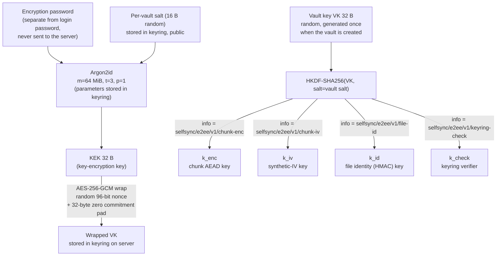
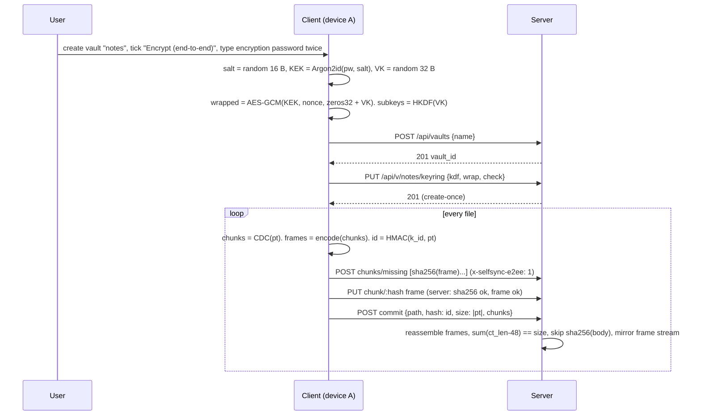
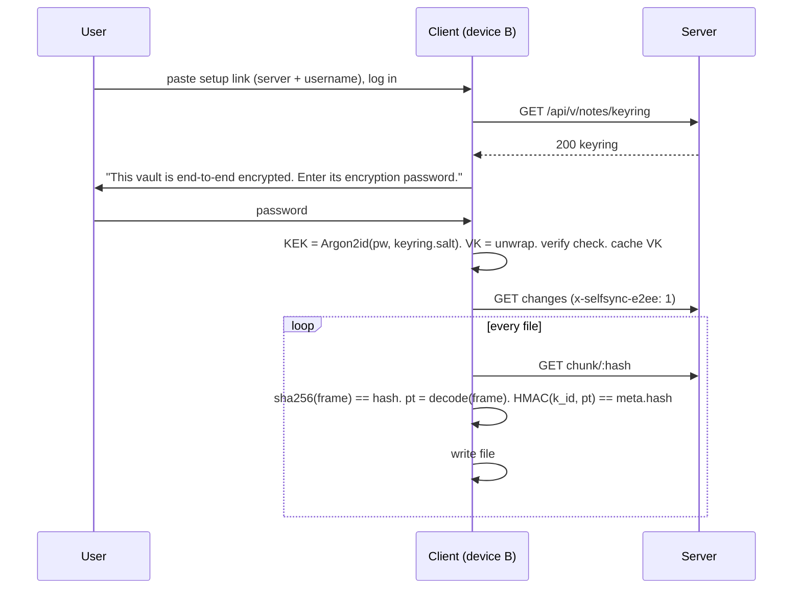
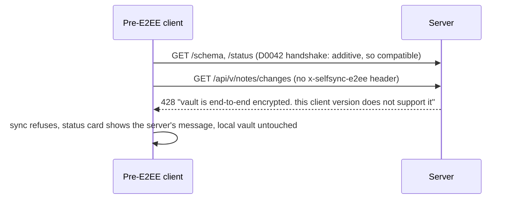

# SelfSync — optional client-side end-to-end encryption (design, revision 2)

**Date:** 2026-11-10 · **Status:** DESIGN under adversarial panel review (D0187) · **Charter:** st009
(owner, 2026-11-10), stories us012–us014 · **Supersedes:** the declined 2026-07-05 spec (D0009).
**Decisions this spec grounds:** D0096 (direction and scope), D0097 (construction and protocol),
D0098 (custody, sharing, migration). All three stay `proposed` until the owner accepts them.

This document is the artifact the panel reviews. Every claim about the code cites `file:line` at
HEAD `4f5d298`. The model (Need, UseCases, SystemRequirements, Decisions, tasks) is the truth. This
document is the readable design with its diagrams and its finding→resolution map.

---

## 1. Goal

An **optional, per-vault** mode in which note content is encrypted on the user's devices before
upload and decrypted only on the user's devices. A compromised, curious, or seized server (or
anyone with the data volume) cannot read note content. Off by default. Chosen when a vault is
created.

## 2. Threat model, stated plainly

| Protected (in an encrypted vault) | Not protected (documented, deliberate) |
|---|---|
| Content of every synced file, including `.obsidian/` config | File **paths**, **sizes** (within chunk granularity), **mtimes**, version numbers, device names, author |
| Integrity of content: a substituted, truncated, or reordered chunk set is detected on the client | **Equality of chunks within one vault** (same plaintext chunk gives the same ciphertext, so dedup works) |
| The encryption password and the vault key never leave the device | Freshness: the server can serve an older version (rollback). No competitor protects this either |
| Password change does not re-encrypt data | The local device: the vault key, the login token, and the three-way-merge base text live in `data.json` as today (client/src/settings.ts:49,64 and client/src/base.ts:22-24) |
| An old client cannot silently write plaintext into an encrypted vault, and cannot write ciphertext into the user's local vault (downgrade guard) | Timing and frequency of edits |

Trusted: the user's devices and the Obsidian runtime. Untrusted: the server, its disk, its operator,
and the network. TLS stays necessary for login credentials and tokens, which E2EE does not cover.

## 3. What exists today (the facts the design must respect)

- Content-defined chunking on the client: `client/src/chunker.ts:3,34-48` (MIN 2 KiB, AVG about 16 KiB,
  MAX 64 KiB). Chunk address = SHA-256 of the chunk bytes (`chunker.ts:17-20`).
- Push: `commitBytes` chunks, queries `missing`, PUTs missing chunks, then commits with
  `hash = sha256(plaintext file)` (`client/src/sync.ts:213-225`).
- Pull: `getVerifiedChunk` checks `sha256(bytes) == hash` before caching (`sync.ts:112-118`).
  `fetchFileBytes` reassembles (`sync.ts:125-127`). `streamFileToDisk` appends per chunk with an
  incremental SHA-256 (`sync.ts:139-160`, `client/src/streamhash.ts:20-56`).
- Reconcile decides by comparing hash strings: local, base, remote (`client/src/reconcile.ts:19-21`).
  Local hashes are computed at `640, 761, 1232, 1422`. Whole-file verify is at `786-799`.
- Server chunk store verifies `sha256(PUT bytes) == :hash` (`server/src/chunkstore.rs:77-82`).
- Server commit reassembles every chunk and needs `len == req.size && sha256(body) == req.hash`
  (`server/src/vault.rs:588-620`).
- Server writes a plaintext **mirror** of every committed file to `root/vault/<path>`
  (`vault.rs:104-123, 687-690`). **Reindex rebuilds the index from the mirror.** It reads each file
  and SHA-256s it. It re-chunks it with the server's port of the CDC chunker and stores the chunks
  (`vault.rs:464-473`, `server/src/chunker.rs:8-10`).
- Index rows hold path, hash, size, mtime, version, chunk list, provenance in SQLite
  (`server/src/index_store.rs:47-62`). The `meta` table is integer-valued only (`index_store.rs:47`).
- Shares: a Read grant can call `changes`, `chunk`, `meta` (`server/src/api.rs:101-119, 184-197`,
  `server/src/shares.rs:67-88`). A share link carries server + token only (`client/src/sharelink.ts:11-29`).
- Mounts wrap the same `SyncApi` (`client/src/mountio.ts:69-70, 88-105`).
- The setup wizard has **no** encryption field. The "seam" D0007 describes does not exist in code
  (`client/src/setupwizard.ts:93`, grep for encrypt/passphrase: zero hits).
- Client crypto today: `crypto.subtle.digest` only (`chunker.ts:20`). No AEAD, no KDF, no WASM.
  Server: `argon2 0.5`, `sha2`, `blake3` (unused) in `server/Cargo.toml:24-26`. No AEAD crate.
- The wire contract is signed and diffed directionally. Additive fields and endpoints are compatible.
  Removed or retyped fields break (D0042, `server/src/wire_signature.rs`).

## 4. Architecture

### 4.1 Key hierarchy



Why a random VK under a password-derived KEK, and not a password-derived content key: a password
change re-wraps 32 bytes instead of re-encrypting the vault. Sharing hands over a key, not a
password hash. This is the Bitwarden, Proton, and Standard Notes shape (see §5).

### 4.2 Chunk encryption (deterministic, so content-addressed dedup survives)

```
plaintext chunk  pt  (2–64 KiB, from the existing CDC chunker)
iv   = HMAC-SHA256(k_iv, pt)[0..12]                 synthetic IV: same pt gives same iv, same ct
body = 0x00 x 32 || pt                              key-commitment pad (Albertini et al. 2020)
ct   = AES-256-GCM(k_enc, iv, body, aad)            aad = "selfsync/e2ee/v1" || vault_id
frame = magic "SSE1" (4 B) || iv (12 B) || ct_len (4 B, LE) || ct (incl. 16 B tag)
chunk address = SHA-256(frame)                      the server's existing content address, unchanged
```

- The same plaintext under the same VK gives the same frame, so `missing` and dedup work exactly as
  now. The server learns which chunks are equal **within a vault**, and nothing else. It cannot
  confirm a guessed plaintext because the IV key is secret. This is keyed deterministic encryption,
  not plain convergent encryption (see §5 row 4).
- Two different plaintexts collide on a 96-bit IV with probability about n²/2⁹⁷. At 2²⁰ chunks that
  is 2⁻⁵⁷. A collision would reuse a GCM nonce under one key. The bound is why this is acceptable.
- The 32-byte zero pad makes decryption **key-committing**. A frame that authenticates under two keys
  cannot also start with 32 zero bytes under both. This closes the partitioning-oracle attack on a
  password-derived key hierarchy (Len, Grubbs, Ristenpart 2021). Cost: 32 B per chunk, about 0.2 %
  at the 16 KiB average.
- The frame is **self-delimiting without the key**. Magic and lengths let the server split a
  mirrored file back into its frames (§4.5), validate that an encrypted vault receives only frames
  (§4.6), and compute the plaintext size (`ct_len - 16 - 32`) without decrypting.

### 4.3 File identity (what `FileMeta.hash` means in an encrypted vault)

`hash = HMAC-SHA256(k_id, plaintext file)` (hex). It replaces `sha256(plaintext)` everywhere the
client compares identities (`reconcile.ts:19-21, 640, 761, 1232, 1422, 786-799` and `sync.ts:224`).

- Reconcile logic is unchanged. It still compares three identity strings.
- The server cannot compute it, so it stores it opaquely and **skips** the whole-file hash check for
  encrypted vaults. It keeps the per-chunk `sha256(frame)` check and the size check (§4.6).
- The client verifies the reassembled plaintext against it on every pull. A server that substitutes
  one valid chunk of the vault for another, drops a chunk, or reorders the list produces a plaintext
  whose HMAC does not match. The pull fails loudly and the local file is untouched. The per-chunk
  `sha256(frame)` check alone cannot give this, because the server knows every frame hash.
- `FileMeta.size` stays the **plaintext** size. The client already reconciles on it, and the server
  can verify it from the frame headers.

### 4.4 Keyring: the per-vault record the server stores but cannot open

```json
{
  "version": 1,
  "kdf":  { "alg": "argon2id", "m_kib": 65536, "t": 3, "p": 1, "salt": "<base64 16 B>" },
  "wrap": { "alg": "A256GCM", "nonce": "<base64 12 B>", "ct": "<base64 32 pad + 32 VK + 16 tag>" },
  "check": "<hex HMAC-SHA256(k_check, \"selfsync-keyring-v1\")>",
  "created_at": "2026-11-10T00:00:00Z", "created_by": "<server-authenticated username>"
}
```

- Stored as a sidecar `root/.keyring.json` next to `.version-hwm` (`vault.rs:279-296` is the
  pattern), **not** in the integer-only `meta` table.
- `created_by` is server-written from the authenticated user, as `author` is today.
- `check` lets a client tell "wrong password" from "corrupt keyring" before it touches content. It
  also lets an enrolled device detect a keyring the server swapped, because a different VK fails the
  check against the cached VK.

Endpoints (additive, so the D0042 compatibility verdict for existing clients is "compatible"):

| Route | Access | Semantics |
|---|---|---|
| `GET /api/v/:vault/keyring`, `GET /api/u/:owner/:vault/keyring` | Read grant | 200 keyring, 404 = vault is not encrypted |
| `PUT /api/v/:vault/keyring` | owner only | create-once (409 if present). Rotation is a later capability |

### 4.5 Server mirror and reindex for an encrypted vault

The mirror stays, because durability and reindex-from-disk are properties the operator relies on
(`docs/deployment.md:88-89`). For an encrypted vault the mirror holds the **frame stream** (the
concatenation of the committed frames) under the real path. A human on the server sees names, not
content.

For a vault whose `.keyring.json` exists, reindex splits each mirrored file by frame headers
instead of running the CDC chunker. The rebuilt chunk addresses then equal the client's, and dedup is
preserved. (`vault.rs:464-473` gains the frame-split branch. `vault.rs:618-620` gains the
encrypted-vault check of §4.6.)

### 4.6 Server-side verification and the downgrade guard

For a vault with a keyring (`encrypted = true`):

1. `PUT chunk`: `sha256(bytes) == :hash` as today **and** the bytes parse as one frame (magic,
   `ct_len` consistent with body length, `ct_len >= 48`). A plaintext chunk is refused with 422 and a
   message naming the cause.
2. `commit`: reassembly and chunk presence as today. `size` must equal the sum of
   `ct_len - 48` over the frames. The `sha256(body) == req.hash` check is **skipped**, because the
   hash is a keyed identity the server cannot compute.
3. `GET changes`, `GET chunk`, `GET meta`, `POST commit`, `PUT chunk`: the request must carry the
   header `x-selfsync-e2ee: 1`. Without it the server answers HTTP 428 with
   `"vault is end-to-end encrypted; this client version does not support it"`. A pre-E2EE client
   so fails at its first `changes` call with a visible error. It does not write ciphertext into the
   user's local vault or plaintext into the server's.

For a vault without a keyring nothing changes.

### 4.7 Client: one seam, the content codec

```ts
interface ContentCodec {
  readonly encrypted: boolean;
  encodeChunk(pt: Uint8Array): Promise<Uint8Array>;      // plaintext to frame (identity when plain)
  decodeChunk(frame: Uint8Array): Promise<Uint8Array>;   // frame to plaintext
  fileIdentity(pt: Uint8Array): Promise<string>;         // sha256 | HMAC(k_id)
  identityStream(): IdentityStream;                      // incremental form for streamFileToDisk
}
```

- `PlainCodec` reproduces today's behaviour byte for byte. `E2eeCodec` holds the three subkeys.
- Touch points: `commitBytes` (encode after chunking, identity over plaintext). `getVerifiedChunk`
  (verify `sha256(frame)`, then decode. The cache keeps **plaintext** keyed by frame hash, so cache
  semantics are unchanged). `streamFileToDisk` and the buffered `fetchVerified` (decode per chunk,
  identity over plaintext). The four local-identity sites in reconcile. Mounts and shares get the
  codec through the same `SyncCtx` and `SyncApi` construction (`client/src/main.ts:618, 3150, 3434`).
- `HttpTransport` sends `x-selfsync-e2ee: 1` on every vault-scoped request when the codec is
  encrypted.

### 4.8 Custody on the device

- The device stores **VK** (base64) in `data.json`, never the encryption password. This matches the
  existing custody of the login token (`settings.ts:64`) and of the merge base text. Obsidian has no
  keychain API for plugins.
- The device setup link (server + username) and the share link (server + token) **never** carry VK or
  the password. A second device, or a collaborator, types the encryption password once. The client
  fetches the keyring, derives KEK, unwraps VK, checks `check`, and caches VK.
- Wrong password: unwrap fails (GCM tag) and the client says so. No content is touched.

### 4.9 Sequence: first device creates an encrypted vault



### 4.10 Sequence: second device joins



### 4.11 Sequence: old client meets an encrypted vault



## 5. Comparison with published practice, and the revisions it caused

| # | Topic | Revision 1 (first draft, and the 2026-07-05 spec) | Published practice | Revision 2 (adopted) |
|---|---|---|---|---|
| 1 | Content key | Derived directly from the password: `Argon2id(pw, salt)` as the chunk key | Bitwarden, Proton, Standard Notes 004, Cryptomator: a **random** content or master key wrapped by a password-derived KEK. Password change re-wraps only | Random VK wrapped by KEK (§4.1). Password change = re-wrap. Sharing = hand over VK, not a password hash |
| 2 | Subkeys | One key for everything | Cryptomator: separate encryption and MAC keys. Standard Notes: per-purpose keys. NIST SP 800-108 and HKDF | HKDF-SHA256 from VK with distinct `info` strings for enc, IV, file identity, keyring check |
| 3 | Cipher | XChaCha20-Poly1305 via a JS or WASM lib | Obsidian Sync: AES-256-GCM. Cryptomator: AES-GCM. LiveSync: WebCrypto AES-GCM. Both AES-GCM and XChaCha are sound. The difference is nonce size and runtime availability | **AES-256-GCM via WebCrypto** (native on Electron and both mobile WebViews, no bundle, no CSP or WASM exposure). The 96-bit nonce is safe here because IVs are synthetic and per-key budgets are small (§4.2 bound) |
| 4 | Dedup vs confidentiality | Convergent: nonce from the plaintext hash | Plain convergent encryption (key from plaintext) is brute-forceable for low-entropy content. DupLESS adds a secret-keyed PRF so only equality leaks, and only to a party without the key | Synthetic IV from **HMAC(k_iv, pt)** with a secret key: equality leaks within a vault only. No offline confirmation of guessed notes |
| 5 | Key commitment | Not considered | Len, Grubbs, Ristenpart 2021: AES-GCM and ChaCha-Poly are not key-committing, and password-derived keys are the exploitable case. Albertini et al. 2020: a zero-block pad gives commitment cheaply | 32-byte zero pad inside every AEAD body, including the VK wrap (§4.2, §4.4) |
| 6 | Integrity of the chunk list | Per-chunk content-address check only | Cryptomator binds each chunk to a file header nonce and chunk number via AAD. Standard Notes authenticates the whole item | Keyed file identity `HMAC(k_id, pt)` in `FileMeta.hash` detects substitution, truncation, reorder (§4.3). Per-chunk AAD binding to the file was rejected because it breaks cross-file dedup and makes a rename a full re-upload |
| 7 | KDF | Argon2id, parameters unstated, library unstated | OWASP: Argon2id at least 19 MiB, t=2, p=1. Bitwarden default 64 MiB, t=3, p=4. WebCrypto has no Argon2 | Argon2id **64 MiB, t=3, p=1** from `@noble/hashes` (audited, pure JS, no WASM, no CSP risk). Runs once per device enrolment. A few seconds on a phone is acceptable. Parameters are stored in the keyring so they can rise later |
| 8 | Wrong-password detection | Decrypt a chunk and see | Obsidian Sync and Cryptomator: a verifier independent of content | `check` field (§4.4): wrong password and corrupt or swapped keyring are told apart before any content is read |
| 9 | Downgrade protection | None | Signal and Matrix: capability negotiation fails closed. D0042 in this repo: fail closed on unknown contract | 428 unless `x-selfsync-e2ee: 1`. The server refuses plaintext chunks into an encrypted vault (§4.6) |
| 10 | Paths and structure | Visible (content-only) | Obsidian Sync: content-only. LiveSync: optional path obfuscation. Cryptomator: full name encryption | **Content-only in v1**, deliberately. It keeps the readable mirror tree, conflict naming, and the mount and share path semantics intact. Path encryption is a separable later layer and is recorded as such |
| 11 | Migration of an existing vault | In-place "encrypt this vault" re-upload | Obsidian Sync: encryption chosen at remote-vault creation. LiveSync: rebuild the remote | **Chosen at vault creation** (§6). Encrypting an existing vault = create an encrypted vault, switch to it with the existing upload flow, delete the old vault. No new migration code, no plaintext residue after the delete |
| 12 | Revocation of a collaborator | Not considered | Bitwarden org key: removal is ACL-only until the key rotates. Proton: re-encrypt the vault key for the remaining members | v1: ACL revocation only (the server stops serving). Cryptographic revocation needs VK rotation and is tracked as a follow-up, stated honestly in the UI copy |
| 13 | Local custody | Password cached | Obsidian Sync and LiveSync keep the key or passphrase in app storage. No plugin keychain exists | VK cached, password never (§4.8) |
| 14 | Recovery | Lose the password, lose the data | Obsidian Sync: same. Bitwarden: optional recovery code | v1: same as Obsidian Sync, with a double-entry password field and an explicit warning. A recovery key is a tracked follow-up, not v1 |

## 6. Scope of v1 and what is explicitly not in it

**In v1:**
- Encrypted vault creation (wizard and "create vault" dialog).
- Second-device join. Shared-vault join with the password.
- All push and pull paths (buffered and streamed). Config sync rides the same pipeline.
- The keyring endpoints. Server frame validation. The downgrade guard. Reindex of an encrypted vault.
- The `docs/deployment.md` trust-model update and the CMMC posture note.

**Not in v1 (each a tracked task, not a silent omission):**
1. Mounting an **encrypted** source vault into a composed vault: refused with a clear message.
2. VK rotation (cryptographic revocation, password compromise).
3. Path and structure encryption.
4. Recovery key.
5. In-place encryption of an existing vault (the create-switch-delete route covers the need).

## 7. Implementation plan (sprints, Fibonacci points)

| Sprint | Deliverable | Pts |
|---|---|---|
| E1 | `client/src/e2ee/` crypto core: KDF, keyring wrap, unwrap and check, HKDF subkeys, frame encode and decode, keyed identity (incremental too). Property tests: round-trip, determinism, tamper detection, commitment pad, cross-check against a Rust test vector | 5 |
| E2 | Server: keyring sidecar and endpoints, frame parser, encrypted-vault commit and PUT rules, 428 guard, reindex frame-split, wire signature regenerated, tests | 5 |
| E3 | Client wiring: `ContentCodec` seam through `commitBytes`, pull, stream, reconcile. Header on transport. VK custody in settings. Wizard, create-vault and join prompts. Refuse encrypted mounts. Docs | 8 |
| E4 | Real-server e2e: two clients, encrypted vault, push, pull, merge, conflict, config. Old-client 428 arm. Release | 3 |

## 8. Open points for the owner (not blocking the panel)

1. Argon2id memory: 64 MiB is the proposed default. Lower it to 32 MiB if the real-device perf
   protocol (`docs/architecture/93-real-device-perf-protocol.md`) shows a phone taking more than
   about 8 s.
2. Whether a shared vault's guests should see the "encrypted" badge before they have the password.

## 9. Finding to resolution map (panel rounds)

Filled in as rounds complete. Each row: panelist, finding number, severity, resolution or
evidence-backed refutation, verified by.

| Round | Panelist | # | Sev | Finding | Resolution |
|---|---|---|---|---|---|
| — | — | — | — | (round 1 pending) | — |

## Sources

- Obsidian Sync encryption: https://obsidian.md/blog/verify-obsidian-sync-encryption/ and
  https://help.obsidian.md/sync/security
- Cryptomator architecture: https://docs.cryptomator.org/security/architecture/
- Standard Notes 004: https://standardnotes.com/help/security/encryption
- Bitwarden key hierarchy: https://contributing.bitwarden.com/architecture/cryptography/crypto-guide
- Proton Pass sharing model: https://proton.me/blog/proton-pass-security-model
- Partitioning oracle attacks (Len, Grubbs, Ristenpart, USENIX Security 2021): https://www.usenix.org/conference/usenixsecurity21/presentation/len
- Key commitment fix by padding (Albertini et al.): https://eprint.iacr.org/2020/1456
- DupLESS (server-aided keyed deduplication): https://eprint.iacr.org/2013/429
- NIST SP 800-38D §8.3 random-IV budget: https://csrc.nist.gov/publications/detail/sp/800-38d/final
- OWASP Password Storage Cheat Sheet (Argon2id minimums): https://cheatsheetseries.owasp.org/cheatsheets/Password_Storage_Cheat_Sheet.html
- hash-wasm and argon2 in browsers: https://github.com/Daninet/hash-wasm and `@noble/hashes`: https://github.com/paulmillr/noble-hashes
- LiveSync E2EE overview: https://deepwiki.com/vrtmrz/obsidian-livesync/6.3-end-to-end-encryption
