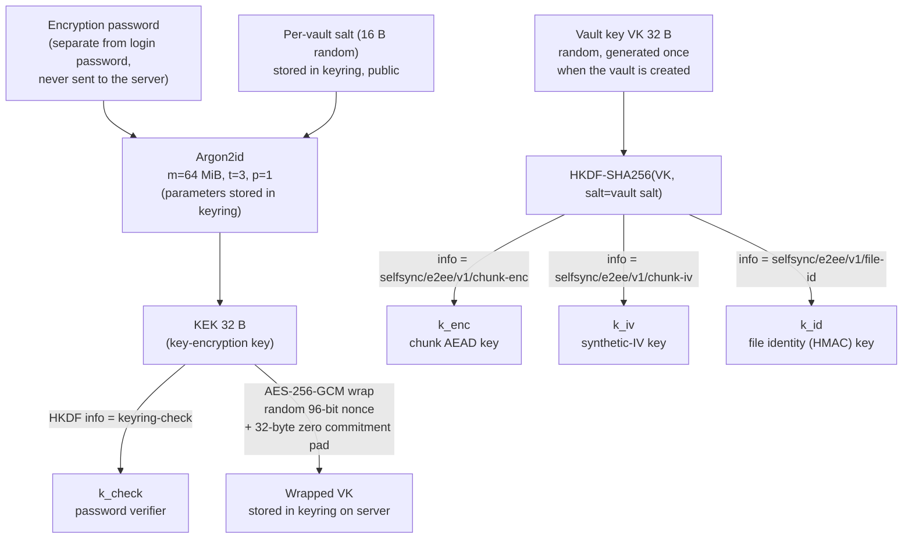
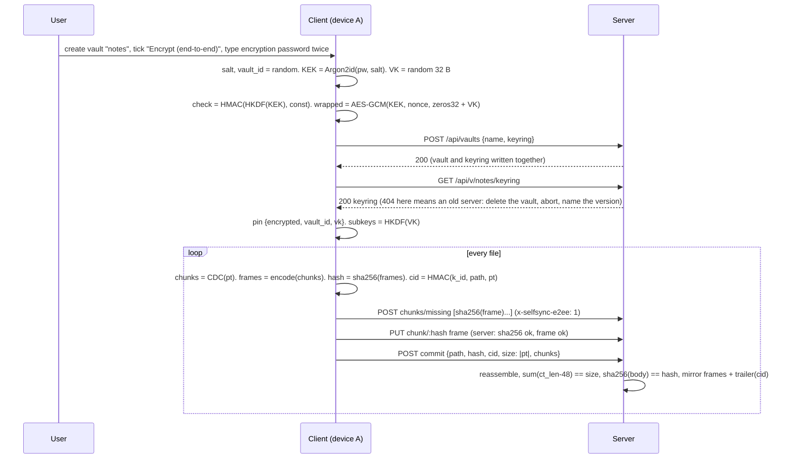
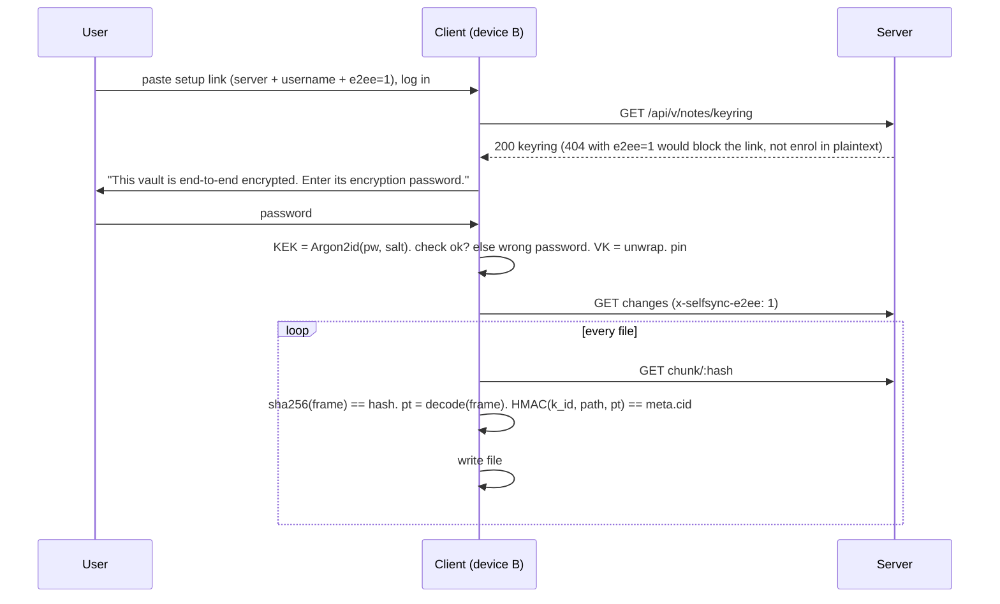
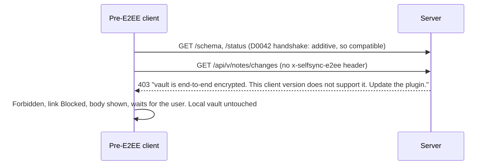

# SelfSync — optional client-side end-to-end encryption (design, revision 3)

**Date:** 2026-11-10 · **Status:** DESIGN, panel round 2 (D0187) · **Charter:** st009 (owner,
2026-11-10), stories us012–us014 · **Supersedes:** the declined 2026-07-05 spec (D0009).
**Decisions this spec grounds:** D0096 (direction and scope), the D0097 clause chain (construction
and protocol) and the D0098 clause chain (custody, sharing, migration). All stay `proposed` until
the owner accepts them.

This document is the artifact the panel reviews. Every claim about the code cites `file:line` at
HEAD `6de495c` (source files unchanged since `4f5d298`). The model (Need, UseCases,
SystemRequirements, Decisions, tasks) is the truth. This document is the readable design with its
diagrams and its finding→resolution map (§10).

**What changed in revision 3** (round-1 panel, 7 of 7 OBJECT):
- the file identity split (§4.3) and the mirror trailer so reindex rebuilds a whole row (§4.5).
- the keyring pinned on the device so a 404 can never downgrade (§4.8).
- `check` derived from the KEK, atomic vault creation (§4.4), a random `vault_id` (§4.2).
- a path-bound identity (§4.3), 403 instead of 428 (§4.6), the chunk cache keyed by codec (§4.7).
- honest residue and fingerprint statements (§2), the Obsidian Sync precedent corrected (§5).
- password change restructured (§6) and E3 split (§7).

---

## 1. Goal

An **optional, per-vault** mode in which note content is encrypted on the user's devices before
upload and decrypted only on the user's devices. A compromised, curious, or seized server (or
anyone with the data volume) cannot read note content. Off by default. Chosen when a vault is
created.

## 2. Threat model, stated plainly

| Protected (in an encrypted vault) | Not protected (documented, deliberate) |
|---|---|
| Content of every synced file, including `.obsidian/` config | File **paths**, **sizes**, **mtimes**, version numbers, device names, author |
| Integrity of a file: a chunk substituted, dropped or reordered inside a file, or a file's content served under another path, is detected on the client | **Chunk equality within one vault** (same plaintext chunk gives the same frame, so dedup works) |
| The encryption password and the vault key never leave the device | **Chunk-length sequence**: CDC boundaries are a public function of the plaintext, and every frame exposes its length. For a file over 2 KiB this is a fingerprint. A server can test "is document X in this vault" by chunking X and matching lengths |
| An old client cannot write plaintext into an encrypted vault, and cannot write ciphertext into the user's local vault | **Freshness and version mix**: the server can serve an older version of a file (rollback). No competitor protects this either |
| An enrolled device never silently falls back to plaintext when the server answers that the vault is not encrypted | **Offline password guessing**: anyone with the keyring (a Read grant, a backup, the disk) can run Argon2id against the wrapped key. Argon2id cost and the password floor (§4.9) are the only brakes |
| | **The local device**: the vault key, the login token and the three-way-merge base text live in `data.json` as today (`client/src/settings.ts:49,64`, `client/src/base.ts:22-24`) |
| | **Timing and frequency of edits**. **Pre-encryption copies**: an earlier plaintext vault is deleted, not scrubbed, and earlier operator backups still hold it (§6) |

Trusted: the user's devices and the Obsidian runtime. Untrusted: the server, its disk, its operator,
and the network. TLS stays necessary for login credentials and tokens, which E2EE does not cover.

## 3. What exists today (the facts the design must respect)

- Content-defined chunking on the client: `client/src/chunker.ts:3,34-48` (MIN 2 KiB, AVG about
  16 KiB, MAX 64 KiB). Chunk address = SHA-256 of the chunk bytes (`chunker.ts:17-20`). An empty file
  yields one empty chunk (`chunker.ts:45`).
- Push: `commitBytes` chunks, queries `missing`, PUTs missing chunks, then commits with
  `hash = sha256(plaintext file)` (`client/src/sync.ts:209-225`).
- Pull: `getVerifiedChunk` checks `sha256(bytes) == hash` before caching (`sync.ts:112-118`).
  `fetchFileBytes` reassembles (`sync.ts:125-127`). `streamFileToDisk` appends per chunk with an
  incremental SHA-256 and verifies before rename (`sync.ts:134-160`, `client/src/streamhash.ts:20-56`).
- Reconcile decides by comparing hash strings: local, base, remote (`client/src/reconcile.ts:19-21`).
  Local identity sites that feed or compare `FileMeta.hash`: `reconcile.ts:640, 761, 1078, 1232, 1321,
  1422`, `reconcile.ts:787-800` (whole-file verify), `client/src/main.ts:842, 1225` (switch preview).
  The `normalizedHash` family (`reconcile.ts:616-650, 1247, 1442`) compares local bytes with local
  base text only and keeps plain SHA-256.
- Server chunk store verifies `sha256(PUT bytes) == :hash` (`server/src/chunkstore.rs:77-82`).
- Server commit reassembles every chunk, aborts when the running total exceeds `req.size`
  (`server/src/vault.rs:606-617`) and needs `len == req.size && sha256(body) == req.hash`
  (`vault.rs:618-620`).
- Server writes a plaintext **mirror** of every committed file to `root/vault/<path>`
  (`vault.rs:104-123, 687-690`). The mirror comment states its purpose: if the index is lost, reindex
  rebuilds from the mirror (`vault.rs:108-111`). A corrupt index is quarantined and rebuilt at open
  with no operator action (`vault.rs:205-270`). The rebuild reads each mirrored file, SHA-256s it,
  re-chunks it with the server's CDC port, and version-preserves on `old.hash == hash`
  (`vault.rs:464-482`). A healthy index never reads the mirror (`vault.rs:445-451`).
- Index rows hold path, hash, size, mtime, version, chunk list, provenance in SQLite
  (`server/src/index_store.rs:47-62`). The `meta` table is integer-valued only (`index_store.rs:47`).
- Vaults are keyed by `(owner, name)`. `POST /api/vaults` returns a bare status with no id
  (`server/src/vaults.rs:15-41`). A delete tombstone is cleared by a deliberate recreate
  (`vaults.rs:35-38`).
- Shares: a Read grant can call `changes`, `chunk`, `meta` (`server/src/api.rs:101-119, 124-130,
  184-197`, `server/src/shares.rs:67-88`). A share link carries server + token only
  (`client/src/sharelink.ts:11-29`).
- Mounts wrap the same `SyncApi` and rewrite paths to the source vault (`client/src/mountio.ts:69-70,
  76-105`). The primary and every mount share one `ChunkCache` (`client/src/main.ts:422, 3185-3188`).
- Old-client error handling: an unknown 4xx is `ServerDegraded` and retries slowly. A 403 is
  `Forbidden`, which blocks the link and waits for the user (`client/src/connstate.ts:90-107, 112-124`).
- The setup wizard has **no** encryption field (`client/src/setupwizard.ts:93`). The only
  `encrypt` hits in `client/src` are the "unencrypted http" TLS refusals.
- Client crypto today: `crypto.subtle.digest` only (`chunker.ts:20`). No AEAD, no KDF, no WASM.
  Server: `argon2 0.5`, `sha2`, `blake3` (unused) in `server/Cargo.toml:24-26`. No AEAD crate.
- The wire contract is signed and diffed directionally (D0042, `server/src/wire_signature.rs`,
  `client/src/wiresignature.ts:15-22, 117-126`). The gate does not see a new response field, a new
  optional request field, a new endpoint, or a new request header. All four are compatible.

## 4. Architecture

### 4.1 Key hierarchy



Why a random VK under a password-derived KEK, and not a password-derived content key? A password
change re-wraps 32 bytes instead of re-encrypting the vault. Sharing hands over a key, not a
password hash. This is the Bitwarden, Proton, and Standard Notes shape (see §5). `k_check` derives
from the **KEK**, not from VK, which is Cryptomator's shape. So it can be tested before any unwrap
(§4.4).

### 4.2 Chunk encryption (deterministic, so content-addressed dedup survives)

```
plaintext chunk  pt  (0–64 KiB, from the existing CDC chunker)
iv   = HMAC-SHA256(k_iv, pt)[0..12]                 synthetic IV: same pt gives same iv, same ct
body = 0x00 x 32 || pt                              key-commitment pad (Albertini et al. 2020)
ct   = AES-256-GCM(k_enc, iv, body, aad)            aad = "selfsync/e2ee/v1" || keyring.vault_id
frame = magic "SSE1" (4 B) || iv (12 B) || ct_len (4 B, LE) || ct (incl. 16 B tag)
chunk address = SHA-256(frame)                      the server's existing content address, unchanged
```

- Per-chunk overhead: 4 + 12 + 4 + 16 + 32 = 68 B, about 0.41 % at the 16 KiB average. A zero-byte
  file is one 68-byte frame with `size 0`.
- `vault_id` is a random 16-byte value minted by the client at creation and stored in the keyring.
  Vaults have no id on the wire today (§3), and the two route families name a vault differently.
  A random id gives both routes one AAD and gives a same-name recreate a new AAD and a new VK.
- The same plaintext under the same VK gives the same frame, so `missing` and dedup work exactly as
  now. The server learns which chunks are equal **within a vault**, and nothing else. It cannot
  confirm a guessed plaintext from the ciphertext, because the IV key is secret. It can match a
  guessed document by its chunk-length sequence (§2).
- Two different plaintexts collide on a 96-bit IV with probability about n²/2⁹⁷. At 2²⁰ chunks that
  is 2⁻⁵⁷. A collision would reuse a GCM nonce under one key. The bound is why this is acceptable.
- The 32-byte zero pad makes decryption **key-committing**. A frame that authenticates under two keys
  cannot also start with 32 zero bytes under both. `decodeChunk` verifies the tag, then checks all 32
  pad bytes, then recomputes `iv` from the plaintext and compares. Only then is plaintext released or
  cached. This closes the partitioning-oracle attack on a password-derived key hierarchy (Len,
  Grubbs, Ristenpart 2021).
- The frame is **self-delimiting without the key**. Magic and lengths let the server split a
  mirrored file back into its frames (§4.5), validate that an encrypted vault receives only frames
  (§4.6), and compute the plaintext size (`ct_len - 48`) without decrypting.

### 4.3 File identity, split in two

Revision 2 put a keyed HMAC into `FileMeta.hash`. Five panelists showed the server then cannot
verify a commit or rebuild a row from the mirror. Revision 3 keeps two identities.

| Field | Value in an encrypted vault | Who computes | Who verifies |
|---|---|---|---|
| `FileMeta.hash` (exists) | `sha256(frame_1 ‖ … ‖ frame_n)`, the frame stream | client and server | server at commit (`vault.rs:618`, unchanged), reindex, `classify_missing` |
| `FileMeta.cid` (new, optional, additive) | `HMAC-SHA256(k_id, len(path) ‖ path ‖ pt)` (hex) | client only | client on every pull, before the file is written |
| `FileMeta.size` (exists) | plaintext size | client | server from frame headers (§4.6), client as today |

- Reconcile is unchanged in logic. For an encrypted vault the client's identity string is `cid`.
  `decide()` compares local `cid`, base `cid`, remote `cid`. The codec exposes
  `fileIdentity(path, pt)`. For a plaintext vault it returns `sha256(pt)` and `cid` is absent.
- `path` is the **source-vault path**. `MountedApi` rewrites paths (`mountio.ts:76-85`), so the
  codec hashes the path the server stores, never the local mount path.
- A rename is a delete plus a create with a new `cid`. Its chunks dedup, so the cost is one commit.
- What the client now detects on pull: a chunk substituted, dropped or reordered inside a file, and a
  file's content served under another path. What it cannot detect: an older version of the same
  path served as current (§2, freshness).
- The server stores `cid` opaquely in the index row and returns it in `changes` and `meta`. For an
  encrypted vault a commit without `cid` is refused (§4.6).

### 4.4 Keyring: the per-vault record the server stores but cannot open

```json
{
  "version": 1,
  "vault_id": "<base64 16 B random>",
  "kdf":  { "alg": "argon2id", "m_kib": 65536, "t": 3, "p": 1, "salt": "<base64 16 B>" },
  "check": "<hex HMAC-SHA256(HKDF(KEK, info=keyring-check), \"selfsync-keyring-v1\")>",
  "wrap": { "alg": "A256GCM", "nonce": "<base64 12 B>", "ct": "<base64 32 pad + 32 VK + 16 tag>" },
  "created_at": "2026-11-10T00:00:00Z", "created_by": "<server-authenticated username>"
}
```

- Stored as a sidecar `root/.keyring.json` next to `.version-hwm` (`vault.rs:279-292` is the
  pattern), **not** in the integer-only `meta` table.
- `created_by` is server-written from the authenticated user, as `author` is today.
- Three outcomes a joining device tells apart, in this order and before any content is read:
  the record does not parse → **corrupt keyring**. `check` does not match → **wrong password**.
  `check` matches but the wrap's tag fails → **corrupt keyring**. An enrolled device also compares
  the fetched `vault_id` with its pinned one. A mismatch → **keyring changed**, link blocked.
- **Atomic creation.** `POST /api/vaults {name, keyring?}` creates the vault and its keyring in one
  call. There is no window in which the vault exists without its keyring. `keyring` is an optional
  request field, so the change is additive.
- **Old server.** An old server ignores the field and creates a plaintext vault. So the client reads
  `GET keyring` after creation. On 404 it deletes the vault, discards the generated VK, and names the
  minimum server version. No commit happens before that check passes.
- **No `PUT keyring` and no `DELETE keyring` in v1.** The keyring lives and dies with the vault.
  Re-wrap (password change) and rotation are tracked follow-ups (§6).

Endpoints (additive):

| Route | Access | Semantics |
|---|---|---|
| `GET /api/v/:vault/keyring`, `GET /api/u/:owner/:vault/keyring` | Read grant | 200 keyring, 404 = vault is not encrypted |
| `POST /api/vaults {name, keyring?}` | owner | create vault and keyring atomically (409 if the name exists) |

### 4.5 Server mirror and reindex for an encrypted vault

The mirror stays, because reindex-from-disk is the durability property the mirror exists for
(`vault.rs:108-111`). For an encrypted vault the mirror file holds the **frame stream followed by a
trailer**: `frame_1 ‖ … ‖ frame_n ‖ "SSEM" ‖ cid (32 B)`. A human on the server sees names, not
content.

For a vault whose `.keyring.json` exists, the corrupt-index rebuild splits each mirrored file by
frame headers, stores the frames as chunks, sets `hash = sha256(frames)`, `size = Σ(ct_len − 48)`,
and `cid` from the trailer. The rebuilt row equals the committed row, so every client verifies it.
A mirror file that does not parse (truncated, no trailer, bad magic) is skipped and logged, never
ingested. The host-filesystem edit feature of the mirror (`vault.rs:632-636`) is unavailable for an
encrypted vault, and `docs/deployment.md` says so.

### 4.6 Server-side verification and the downgrade guard

For a vault with a keyring (`encrypted = true`):

1. `PUT chunk`: `sha256(bytes) == :hash` as today **and** the bytes parse as one frame (magic,
   `ct_len` consistent with body length, `ct_len >= 48`, body ≤ `MAX_CHUNK_BYTES`). A plaintext chunk
   is refused with 422 and a message naming the cause.
2. `commit`: the running-total guard (`vault.rs:606-617`) accumulates plaintext length
   (`ct_len − 48` per frame) against `req.size`. Final checks: `Σ(ct_len − 48) == req.size`,
   `sha256(body) == req.hash` (unchanged), and `req.cid` present. The mirror receives the frame
   stream plus trailer.
3. **Downgrade guard inside `scoped()`** (`api.rs:26-31`), so every vault-scoped route inherits it,
   with an allow-list of `status` and `GET keyring`. A request on an encrypted vault without the
   header `x-selfsync-e2ee: 1` is answered **HTTP 403** with the body
   `vault is end-to-end encrypted. This client version does not support it. Update the plugin.`
   A pre-E2EE client maps 403 to `Forbidden`, blocks the link, shows the body, and waits for the user
   (`connstate.ts:95-96, 118-124`). It does not write ciphertext into the user's vault or plaintext
   into the server's. A test enumerates the router and asserts the guard on every vault-scoped route.
4. `DELETE /api/vault` removes the keyring with the vault. No other route deletes it.

For a vault without a keyring nothing changes.

### 4.7 Client: one seam, the content codec

```ts
interface ContentCodec {
  readonly tag: "plain" | string;                                  // cache namespace (E2EE: hex of vault_id)
  readonly encrypted: boolean;
  encodeChunk(pt: Uint8Array): Promise<Uint8Array>;               // plaintext to frame (identity when plain)
  decodeChunk(frame: Uint8Array): Promise<Uint8Array>;            // frame to plaintext (tag, pad, iv checks)
  fileIdentity(path: string, pt: Uint8Array): Promise<string>;    // sha256(pt) | HMAC(k_id, path, pt)
  identityStream(path: string): IdentityStream;                   // incremental form for streamFileToDisk
  fileHash(frames: Uint8Array[]): Promise<string>;                // FileMeta.hash: sha256 of the stream
}
```

- `PlainCodec` reproduces today's behaviour byte for byte. `E2eeCodec` holds the three subkeys.
- **Cache.** `ChunkCache` keys become `tag ‖ ":" ‖ hash`. A plain primary and an encrypted mount,
  or two mounts with different keys, never share an entry. `commitBytes` caches plaintext under the
  **frame** hash after encoding, never under `sha256(pt)`.
- Touch points: `commitBytes` (encode after chunking, `hash` over frames, `cid` over path and
  plaintext). `getVerifiedChunk` (verify `sha256(frame)`, then decode, then cache). `streamFileToDisk`
  and the buffered `fetchVerified` (decode per chunk, `cid` over plaintext, `written` counts
  plaintext). The identity sites listed in §3. A lint test fails on any `sha256hex` import outside
  `chunker.ts`, the codec, and `streamhash.ts` (D0047: a correction becomes a guard).
- `HttpTransport` sends `x-selfsync-e2ee: 1` on every vault-scoped request when the codec is
  encrypted.
- `Sha256` in `streamhash.ts` gains `digest(): Uint8Array` so an incremental HMAC can wrap it.

### 4.8 Custody on the device, pinned

- At enrolment the device stores, per vault, `{ encrypted: true, vaultId, vk }` in `data.json`. It
  never stores the encryption password. This matches the existing custody of the login token
  (`settings.ts:64`) and of the merge base text. Obsidian has no keychain API for plugins.
- **The pin wins over the server.** On every connect the client reads `GET keyring`. For a pinned
  vault, a 404, a different `vault_id`, or a parse failure blocks the link with a named reason. The
  codec is never changed by a server answer. This closes the operator-deleted-keyring, the
  restored-old-backup, the same-name-recreate, and the lying-server cases.
- The device setup link and the share link gain a flag `e2ee=1` and never carry VK or the password.
  A joining device that sees the flag and receives 404 on `GET keyring` fails closed with a named
  reason, instead of enrolling in plaintext.
- A second device, or a collaborator, types the encryption password once. The client fetches the
  keyring, derives KEK, checks `check`, unwraps VK, pins `{vaultId, vk}`.
- Secrets never reach a log line, the audit log, an error body, a conflict-copy name, or a
  composition recipe: password, KEK, VK, subkeys. A grep test pins this.

### 4.9 Password floor and KDF cost

- The creation dialog refuses an encryption password under 12 characters and refuses a password
  equal to the login password. The dialog asks twice and states that a lost password loses the data.
- Argon2id runs once per device enrolment and once per wrong-password retry. The dialog shows
  progress during derivation. The real-device perf protocol gains a row: KDF wall time and peak
  memory on desktop, iOS and Android. The 64 MiB default drops to 32 MiB if a phone needs more than
  about eight seconds. The parameters live in the keyring, so raising them later is a re-wrap.

### 4.10 Sequence: first device creates an encrypted vault



### 4.11 Sequence: second device joins



### 4.12 Sequence: old client meets an encrypted vault



## 5. Comparison with published practice, and the revisions it caused

| # | Topic | Revision 1 (first draft, and the 2026-07-05 spec) | Published practice | Adopted (revision 3) |
|---|---|---|---|---|
| 1 | Content key | Derived directly from the password | Bitwarden, Proton, Standard Notes 004, Cryptomator: a **random** content or master key wrapped by a password-derived KEK | Random VK wrapped by KEK (§4.1) |
| 2 | Subkeys | One key for everything | Cryptomator: separate encryption and MAC keys. Standard Notes: per-purpose keys. NIST SP 800-108 and HKDF | HKDF-SHA256 from VK: enc, IV, file identity. `k_check` from the KEK |
| 3 | Cipher | XChaCha20-Poly1305 via a JS or WASM lib | Obsidian Sync: AES-256-GCM with scrypt and HKDF. Cryptomator: AES-GCM. LiveSync: WebCrypto AES-GCM | **AES-256-GCM via WebCrypto** (native on Electron and both mobile WebViews, no bundle). Synthetic IVs keep the 96-bit nonce safe (§4.2 bound) |
| 4 | Dedup vs confidentiality | Convergent: nonce from the plaintext hash | Plain convergent encryption is brute-forceable for low-entropy content. DupLESS adds a secret-keyed PRF | Synthetic IV from **HMAC(k_iv, pt)** with a secret key. Equality leaks within a vault. The chunk-length fingerprint is stated, not hidden (§2) |
| 5 | Key commitment | Not considered | Len, Grubbs, Ristenpart 2021. Albertini et al. 2020: a zero-block pad gives commitment cheaply | 32-byte zero pad, checked after the tag and before release, in every frame and in the wrap |
| 6 | Integrity of the chunk list | Per-chunk content-address check only | Cryptomator binds chunks to a file header. Standard Notes authenticates the whole item | Path-bound keyed identity `cid` (§4.3) plus the server-verifiable stream hash. Per-chunk AAD binding to the file was rejected: it breaks cross-file dedup |
| 7 | KDF | Argon2id, parameters and library unstated | OWASP: Argon2id at least 19 MiB, t=2, p=1. Bitwarden's Argon2id option defaults to 64 MiB, t=3, p=4. WebCrypto has no Argon2 | Argon2id **64 MiB, t=3, p=1** from `@noble/hashes`. Its `argon2` module is **outside** the Cure53 audit scope (README). Accepted because it runs once per enrolment and feeds only the KEK. Parameters live in the keyring |
| 8 | Wrong-password detection | Decrypt a chunk and see | Cryptomator: `versionMac`, a verifier independent of content | `check` from the KEK (§4.4): wrong password, corrupt keyring and changed keyring are told apart before any content is read |
| 9 | Downgrade protection | None | Signal and Matrix: capability negotiation fails closed. D0042 in this repo | 403 inside `scoped()` unless `x-selfsync-e2ee: 1`. Frame validation on PUT. Pinned custody on the device (§4.8) |
| 10 | Paths and structure | Visible (content-only) | **Obsidian Sync encrypts paths** (its security page lists only device, time and the path↔content mapping as visible). LiveSync: optional path obfuscation. Cryptomator: full name encryption | **Content-only in v1**, on this repo's own grounds: the readable mirror tree, conflict naming by path, mount and share path semantics. Path encryption is a tracked follow-up |
| 11 | Migration of an existing vault | In-place re-upload | Obsidian Sync: chosen at remote-vault creation. LiveSync: rebuild the remote | **Chosen at vault creation**. Encrypting an existing vault = create, switch, delete. The old copy is deleted, not scrubbed, and earlier backups keep it (§6) |
| 12 | Revocation of a collaborator | Not considered | Bitwarden org key: ACL-only until rotation. Proton: re-encrypt the vault key for the rest | v1: ACL revocation only. Rotation is a tracked follow-up. The UI copy says so |
| 13 | Local custody | Password cached | Obsidian Sync and LiveSync keep the key or passphrase in app storage | VK pinned with `vault_id`, password never (§4.8) |
| 14 | Recovery | Lose the password, lose the data | Obsidian Sync: same. Bitwarden: optional recovery code | v1: same as Obsidian Sync, double entry, explicit warning, 12-character floor. A recovery key is a tracked follow-up |

## 6. Scope of v1 and what is explicitly not in it

**In v1:**
- Encrypted vault creation (wizard and "create vault" dialog), atomic with its keyring.
- Second-device join. Shared-vault join by a **different account** through a share link.
- All push and pull paths (buffered and streamed). Config sync rides the same pipeline.
- `GET keyring`, atomic create, server frame validation, the 403 guard, the mirror trailer and the
  reindex rebuild for an encrypted vault.
- The `docs/deployment.md` trust-model update (custody, upgrade order server-first, keyring in
  backups, pre-encryption backups still hold plaintext, host-FS edits unavailable) and the CMMC
  posture note.

**Not in v1 (each a tracked task):**
1. `e2eeEncryptedMountSource`: mounting an encrypted source vault. v1 refuses with a clear message.
2. `e2eePasswordChange`: a re-wrap route with compare-and-swap on `check`, and a settings action.
   The key hierarchy already makes it a 32-byte change. Every enrolled device keeps its VK.
3. `e2eeVaultKeyRotation`: cryptographic revocation.
4. `e2eePathEncryptionDesign`: path and structure encryption, design first.
5. `e2eeRecoveryKey`: a recovery key.

**Declined, not tracked:** in-place encryption of an existing vault. The create-switch-delete route
covers it. On the switch the client clears the old vault's base entries from `data.json`.

## 7. Implementation plan (sprints, Fibonacci points)

| Sprint | Task | Deliverable | Pts |
|---|---|---|---|
| E1 | `e2eeCryptoCore` | `client/src/e2ee/`. KDF. Keyring create and open (check, wrap, three outcomes). HKDF subkeys. Frame encode and decode (tag, pad, iv checks). `cid` and incremental `cid`. Stream hash. Re-wrap at library level. Test vector shared with the server | 5 |
| E2 | `e2eeServerKeyringAndGuard` | Keyring sidecar. Atomic create. `GET keyring` on both routes. Frame parser. PUT and commit rules. `cid` column. 403 guard in `scoped()`. Mirror trailer. Reindex rebuild. Wire signature. Router-enumerating test | 5 |
| E3a | `e2eeClientWiring` | `ContentCodec` seam. Codec-keyed cache. Transport header. Pinned custody. Lint guard on `sha256hex` | 5 |
| E3b | `e2eeClientFlows` | Wizard and create dialog (double entry, 12-char floor, progress, abort on old server). Join prompt (three outcomes). Encrypted-mount refusal. `e2ee=1` link flag. Docs and perf-protocol row | 3 |
| E4 | `e2eeRealServerE2e` | Two accounts via share link. Push, pull, merge, conflict copy, config. Plaintext-marker grep. Old-client 403 arm asserting the link state. Dedup. Reindex-from-mirror. Release server-first | 3 |

## 8. Open points for the owner (not blocking the panel)

1. Argon2id memory: 64 MiB is the proposed default, decided by the perf-protocol row (§4.9).
2. Whether a shared vault's guests should see the "encrypted" badge before they have the password.
3. Whether content-only (paths visible) is the boundary you meant. Obsidian Sync hides paths. The
   Need records this boundary as the AI's proposal, not as elicited.

## 9. Round-1 cross-checks the author refutes with evidence

- REDUCER 8 (cut the path-encryption and recovery-key tasks): kept. CLAUDE.md §4 says fix it or
  track it, and D0096 names them. A `fail` NOT STARTED result is honest state, not frontier noise.
- REDUCER 9 (drop the AAD): kept, with a random `vault_id`. Cost is zero. PEDANT-3 7 shows the
  hazard. A reused VK with a changed AAD is the GCM forbidden-attack precondition. One stable id is
  the safe shape.
- REDUCER 2 (cut the frame-split reindex): superseded by §4.3 and §4.5. With `hash = sha256(frames)`
  and `cid` in the trailer, reindex rebuilds a row the client accepts.
- OPTIMIST-1 1 and PESSIMIST-2 1 (split the identity): adopted as written, with the trailer.

## 10. Finding to resolution map

Round 1, seven panelists, all OBJECT. Severity as the panelist gave it. "Adopted" means revision 3
changes the design as the finding asked. "Refuted" names the evidence.

| Panelist | # | Sev | Finding (short) | Resolution |
|---|---|---|---|---|
| OPTIMIST-1 | 1 | MAJOR | reindex cannot rebuild keyed identity | Adopted: §4.3 split, §4.5 trailer |
| OPTIMIST-1 | 2 | MAJOR | 404 = plaintext is a downgrade hole, links carry no flag | Adopted: §4.8 pin, `e2ee=1` link flag |
| OPTIMIST-1 | 3 | MINOR | `check` from VK cannot separate wrong from corrupt | Adopted: `check` from KEK, §4.4 |
| OPTIMIST-1 | 4 | MINOR | `vault_id` undefined | Adopted: random id in keyring, §4.2 |
| OPTIMIST-1 | 5–11 | MINOR | seven walls (pad, keyed identity, separate password, PUT check, keyed IV, content-only, KDF params) | Kept, all |
| OPTIMIST-1 | 12 | MINOR | VK-not-password is a mild wall | Agreed, stated as custody not crypto (§4.8) |
| PESSIMIST-2 | 1 | BLOCKER | reindex and classify_missing cannot work with keyed hash | Adopted: `hash` = stream sha256, `cid` additive |
| PESSIMIST-2 | 2 | BLOCKER | keyring 404 with cached VK undefined, old server, backups | Adopted: §4.8 pin, atomic create, deployment doc items |
| PESSIMIST-2 | 3 | MAJOR | 428 guard is a route list | Adopted: guard in `scoped()` with allow-list, router test |
| PESSIMIST-2 | 4 | MAJOR | Argon2id on a phone unmeasured | Adopted: perf-protocol row, progress UI, §4.9 |
| PESSIMIST-2 | 5 | MAJOR | "no plaintext residue" false | Adopted: §2, §6, decisions reworded, base entries cleared |
| PESSIMIST-2 | 6 | MINOR | status card path for the error body unproven | Adopted: E4 asserts the link state |
| PESSIMIST-2 | 7 | MINOR | identity sites undercounted, normalizedHash is local-only | Adopted: §3 list |
| PESSIMIST-2 | 8 | MINOR | no secrets-in-logs rule | Adopted: §4.8, grep test |
| PESSIMIST-1 | 1 | BLOCKER | reindex cannot rebuild identity | Adopted: §4.3, §4.5 |
| PESSIMIST-1 | 2 | MAJOR | chunk-length fingerprint | Adopted: §2, Need statement |
| PESSIMIST-1 | 3 | MAJOR | path and version mix-and-match | Adopted: path-bound `cid`, version stated unprotected |
| PESSIMIST-1 | 4 | MAJOR | residue false | Adopted (as PESSIMIST-2 5) |
| PESSIMIST-1 | 5 | MAJOR | keyring to Read grants = offline guessing | Adopted: §2 row, 12-char floor, §4.9 |
| PESSIMIST-1 | 6 | MINOR | 428 is retried, DELETE file unguarded | Adopted: 403, guard in `scoped()` |
| PESSIMIST-1 | 7 | MINOR | `vault_id` missing | Adopted |
| PESSIMIST-1 | 8 | MINOR | CSP rationale wrong, KDF unmeasured | Adopted: rationale is dependency surface and untested WASM path |
| PESSIMIST-1 | 9 | MINOR | D0096 basis is "owner reversed" | Adopted in part: §8 item 3 asks the owner. The owner's words are the charter (st009) |
| SE | 1 | MAJOR | no typed `#Verify` edges | Adopted: `acceptance.sysml` edges per task |
| SE | 2 | MAJOR | password-change SR unsatisfiable | Adopted: SR restated as the structural invariant, tested at E1. Flow is `e2eePasswordChange` |
| SE | 3 | MAJOR | old-server create fails silently | Adopted: atomic create plus `GET keyring` check, E3b DoD |
| SE | 4 | MAJOR | compound D0097 and D0098 | Adopted: one Decision per clause, `#DependsOn` chained, D0097 and D0098 superseded |
| SE | 5 | MINOR | mechanism in SR text, compound shalls | Adopted: SRs restated, split |
| SE | 6 | MINOR | sharing branch untested | Adopted: E4 uses a second account |
| SE | 7 | MINOR | not-protected rows absent from the Need | Adopted: Need statement |
| SE | 8 | MINOR | two create extensions without DoD | Adopted: E3b DoD |
| PEDANT-1 | 1 | MAJOR | noble argon2 outside audit | Adopted: row 7, D0097 clause |
| PEDANT-1 | 2 | MAJOR | Obsidian Sync encrypts paths | Adopted: row 10, D0096 text |
| PEDANT-1 | 3–5 | MINOR | grep claim, deployment citation, four line ranges | Adopted: §3 |
| PEDANT-1 | 6 | MINOR | "five tracked, four tasks" | Adopted: §6 lists five tasks, in-place declined |
| PEDANT-1 | 7 | MINOR | E3 at 8 points | Adopted: E3a and E3b |
| PEDANT-1 | 8–10 | MINOR | Bitwarden wording, Obsidian verifier cell, 68 B overhead | Adopted: §5, §4.2 |
| REDUCER | 1 | MAJOR | cut `check` as designed | Adopted in substance: `check` now from the KEK, which gives the three outcomes |
| REDUCER | 2 | MAJOR | cut frame-split reindex | Superseded by the identity split, see §9 |
| REDUCER | 3 | MINOR | cut `ct_len` | Refuted: the trailer and the mirror split need it. The size check uses it |
| REDUCER | 4, 6, 7, 10–14 | — | KEEP items | Agreed |
| REDUCER | 5 | MAJOR | cut the password-change SR | Adopted in part: SR restated to the invariant (SE 2) |
| REDUCER | 8 | MINOR | cut two follow-up tasks | Refuted, see §9 |
| REDUCER | 9 | MINOR | cut the AAD | Refuted, see §9 |
| PEDANT-3 | 1 | BLOCKER | server-driven downgrade of an enrolled device | Adopted: §4.8 pin, keyring dies with the vault |
| PEDANT-3 | 2 | BLOCKER | reindex cannot rebuild | Adopted: trailer, §4.5 |
| PEDANT-3 | 3 | MAJOR | create-then-keyring gap | Adopted: atomic `POST /api/vaults {name, keyring}` |
| PEDANT-3 | 4 | MAJOR | password change impossible, rewrap evicts nobody | Adopted: §6 item 2 with CAS, custody caveat stated |
| PEDANT-3 | 5 | MAJOR | shared cache across codecs | Adopted: codec-keyed cache, commit caches under frame hash |
| PEDANT-3 | 6 | MAJOR | cross-path substitution | Adopted: path-bound `cid` over the source path |
| PEDANT-3 | 7 | MAJOR | `vault_id` undefined, AAD hazard | Adopted: random id |
| PEDANT-3 | 8 | MINOR | 428 is retried | Adopted: 403 |
| PEDANT-3 | 9 | MINOR | commit guard arithmetic, zero-byte file, host-FS edit | Adopted: §4.6 item 2, §4.2, §4.5 |
| PEDANT-3 | 10 | MINOR | identity sites incomplete, lint guard | Adopted: §3, §4.7 |
| PEDANT-3 | 11 | MINOR | pad check and iv recheck unstated | Adopted: §4.2 |
| PEDANT-3 | 12 | MINOR | Sha256 digest, written counts plaintext | Adopted: §4.7 |

## Sources

- Obsidian Sync security: https://help.obsidian.md/sync/security and
  https://obsidian.md/blog/verify-obsidian-sync-encryption/
- Cryptomator architecture: https://docs.cryptomator.org/security/architecture/
- Standard Notes 004: https://standardnotes.com/help/security/encryption
- Bitwarden key hierarchy: https://contributing.bitwarden.com/architecture/cryptography/crypto-guide
- Proton Pass sharing model: https://proton.me/blog/proton-pass-security-model
- Partitioning oracle attacks (Len, Grubbs, Ristenpart, USENIX Security 2021): https://www.usenix.org/conference/usenixsecurity21/presentation/len
- Key commitment fix by padding (Albertini et al.): https://eprint.iacr.org/2020/1456
- DupLESS (server-aided keyed deduplication): https://eprint.iacr.org/2013/429
- NIST SP 800-38D §8.3 random-IV budget: https://csrc.nist.gov/publications/detail/sp/800-38d/final
- OWASP Password Storage Cheat Sheet: https://cheatsheetseries.owasp.org/cheatsheets/Password_Storage_Cheat_Sheet.html
- `@noble/hashes` README, audit scope: https://github.com/paulmillr/noble-hashes
- LiveSync E2EE overview: https://deepwiki.com/vrtmrz/obsidian-livesync/6.3-end-to-end-encryption
